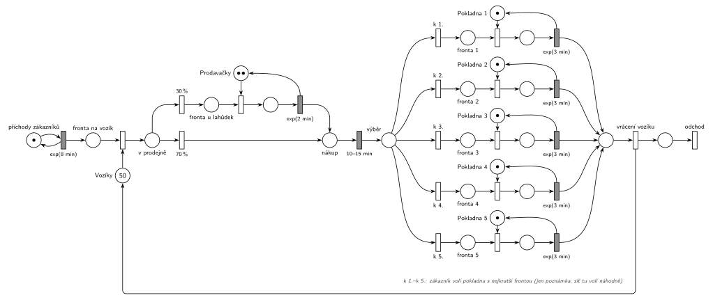

# Samoobsluha

Úloha 01/02

## Zadání

> Do samoobsluhy přicházejí zákazníci v intervalech exponenciálně se středem 8 minut. Každý zákazník si nejprve opatří vozík. Vozíky se koncentrují na seřadišti a je jich celkem 50. Zákazník vstoupí do prodejny a 30% jde okamžitě k pultíku s lahůdkami, kde obsluhují dvě prodavačky. Obsloužení zákazníka zde trvá exponenciálně se středem 2 minuty a pak zákazník pokračuje běžným nákupem. Běžný nákup trvá rovnoměrně 10–15 minut. Nakonec přistupuje k jedné z pěti pokladen. Vybírá si pokladnu podle nejkratší fronty. Obsluha u pokladny trvá exponenciálně se středem 3 minuty. Při odchodu ze systému zákazník vrací vozík.

Podobné úlohy: [Opravářská dílna](<../01 - Opravářská dílna/01 - Opravářská dílna.md>), [Menza](<../../09 - Obsluha zákazníků/16 - Menza/16 - Menza.md>).

## Nápověda

<details>
<summary>Zobrazit nápovědu</summary>
<br>

- **Příchody:** *příchody zákazníků* ⇄ `exp(8 min)` → *fronta na vozík*.
- **Vozíky** jsou sklad (Store) s 50 značkami. Místo před jejich zabráním je zároveň frontou k tomuto skladu. Vozík se vrací až při odchodu, takže v prodejně může být nejvýš 50 zákazníků. Při příchodu jednou za 8 minut se to prakticky neprojeví.
- **30 % k lahůdkám:** z místa *v prodejně* vedou okamžité přechody `30 %` (nahoru k lahůdkám) a `70 %` (rovně k nákupu).
- **Lahůdky:** jedna fronta ke dvěma prodavačkám, tedy sklad *Prodavačky* se 2 značkami, ne dvě zařízení. Obsazení bere značku, `exp(2 min)` ji vrací a zákazník pokračuje do místa *nákup*.
- **Běžný nákup** je časovaný přechod `10–15 min` bez zdroje. Každý zákazník v místě *nákup* má vlastní odpočet (slajd 138), takže nakupují všichni souběžně a na nikoho nečekají.
- **Pokladny:** pět zařízení *Pokladna 1* až *Pokladna 5*, ke každému stojí zvláštní fronta (analýza na slajdu 196). Uvolnění pokladny je sloučené s časovaným přechodem `exp(3 min)`.
- **„Podle nejkratší fronty“** se v SPN přímo vyjádřit nedá. Priority a pravděpodobnosti jsou pevná čísla a délky pěti front by se musely porovnávat každá s každou. Výběr se proto jen označí poznámkou (jako na slajdu 198): přechody *k 1.* až *k 5.* bez parametru. Simulátor mezi nimi volí náhodně, takže fronty jsou v simulaci o něco delší než při skutečném výběru nejkratší fronty. Přesné pravidlo je až v SIMLIB (`QueueLen()`).
- Částečně by výběr šel zpřesnit přechodem s `p=1` pro každou pokladnu, který testuje volnou pokladnu (hrana tam a zpět, neblokující obsazení ze slajdu 153). Zákazník by pak šel přednostně k volné pokladně a jen když jsou všechny obsazené, volil by náhodně.
- **Odchod:** po zaplacení vrací zákazník vozík samostatným okamžitým přechodem *vrácení vozíku* (značka zpět do *Vozíků*, na slajdu `Leave(Voziky, 1)`) a pak odchází přechodem *odchod*.

</details>

## Petriho síť

<details>
<summary>Zobrazit Petriho síť</summary>
<br>



</details>

## Časté chyby

<details>
<summary>Zobrazit časté chyby</summary>
<br>

- Pět pokladen jako jeden sklad s 5 značkami a jednou společnou frontou. Zadání i analýza na slajdu 196 mají ke každé pokladně zvláštní frontu.
- Vozík vrácený hned po vstupu do prodejny nebo po nákupu. Vrací se až při odchodu.
- Běžný nákup jako zařízení s jednou značkou. Zákazníci by pak nakupovali jeden po druhém.
- Lahůdky jako dvě zařízení se dvěma frontami. U pultíku stojí jedna fronta ke dvěma prodavačkám.

</details>

## SIMLIB

<details>
<summary>Zobrazit SIMLIB kód</summary>
<br>

Model je izomorfní k Petriho síti výše: každé místo, přechod a značka mají svůj protějšek v kódu. Jediný rozdíl je výběr pokladny: síť ho jen naznačuje poznámkou, kód vybírá skutečně nejkratší frontu. Do délky fronty se počítá i zákazník, který právě platí; s holým `QueueLen()` by si zákazník při shodě mohl vybrat obsazenou pokladnu, i když je jiná volná.

```cpp
// Samoobsluha – model v SIMLIB/C++
#include "simlib.h"
#include <string>

const int N = 5;                       // počet pokladen
Store Voziky("Vozíky", 50);            // místo Vozíky s 50 značkami
Store Prodavacky("Prodavačky", 2);     // místo Prodavačky se 2 značkami (jedna fronta)
Facility Pokladna[N];                  // místa Pokladna 1–5 (každá 1 značka, vlastní fronta)
Histogram Doba("Doba zákazníka v samoobsluze [min]", 0, 5, 20);

int Delka(int i) {                     // délka fronty u pokladny včetně placení
  return Pokladna[i].QueueLen() + (Pokladna[i].Busy() ? 1 : 0);
}

class Zakaznik : public Process {      // transakce = značka, která prochází sítí
  void Behavior() {
    double prichod = Time;
    Enter(Voziky, 1);                  // fronta na vozík + přechod, který bere vozík
    if (Random() < 0.30) {             // v prodejně: okamžité přechody 30 % / 70 %
      Enter(Prodavacky, 1);            // fronta u lahůdek + obsazení prodavačky
      Wait(Exponential(2));            // časovaný přechod exp(2 min) ...
      Leave(Prodavacky, 1);            // ... který vrací prodavačku
    }
    Wait(Uniform(10, 15));             // nákup: časovaný přechod 10–15 min
    int k = 0;                         // výběr: přechody k 1. až k 5.
    for (int i = 1; i < N; i++)        // pokladna s nejkratší frontou (při shodě nižší číslo)
      if (Delka(i) < Delka(k))
        k = i;
    Seize(Pokladna[k]);                // fronta k + obsazení pokladny
    Wait(Exponential(3));              // časovaný přechod exp(3 min) ...
    Release(Pokladna[k]);              // ... který vrací pokladnu
    Leave(Voziky, 1);                  // zaplaceno → vrácení vozíku
    Doba(Time - prichod);
  }                                    // konec Behavior = přechod odchod
};

class Generator : public Event {       // místo „příchody zákazníků“ ve smyčce s exp(8 min)
  void Behavior() {
    (new Zakaznik)->Activate();        // nová značka v místě fronta na vozík
    Activate(Time + Exponential(8));   // další příchod
  }
};

int main() {
  for (int i = 0; i < N; i++)
    Pokladna[i].SetName("Pokladna " + std::to_string(i + 1));
  Init(0, 60 * 10000);                 // modelový čas v minutách: 10 000 hodin provozu
  (new Generator)->Activate();
  Run();
  Voziky.Output();
  Prodavacky.Output();
  for (int i = 0; i < N; i++)
    Pokladna[i].Output();
  Doba.Output();
}
```

| Petriho síť | SIMLIB |
|---|---|
| *příchody zákazníků* ⇄ `exp(8 min)` | událost `Generator`, která se znovu plánuje za `Exponential(8)` |
| značka (zákazník) | proces `Zakaznik` |
| *Vozíky* (50 značek), *fronta na vozík* + zabrání | `Store Voziky(50)`, `Enter(Voziky, 1)` |
| `30 %` / `70 %` | `if (Random() < 0.30)` |
| *Prodavačky* (2 značky), *fronta u lahůdek* + obsazení, `exp(2 min)` | `Store Prodavacky(2)`, `Enter`, `Wait(Exponential(2))`, `Leave` |
| *nákup* + `10–15 min` | `Wait(Uniform(10, 15))` |
| *výběr* + přechody *k 1.* až *k 5.* (poznámka) | cyklus přes pokladny podle `Delka(i)` |
| *fronta i* + obsazení *Pokladny i*, `exp(3 min)` se sloučeným uvolněním | `Facility Pokladna[5]`, `Seize`, `Wait(Exponential(3))`, `Release` |
| *zaplaceno* → *vrácení vozíku* | `Leave(Voziky, 1)` |
| *odchod* | konec metody `Behavior()` |

**Kontrola simulací.** Petriho síť: platí *Vozíky* + zákazníci v prodejně = 50, prodavačky i všechny pokladny se vždy vrátí, všechny přechody se provádějí (`make check`). K lahůdkám jde asi 30 % zákazníků, každá pokladna dostane asi pětinu, protože síť volí náhodně. Fronty u pokladen zůstávají krátké (nejvýš 3) a na vozík nikdo nečeká. Souběžně nakupuje až asi 9 zákazníků. SIMLIB model: v jednom běhu (10 000 hodin) bylo průměrně vypůjčeno 2,02 vozíku, nejvýš 12. Teorie: zákazník je v samoobsluze průměrně 0,3 · 2 + 12,5 + 3 ≈ 16,1 min (plus krátké čekání), takže vozíků je v průměru 16,1 / 8 ≈ 2,01. Prodavačky byly obsazené v průměru 0,076 (teorie 0,3 · 2 / 8 = 0,075), pokladny dohromady 0,374 (teorie 3 / 8 = 0,375). S výběrem nejkratší fronty (při shodě nižší číslo) zaplatilo 73 % zákazníků u pokladny 1 a pokladny 4 a 5 skoro nepracovaly; v síti s náhodnou volbou dostane každá pokladna asi pětinu (`make simlib`).

</details>

## Původ a zdroje

<details>
<summary>Zobrazit původ a zdroje</summary>
<br>

**Původ:** řešený příklad z přednášky, slajdy 195–198 (SIMLIB část přednášky). Stejný příklad s řešením v SIMLIB je ve Studijní opoře.

**Původní znění:**

> Do samoobsluhy přicházejí zákazníci v intervalech daných exponenciálním rozložením se středem 8 minut. Každý zákazník si nejprve opatří vozík. Vozíky se koncentrují na seřadišti a je jich celkem 50. Zákazník vstoupí do prodejny a 30% jde okamžitě k pultíku s lahůdkami, kde obsluhují dvě prodavačky. Obsloužení zákazníka zde trvá 2 minuty (exponenciálně) a pak zákazník pokračuje běžným nákupem. Běžný nákup trvá 10-15 minut rovnoměrně. Nakonec přistupuje k jedné z pěti pokladen. Vybírá si pokladnu podle nejkratší fronty. Doba obsluhy u pokladny se řídí exponenciálním rozložením se středem 3 minuty. Při odchodu ze systému zákazník vrací vozík.
>
> Zadání: analýza problému, model ve formě SPN, model ve formě SIMLIB

**Zdroje:**

- `Přednášky - Prezentace 2025/IMS - Prezentace.pdf`: slajd 195 (zadání), 196 (analýza), 197–198 (Petriho síť)
- `IMP - Studijní opora.pdf`, s. 53–55, oddíl 5.5.15 (stejné zadání, řešení v SIMLIB)
- `Přednášky - Video 2024/Přepisy/IMS_2024-10-18_1080p.txt` (výklad)

**Existující řešení:**

- **Slajdy 197–198:** stejná struktura. Rozdíly jsou jen v kreslení: generátor je přechod `exp(8)` bez vstupního místa (zkrácený tvar ze slajdu 151) a časované přechody jsou tu nakreslené bíle, na rozdíl od slajdů 136, 139 a 164. Pokladny jsou nakreslené jen dvě, výběr pokladny je modrý čárkovaný rámeček s poznámkou. Vrácení vozíku a výstupní přechod „exit…“ jsou stejné jako tady.
- **Přednáška (přepis 18. 10. 2024):** o místě před zabráním vozíku přednášející říká, že „je současně i frontou k tomu skladu těch vozíků“; k výběru pokladny, že se v Petriho síti „dá schematizovat pouze nějak symbolicky“; ke sloučenému uvolnění pokladny „Případně tady je s tou prací souběžně i ten release“. Zpřesnění výběru přes `p=1` (viz nápověda) nepoužívá.
- **Studijní opora (s. 54–55):** řešení v SIMLIB: `Store Voziky(50)`, `Store Lahudky(2)`, `Facility Pokladny[5]`. Pokladnu vybírá cyklem podle `QueueLen()`; při shodě vyhraje pokladna s nižším číslem.

</details>

## Reference

- [Jak síť funguje](<../../../basics/Jak síť funguje.md>)
- [Notace a vzory](<../../../basics/Notace a vzory.md>)

<!-- -->

- [Studijní plán](<../../Studijní plán.md>)
- [Seznam úloh](<../../Seznam úloh.md>)
