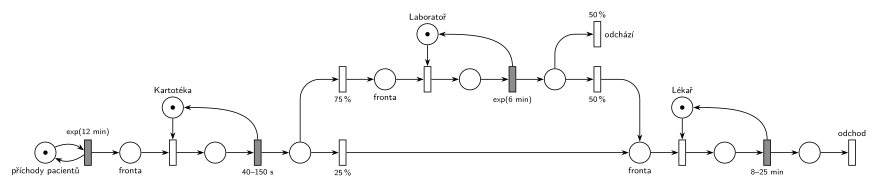

# Zdravotní ordinace

## Zadání

> Budeme modelovat jednoduchou zdravotní ordinaci s jedním lékařem. Pacienti přicházejí v intervalech exponenciálně se středem 12 minut. Všichni nejprve projdou kartotékou, což jim zabere rovnoměrně 40–150 sekund. Poté 25 % pacientů jde přímo k lékaři. Zbývajících 75 % jde nejdříve na odběr do laboratoře, který trvá v průměru 6 minut; polovina z nich ordinaci opouští a druhá polovina pokračuje k lékaři. U lékaře pacienti stráví rovnoměrně 8–25 minut.

Podobné úlohy: [Opravářská dílna](<../01 - Opravářská dílna/01 - Opravářská dílna.md>), [Nemocniční ambulance](<../../09 - Obsluha zákazníků/18 - Nemocniční ambulance/18 - Nemocniční ambulance.md>).

## Nápověda

<details>
<summary>Zobrazit nápovědu</summary>
<br>

- Kartotéka, laboratoř i lékař obsluhují vždy jen jednoho pacienta. Samotný časovaný přechod počet současně obsluhovaných neomezuje (slajd 138), proto je každé z nich zařízení s kapacitou 1: místo s jednou značkou, vlastní fronta a okamžitý přechod, který značku obsadí. Uvolnění je sloučené s časovaným přechodem obsluhy, který po skončení značku vrací.
- „V průměru 6 minut“ bez udaného rozložení se modeluje jako exponenciální rozložení: `exp(6 min)`.
- Polovina, která odchází, se počítá jen z pacientů po laboratoři. Přechod `50 %` *odchází* je zároveň výstupní (nemá výstupní hrany). K lékaři tak jde celkem 25 % + 37,5 % = 62,5 % pacientů.
- Po vyšetření pacient opouští systém výstupním přechodem *odchod*.

</details>

## Petriho síť

<details>
<summary>Zobrazit Petriho síť</summary>
<br>



</details>

## Časté chyby

<details>
<summary>Zobrazit časté chyby</summary>
<br>

- Lékař jako samotný časovaný přechod bez místa se značkou. Podle sémantiky IMS by pak vyšetřoval libovolně mnoho pacientů najednou.
- Počítat `50 %` ze všech pacientů místo jen z těch, kteří prošli laboratoří.

</details>

## SIMLIB

<details>
<summary>Zobrazit SIMLIB kód</summary>
<br>

Model je izomorfní k Petriho síti výše: každé místo, přechod a značka mají svůj protějšek v kódu.

```cpp
// Zdravotní ordinace – model v SIMLIB/C++
#include "simlib.h"

// kartotéka, laboratoř a lékař = místa s jednou značkou (zařízení s kapacitou 1, každé má vlastní frontu)
Facility Kartoteka("Kartotéka");
Facility Laborator("Laboratoř");
Facility Lekar("Lékař");
Histogram Doba("Doba pacienta v ordinaci [min]", 0, 20, 20);
int OdchodPoOdberu = 0;                // počet provedení přechodu „odchází“
int OdchodOdLekare = 0;                // počet provedení přechodu „odchod“

class Pacient : public Process {       // transakce = značka, která prochází sítí
  void Behavior() {
    double prichod = Time;
    Seize(Kartoteka);                  // fronta + obsazení kartotéky
    Wait(Uniform(40.0 / 60, 150.0 / 60)); // časovaný přechod 40–150 s (v minutách) ...
    Release(Kartoteka);                // ... který vrací značku kartotéce
    if (Random() < 0.75) {             // okamžité přechody 75 % (do laboratoře) / 25 % (k lékaři)
      Seize(Laborator);                // fronta + obsazení laboratoře
      Wait(Exponential(6));            // časovaný přechod exp(6 min) ...
      Release(Laborator);              // ... který vrací značku laboratoři
      if (Random() < 0.5) {            // okamžité přechody 50 % (odchází) / 50 % (k lékaři)
        OdchodPoOdberu++;
        Doba(Time - prichod);
        return;                        // výstupní přechod „odchází“
      }
    }
    Seize(Lekar);                      // společná fronta k lékaři + obsazení lékaře
    Wait(Uniform(8, 25));              // časovaný přechod 8–25 min ...
    Release(Lekar);                    // ... který vrací značku lékaři
    OdchodOdLekare++;
    Doba(Time - prichod);
  }                                    // konec Behavior = přechod „odchod“
};

class Generator : public Event {       // místo „příchody pacientů“ ve smyčce s exp(12 min)
  void Behavior() {
    (new Pacient)->Activate();         // nová značka ve frontě ke kartotéce
    Activate(Time + Exponential(12));  // další příchod
  }
};

int main() {
  Init(0, 60 * 1000);                  // modelový čas v minutách: 1000 hodin provozu
  (new Generator)->Activate();
  Run();
  Kartoteka.Output();
  Laborator.Output();
  Lekar.Output();
  Doba.Output();
  Print("Odešlo po odběru: %d, odešlo od lékaře: %d\n", OdchodPoOdberu, OdchodOdLekare);
}
```

| Petriho síť | SIMLIB |
|---|---|
| *příchody pacientů* ⇄ `exp(12 min)` | událost `Generator`, která se znovu plánuje za `Exponential(12)` |
| značka (pacient) | proces `Pacient` |
| místa *Kartotéka*, *Laboratoř*, *Lékař* (1 značka) | `Facility Kartoteka`, `Laborator`, `Lekar` |
| *fronta* + obsazovací přechod | `Seize(…)` (fronta je vnitřní fronta zařízení) |
| časovaný přechod se sloučeným uvolněním | `Wait(…); Release(…);` |
| `40–150 s`, `exp(6 min)`, `8–25 min` | `Uniform(40.0 / 60, 150.0 / 60)`, `Exponential(6)`, `Uniform(8, 25)` (vše v minutách) |
| `75 %` / `25 %` | `if (Random() < 0.75)` |
| `50 %` *odchází* / `50 %` k lékaři | `if (Random() < 0.5) { …; return; }` |
| fronta k lékaři ze dvou směrů | jediné `Seize(Lekar)` za oběma větvemi |
| výstupní přechody *odchází* a *odchod* | `return` / konec metody `Behavior()` |

**Kontrola simulací.** Petriho síť: všechna tři zařízení se vždy vrátí, všechny přechody se provádějí, fronty zůstávají omezené (`make check`). Úzkým místem je lékař: vytížení asi (1/12) · 0,625 · 16,5 ≈ 86 %, takže fronta k lékaři občas naroste (v simulaci sítě až na 15–18 pacientů), ale zůstává omezená. Laboratoř je vytížená asi na (1/12) · 0,75 · 6 = 37,5 %, kartotéka asi na (1/12) · 95/60 ≈ 13 %. SIMLIB model: v jednom běhu (1000 h) prošlo kartotékou 5044 pacientů, k lékaři došlo 3210 z nich (63,6 %, teoreticky 62,5 %). Vytížení vyšlo: kartotéka 13,2 %, laboratoř 37,2 %, lékař 88,6 %; fronta k lékaři měla nejvýše 24 pacientů a kdo v ní čekal, čekal průměrně 82 minut (`make simlib`).

</details>

## Původ a zdroje

<details>
<summary>Zobrazit původ a zdroje</summary>
<br>

**Původ:** řešený příklad z poznámek „Stochastické Petriho sítě“ ke cvičení MSI (Vojnar), které jsou na webu předmětu.

**Původní znění:**

> Budeme modelovat jednoduché zdravotní středisko:
>
> - Příchod pacienta každých 12 minut s exp. rozložením.
> - Všichni pacienti projdou kartotékou, což jim zabere rovnoměrně 40 až 150 sekund.
> - Poté 25% pacientů jde přímo k lékaři.
> - Zbývajících 75% pacientů jde nejdříve na odběr do laboratoře. To jim zabere v průměru 6 minut, načež polovina lidí odchází a druhá polovina pokračuje k lékaři.
> - U lékaře pacienti stráví rovnoměrně 8 až 25 minut.

**Zdroje:**

- `Web předmětu/Petriho sítě - Stochastické (poznámky MSI).pdf`, str. 2 PDF (tištěné s. 3–4): oddíl 3 (zadání) a obr. 6 (řešení)

**Existující řešení:**

- **Poznámky MSI, obr. 6:** stejný tok pacientů (*BeforeInd*, *AfterInd*, *BeforeLab*, *AfterLab*, *BeforeExp*). Zařízení tam nemají vlastní místa, protože kapacitu 1 zajišťuje implicitní kapacita serveru časovaných přechodů. U laboratoře je na obrázku 300 s místo 6 minut z textu. Generátor je nakreslený jako přechod bez vstupního místa a za lékařem chybí výstupní přechod.
- **Jiná konvence v poznámkách MSI** (obr. 3 a 5): bílý obdélník je exponenciální přechod se střední hodnotou v sekundách (*Entrance* `720` = 12 min; z bílého obdélníku u *Laboratory* plyne i exponenciální rozložení odběru), šedý obdélník jiné rozložení (`Uni(40,150)`), černá čárka okamžitý přechod. Okamžité přechody mají místo procent váhy (`75`/`25`, `50`/`50`; pravděpodobnost = váha / součet vah). V notaci IMS je bílý obdélník okamžitý přechod, takže obrázek nejde překreslit doslova.

</details>
