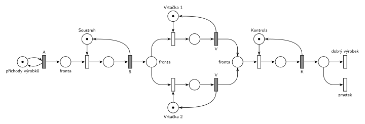

# 01-04 Výrobní systém

## Zadání

> Do výrobního systému přicházejí výrobky. Každý výrobek nejprve zpracuje soustruh a potom jedna ze dvou vrtaček. Nakonec projde kontrolou a systém opouští buď jako dobrý výrobek, nebo jako zmetek.

Podobné úlohy: [Kritická sekce](<../05 - Kritická sekce/05 - Kritická sekce.md>), [Opravářská dílna](<../01 - Opravářská dílna/01 - Opravářská dílna.md>).

## Nápověda

<details>
<summary>Zobrazit nápovědu</summary>
<br>

- Zadání neuvádí žádné časy ani pravděpodobnosti. Doby jsou proto v síti jen symboly: interval příchodů `A`, soustružení `S`, vrtání `V` a kontrola `K`.
- Soustruh i kontrola zpracovávají vždy jen jeden výrobek. Každý z nich je tedy zařízení s kapacitou 1: místo s jednou značkou, okamžitý přechod, který značku obsadí, a časovaný přechod zpracování, který ji po skončení vrací.
- Obě vrtačky jsou stejné (stejná doba `V`, společná fronta) a nezáleží na tom, která výrobek vrtá. Stačí proto jeden sklad *Vrtačky* se dvěma značkami (vzor Sklad v [Notace a vzory](<../../../basics/Notace a vzory.md>)): výrobek čeká ve frontě, jen když jsou obsazené obě, a vrtat se můžou dva výrobky současně, každý s vlastním odpočtem.
- Kdyby se vrtačky lišily (jiná doba vrtání, porucha jen jedné z nich), potřebuje každá vlastní zařízení. Obě pak berou výrobky ze společné fronty a výrobek jde k té, která je volná.
- Výsledek kontroly je větvení za kontrolou: dva okamžité výstupní přechody *dobrý výrobek* a *zmetek*. Bez parametru jsou proto, že zadání poměr neuvádí; kdyby ho uvádělo, dostaly by procenta.

</details>

## Petriho síť

<details>
<summary>Zobrazit Petriho síť</summary>
<br>



</details>

## Časté chyby

<details>
<summary>Zobrazit časté chyby</summary>
<br>

- Stroj bez místa se značkou. Soustruh by pak zpracovával libovolně mnoho výrobků najednou.
- Každé vrtačce vlastní frontu a výrobky mezi ně rozdělit napevno (např. 50 % / 50 %). Výrobek má jít k té vrtačce, která je volná, jinak čeká u obsazené, zatímco druhá stojí.
- Místo *Vrtačky* s jednou značkou. Vrtala by pak jen jedna vrtačka a druhá by nebyla v modelu vůbec.
- Rozhodnout o výsledku kontroly ještě před jejím koncem a značku kontroly vracet jen v jedné z větví. Kontrola by se po prvním výrobku z druhé větve zablokovala.

</details>

## SIMLIB

<details>
<summary>Zobrazit SIMLIB kód</summary>
<br>

Model je izomorfní k Petriho síti výše: každé místo, přechod a značka mají svůj protějšek v kódu.

```cpp
// Výrobní systém – model v SIMLIB/C++
#include "simlib.h"

// zadání časy neuvádí: symboly ze sítě, hodnoty jen pro simulaci (stejné jako v net.py)
const double A = 10;                   // interval příchodů
const double S = 6;                    // soustružení
const double V = 15;                   // vrtání
const double K = 5;                    // kontrola

// soustruh a kontrola = místa s jednou značkou (zařízení s kapacitou 1)
Facility Soustruh("Soustruh");
Store Vrtacky("Vrtačky", 2);           // místo Vrtačky se dvěma značkami (sklad s kapacitou 2)
Facility Kontrola("Kontrola");
int Dobre = 0, Zmetky = 0;             // počty provedení výstupních přechodů

class Vyrobek : public Process {       // transakce = značka, která prochází sítí
  void Behavior() {
    Seize(Soustruh);                   // fronta + obsazení soustruhu
    Wait(S);                           // časovaný přechod S ...
    Release(Soustruh);                 // ... který vrací značku soustruhu

    Enter(Vrtacky, 1);                 // fronta + obsazení jedné značky Vrtačky
    Wait(V);                           // časovaný přechod V ...
    Leave(Vrtacky, 1);                 // ... který značku vrací

    Seize(Kontrola);                   // fronta + obsazení kontroly
    Wait(K);                           // časovaný přechod K ...
    Release(Kontrola);                 // ... který vrací značku kontrole (v obou případech)
    if (Random() < 0.5)                // výstupní přechody bez parametru: rozhodne se náhodně
      Dobre++;                         // „dobrý výrobek“
    else
      Zmetky++;                        // „zmetek“
  }                                    // konec Behavior = výrobek opouští systém
};

class Generator : public Event {       // místo „příchody výrobků“ ve smyčce s přechodem A
  void Behavior() {
    (new Vyrobek)->Activate();         // nová značka ve frontě k soustruhu
    Activate(Time + A);                // další příchod
  }
};

int main() {
  Init(0, 100000);                     // modelový čas v časových jednotkách sítě
  (new Generator)->Activate();
  Run();
  Soustruh.Output();
  Vrtacky.Output();
  Kontrola.Output();
  Print("Dobré výrobky: %d, zmetky: %d\n", Dobre, Zmetky);
}
```

| Petriho síť | SIMLIB |
|---|---|
| *příchody výrobků* ⇄ `A` | událost `Generator`, která se znovu plánuje za `A` |
| značka (výrobek) | proces `Vyrobek` |
| symboly `A`, `S`, `V`, `K` | konstanty s hodnotami jen pro simulaci |
| místa *Soustruh*, *Kontrola* (1 značka) | `Facility Soustruh`, `Facility Kontrola` |
| *fronta* + obsazovací přechod | `Seize(…)` (fronta je vnitřní fronta zařízení) |
| časovaný přechod se sloučeným uvolněním | `Wait(…); Release(…);` |
| místo *Vrtačky* (2 značky) | `Store Vrtacky("Vrtačky", 2)` |
| *fronta* k vrtačkám + obsazovací přechod | `Enter(Vrtacky, 1)` (fronta je vnitřní fronta skladu) |
| časovaný přechod `V`, který značku vrací | `Wait(V); Leave(Vrtacky, 1);` |
| výstupní přechody *dobrý výrobek* / *zmetek* | `if (Random() < 0.5)` a konec metody `Behavior()` |

**Kontrola simulací.** Petriho síť (s hodnotami A = 10, S = 6, V = 15, K = 5): všechny značky strojů se vždy vrátí (u vrtaček obě), všechny přechody se provádějí, fronty zůstávají omezené (`make check`). SIMLIB model: v jednom běhu (100 000 časových jednotek, 10 000 výrobků) vyšlo vytížení soustruhu 60 % a kontroly 50 %, ve skladu *Vrtačky* bylo obsazeno průměrně 1,5 značky ze 2, tedy každá vrtačka vytížená na 75 %, přesně podle teorie (S/A, V/A, K/A). Protože jsou všechny doby konstantní a stroje stíhají, žádný výrobek nečeká ve frontě: vrtají se střídavě jeden a dva výrobky, nikdy ne tři. Dobrých výrobků bylo 4965 a zmetků 5033 (`make simlib`).

</details>

## Původ a zdroje

<details>
<summary>Zobrazit původ a zdroje</summary>
<br>

**Původ:** řešený příklad 1 z poznámek „Černobílé a barvené Petriho sítě“ ke cvičení MSI (Vojnar), které jsou na webu předmětu.

**Původní znění:**

> Výrobní systém – přicházející výrobky jsou zpracovány soustruhem, pak jednou ze dvou vrtaček a opouští systém po kontrole jako dobré nebo špatné.

**Zdroje:**

- `Web předmětu/Petriho sítě - Černobílé a barvené (poznámky MSI).pdf`, str. 2 PDF (tištěná s. 3): oddíl 3, příklad 1 a obr. 6

**Existující řešení:**

- **Poznámky MSI, obr. 6:** P/T síť bez času (místa P1–P13). Každá činnost je tam dvojice přechodů *start* a *stop* s místem mezi nimi, generátor je přechod bez vstupu a o výsledku kontroly se rozhoduje přímo při jejím ukončení, takže značku kontroly vrací oba výsledné přechody. Popisky výstupů *zmetek* a *vyrobek* jsou na obrázku prohozené.

</details>

## Reference

- [Jak síť funguje](<../../../basics/Jak síť funguje.md>)
- [Notace a vzory](<../../../basics/Notace a vzory.md>)

<!-- -->

- [Studijní plán](<../../Studijní plán.md>)
- [Seznam úloh](<../../Seznam úloh.md>)
