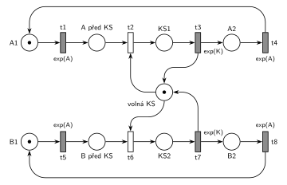

# Kritická sekce

## Zadání

> Uvažujme dva procesy se sdílenou kritickou sekcí: Proces 1 provede akci A1, potom kritickou sekci KS1, akci A2 a pak se jeho činnost opakuje. Proces 2 provádí cyklicky B1, KS2 a B2.

Podobné úlohy: [Výrobní systém](<../04 - Výrobní systém/04 - Výrobní systém.md>). Stejný princip sdíleného prostředku mají čtenáři a písaři na slajdu 131.

## Interpretace

<details>
<summary>Zobrazit interpretaci (nápověda)</summary>
<br>

- **Akce jsou místa, přechody jsou události.** Značka v místě *A1* znamená „proces 1 právě provádí A1“. Proces 1 je cyklus *A1* → t1 → *A před KS* → t2 → *KS1* → t3 → *A2* → t4 → *A1*: t1 je konec A1, t2 vstup do kritické sekce, t3 její opuštění, t4 konec A2 a návrat na začátek. Proces 2 je stejný cyklus *B1* → t5 → *B před KS* → t6 → *KS2* → t7 → *B2* → t8 → *B1*. Počáteční stav: oba procesy provádějí první akci.
- **Kritická sekce** je chráněná místem *volná KS* s jednou značkou (zámek, zařízení s kapacitou 1). Vstup (t2, t6) značku bere, výstup (t3, t7) ji vrací.
- **Vzájemné vyloučení** zaručuje P-invariant *volná KS* + *KS1* + *KS2* = 1: v kritické sekci nemohou být oba procesy současně.
- **Uzavřená síť:** procesy jen obíhají, nic nepřichází ani neodchází, takže síť nemá výstupní přechod.
- **Bez času:** přechody jsou nakreslené jako okamžité. Simulace se tu nespouští, protože okamžité přechody v cyklu by se v nulovém čase prováděly donekonečna. V SPN by akce A1, KS1, A2 (a B1, KS2, B2) měly trvání, takže konce akcí (t1, t3, t4, t5, t7, t8) by byly časované a vstupy do kritické sekce (t2, t6) by zůstaly okamžité.
- Síť nezaručuje férovost: když čekají oba procesy, rozhodne se mezi t2 a t6 nedeterministicky a jeden proces může druhého předbíhat pořád.

</details>

## Petriho síť

<details>
<summary>Zobrazit Petriho síť</summary>
<br>



</details>

## Časté chyby

<details>
<summary>Zobrazit časté chyby</summary>
<br>

- Kritická sekce bez zámku (místa *volná KS*). Oba procesy by pak mohly být v kritické sekci současně.
- Nevrátit značku *volná KS* při výstupu z kritické sekce. Po prvním průchodu kritickou sekcí by oba procesy uvázly před ní.
- Jedna společná značka pro oba procesy. Každý proces je samostatný cyklus s vlastní značkou.

</details>

## SIMLIB

<details>
<summary>Zobrazit SIMLIB kód</summary>
<br>

Model je izomorfní k Petriho síti výše: každé místo, přechod a značka mají svůj protějšek v kódu. Síť je bez času, SIMLIB ale potřebuje, aby akce trvaly. Doby jsou proto doplněné: akce A1, A2, B1, B2 trvají exponenciálně se středem 5 časových jednotek, kritická sekce exponenciálně se středem 2 časové jednotky. Konce akcí (t1, t3, t4, t5, t7, t8) se tím stávají časovanými přechody, vstupy do kritické sekce (t2, t6) zůstávají okamžité.

```cpp
// Kritická sekce – model v SIMLIB/C++
#include "simlib.h"

const double AKCE = 5;                 // střední doba akcí A1, A2, B1, B2 (doplněno, síť je bez času)
const double SEKCE = 2;                // střední doba v kritické sekci (doplněno)

Facility KS("Kritická sekce");         // místo volná KS s jednou značkou (zámek)

class Proces : public Process {        // značka procesu, která obíhá svůj cyklus
  void Behavior() {
    for (;;) {                         // cyklus A1 → t1 → … → t4 → A1 (u procesu 2 B1 … t8)
      Wait(Exponential(AKCE));         // místo A1: akce A1, její konec = přechod t1
      Seize(KS);                       // místo A před KS + přechod t2 (bere značku volná KS)
      Wait(Exponential(SEKCE));        // místo KS1: kritická sekce ...
      Release(KS);                     // ... přechod t3 vrací značku volná KS
      Wait(Exponential(AKCE));         // místo A2: akce A2, její konec = přechod t4
    }
  }
};

int main() {
  Init(0, 1000000);                    // modelový čas v časových jednotkách
  (new Proces)->Activate();            // proces 1: značka v místě A1
  (new Proces)->Activate();            // proces 2: značka v místě B1
  Run();
  KS.Output();                         // vytížení = podíl času, kdy je některý proces v KS
}
```

| Petriho síť | SIMLIB |
|---|---|
| značka procesu 1 / procesu 2 | dva procesy třídy `Proces`; oba mají stejný cyklus, proto stačí jedna třída |
| cyklus *A1* → … → t4 → *A1* | nekonečný cyklus `for (;;)` v `Behavior()` |
| místo *A1* + přechod t1 (*B1* + t5) | `Wait(Exponential(AKCE));` |
| místo *A před KS* + přechod t2 (*B před KS* + t6) | `Seize(KS)` (čekání před KS je vnitřní fronta zařízení) |
| místo *volná KS* (1 značka) | `Facility KS` |
| místo *KS1* + přechod t3 (*KS2* + t7) | `Wait(Exponential(SEKCE)); Release(KS);` |
| místo *A2* + přechod t4 (*B2* + t8) | `Wait(Exponential(AKCE));` a návrat na začátek cyklu |

**Kontrola simulací.** Petriho síť se nesimuluje, protože okamžité přechody v cyklu by se v nulovém čase prováděly donekonečna (`make check` u ní jen kontroluje strukturu). Prohledáním stavového prostoru (15 dosažitelných značení) je ověřené, že ve všech značeních platí *volná KS* + *KS1* + *KS2* = 1, každý proces má právě jednu značku a síť nikdy neuvázne. SIMLIB model: v jednom běhu (10⁶ časových jednotek) byla kritická sekce obsazená 32,4 % času a před ní čekalo průměrně 0,054 procesu. Teorie (uzavřený systém se dvěma procesy, mimo KS průměrně 10 časových jednotek, v KS 2): stavy „v KS nikdo / jeden / oba“ mají váhy 10²/2 : 10 · 2 : 2² = 50 : 20 : 4, takže vytížení je 24/74 = 32,4 % a průměrný počet čekajících 4/74 = 0,054 (`make simlib`).

</details>

## Původ a zdroje

<details>
<summary>Zobrazit původ a zdroje</summary>
<br>

**Původ:** řešený příklad 2 z poznámek „Černobílé a barvené Petriho sítě“ ke cvičení MSI (Vojnar), které jsou na webu předmětu. P/T síť bez času, tady překreslená do notace IMS.

**Zdroje:**

- `Web předmětu/Petriho sítě - Černobílé a barvené (poznámky MSI).pdf`, str. 2 PDF (tištěná s. 3): oddíl 3, příklad 2 a obr. 7

**Existující řešení:**

- **Poznámky MSI, obr. 7:** stejná síť (místa *A1*, *A_pred_KS*, *A_v_KS*, *A2*, *volna_KS*, …, přechody t1–t8). Přechody jsou černé čárky (konvence P/T sítí v poznámkách); místa jsou tu pojmenovaná česky.

</details>
