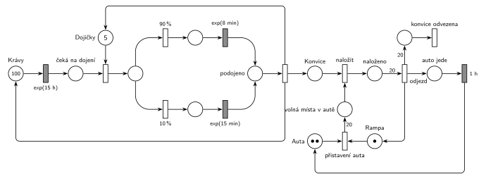

# Kravín

## Zadání

> - Kravín má 100 krav, 5 dojiček, 1 nakládací rampu, 2 auta
> - Krávy v intervalech exponenciálně se středem 15 hodin potřebují podojit (dojička, 10% případů trvá exponenciálně se středem 15 minut, jinak exponenciálně se středem 8 minut).
> - Vznikne konvice s mlékem. Nakládají se na rampě do auta (kapacita 20). Auto náklad odváží (přesně 1 hodinu).


Podobné úlohy: [Bagrista a nákladní auta](<../../11 - Doprava a dávky/10 - Bagrista a nákladní auta/10 - Bagrista a nákladní auta.md>), [Přepravní firma](<../../11 - Doprava a dávky/08 - Přepravní firma/08 - Přepravní firma.md>).

## Nápověda

<details>
<summary>Zobrazit nápovědu</summary>
<br>

- **Procesy:** krávy (100, obíhají dokola), dojičky (sklad 5), konvice (transakce: vznikne podojením, odjede autem), auta (2, obíhají mezi rampou a cestou), rampa (zařízení s kapacitou 1).
- **exp(15 h) platí pro každou krávu zvlášť.** Časovaný přechod je přímo na místě *Krávy* se 100 značkami a podle slajdu 138 má každá značka vlastní odpočet. Celkem tak vychází asi 100 / 15 ≈ 6,7 dojení za hodinu. Generátor s jedním příchodem za 15 h pro celé stádo by s 5 dojičkami nedával smysl.
- **Dojení:** kráva zabere dojičku, pak se okamžitě rozhodne `90 %` / `10 %` a dojí se `exp(8 min)` nebo `exp(15 min)`. Rozhodnutí až po zabrání dojičky nic nemění, okamžité přechody trvají nulový čas.
- **Po podojení** jeden okamžitý přechod vrátí krávu i dojičku a vytvoří konvici (plný tvar Seize–obsluha–Release, slajd 154). Sloučit uvolnění s oběma časovanými přechody by znamenalo čtyři dlouhé zpětné hrany.
- **Nakládání:** auto se přistaví na rampu, když je volné auto (*Auta*, 2 značky) i volná rampa (*Rampa*, 1 značka), a přinese 20 značek *volná místa v autě*. Je to doplňkové místo místo kapacity místa. Každá konvice se naloží, když je volné místo; doba nakládání zadaná není, takže je okamžité. Konvice, které přijdou bez auta na rampě, čekají v místě *Konvice*.
- **Odjezd:** auto odjíždí až plné (hrana s váhou 20 z místa *naloženo*), uvolní rampu a za `1 h` je zpět. Hodina je tu celá cesta tam i zpět. Konvice opouštějí kravín s odjezdem auta (20 značek do výstupního přechodu). Šlo by je nechat odejít až po hodině, na modelu kravínu to nic nemění.
- Zadání chce hlavně „identifikovat procesy“; síť navíc ukazuje, jak spolu procesy synchronizují (sdílená dojička, auto na rampě).

</details>

## Petriho síť

<details>
<summary>Zobrazit Petriho síť</summary>
<br>



</details>

## Časté chyby

<details>
<summary>Zobrazit časté chyby</summary>
<br>

- Krávy jako generátor `exp(15 h)` pro celé stádo. Interval patří každé krávě; časovaný přechod na místě se 100 značkami to vyjádří sám.
- Zabírat auto a rampu pro každou konvici zvlášť (tabule luppo). Auto i rampa patří k nakládání celé dávky 20 konvic.
- Zapomenout při odjezdu uvolnit rampu. Druhé auto by se pak nikdy nepřistavilo.
- Odjezd jen testovat (hrana s váhou 20 tam i zpět) a naložené konvice neodebrat. Auto by pak odjíždělo pořád znovu se stejným nákladem.

</details>

## SIMLIB

<details>
<summary>Zobrazit SIMLIB kód</summary>
<br>

Model je izomorfní k Petriho síti výše: každé místo, přechod a značka mají svůj protějšek v kódu. Krávy a auta jsou procesy, které obíhají dokola; konvice nic nedělají, jen čekají na naložení, proto jsou to jen počty značek v místech (`int`).

```cpp
// Kravín – model v SIMLIB/C++
#define I_REALLY_KNOW_HOW_TO_USE_WAITUNTIL   // povolí WaitUntil (test podmínky v síti)
#include "simlib.h"

Store Dojicky("Dojičky", 5);           // místo Dojičky s 5 značkami
Facility Rampa("Rampa");               // místo Rampa s jednou značkou
int konvice = 0;                       // místo Konvice (konvice čekající na naložení)
int volno = 0;                         // místo volná místa v autě
int nalozeno = 0;                      // místo naloženo
long dojeni = 0, odvezeno = 0;         // počty provedení přechodů (podojeno, konvice odvezena)

class Krava : public Process {         // značka v místě Krávy, obíhá dokola
  void Behavior() {
    for (;;) {
      Wait(Exponential(15 * 60));      // exp(15 h): každá kráva má vlastní odpočet
      Enter(Dojicky, 1);               // čeká na dojení + obsazení (bere značku Dojičky)
      if (Random() < 0.90)             // okamžité přechody 90 % / 10 %
        Wait(Exponential(8));          // exp(8 min)
      else
        Wait(Exponential(15));         // exp(15 min)
      Leave(Dojicky, 1);               // podojeno → okamžitý přechod: vrací dojičku ...
      konvice++;                       // ... vytvoří konvici ...
      dojeni++;
    }                                  // ... a vrací krávu do místa Krávy
  }
};

class Auto : public Process {          // značka v místě Auta, obíhá dokola
  void Behavior() {
    for (;;) {
      Seize(Rampa);                    // přistavení auta (bere značku Rampa) ...
      volno = 20;                      // ... a dává 20 značek do volná místa v autě
      while (volno > 0) {              // naložit: Konvice + volné místo → naloženo
        WaitUntil(konvice > 0);
        konvice--; volno--; nalozeno++;
      }
      nalozeno -= 20;                  // odjezd (váha 20) ...
      odvezeno += 20;                  // ... 20 konvic opouští kravín (konvice odvezena) ...
      Release(Rampa);                  // ... vrací značku Rampa
      Wait(60);                        // auto jede: časovaný přechod 1 h, pak zpět do Auta
    }
  }
};

int main() {
  Init(0, 60 * 10000);                 // modelový čas v minutách: 10 000 hodin provozu
  for (int i = 0; i < 100; i++)
    (new Krava)->Activate();           // místo Krávy: 100 značek
  for (int i = 0; i < 2; i++)
    (new Auto)->Activate();            // místo Auta: 2 značky
  Run();
  Dojicky.Output();
  Rampa.Output();
  Print("Dojení za hodinu: %.2f, odvezeno konvic: %ld, čeká na naložení: %d\n",
        dojeni / (Time / 60), odvezeno, konvice);
}
```

| Petriho síť | SIMLIB |
|---|---|
| místo *Krávy* (100 značek) | 100 procesů `Krava`, každý v nekonečném cyklu |
| `exp(15 h)` (vlastní odpočet každé krávy) | `Wait(Exponential(15 * 60))` v procesu krávy |
| *Dojičky* (5 značek), *čeká na dojení* + obsazení | `Store Dojicky(5)`, `Enter(Dojicky, 1)` (čekání je vnitřní fronta skladu) |
| `90 %` / `10 %` → `exp(8 min)` / `exp(15 min)` | `if (Random() < 0.90) Wait(Exponential(8)); else Wait(Exponential(15));` |
| *podojeno* → okamžitý přechod (vrací dojičku a krávu, vytvoří konvici) | `Leave(Dojicky, 1); konvice++;` a další průchod cyklem |
| místa *Konvice*, *volná místa v autě*, *naloženo* | proměnné `konvice`, `volno`, `nalozeno` |
| místo *Auta* (2 značky) | 2 procesy `Auto`; auto čekající ve frontě rampy je značka v *Autech* |
| *Rampa* (1 značka), *přistavení auta* (váha 20) | `Facility Rampa`, `Seize(Rampa); volno = 20;` |
| *naložit* (Konvice + volné místo) | `WaitUntil(konvice > 0); konvice--; volno--; nalozeno++;` |
| *odjezd* (váha 20), *konvice odvezena* | `nalozeno -= 20; odvezeno += 20; Release(Rampa);` |
| *auto jede* + `1 h` | `Wait(60)` a návrat na začátek cyklu |

**Kontrola simulací.** Petriho síť: krav je vždy 100, dojičky se vždy vrátí, platí 20 · *Rampa* + *volná místa* + *naloženo* = 20 a 20 · (*Auta* + *auto jede*) + *volná místa* + *naloženo* = 40, všechny přechody se provádějí (`make check`). Dojí se asi 6,6krát za hodinu, 10 % dojení je dlouhých. Auto se plní asi 3 hodiny a cesta trvá 1 hodinu, takže druhé auto je vždy připravené a konvice skoro nečekají. SIMLIB model: v jednom běhu (10 000 hodin) se dojilo 6,59krát za hodinu, průměrně byly obsazené 0,95 dojičky z 5 a rampa byla obsazená 100 % času (druhé auto vždy čeká ve frontě rampy). Teorie: kráva oběhne cyklus průměrně za 900 + 0,9 · 8 + 0,1 · 15 = 908,7 min, takže 100 krav dá 100 · 60 / 908,7 = 6,60 dojení za hodinu a obsazených dojiček je 6,60 · 8,7 / 60 = 0,96 (`make simlib`).

</details>

## Původ a zdroje

<details>
<summary>Zobrazit původ a zdroje</summary>
<br>

**Původ:** příklad z přednášky („Příklad: kravín“). Zachoval se jen jako výřez slajdu na studentské tabuli luppo spolu se studentským řešením. Ve slajdech 2025 ani v přepisech přednášek 2024 není, jde zřejmě o starší verzi přednášky.

**Původní znění:**

> **Příklad: kravín**
>
> - Kravín má 100 krav, 5 dojiček, 1 nakládací rampu, 2 auta
> - Krávy v intervalech exp(15h) potřebují podojit (dojička, 10% případů trvá exp (15min), jinak exp(8min)).
> - Vznikne konvice s mlékem. Nakládají se na rampě do auta (kapacita 20). Auto náklad odváží (1hod).
> - Identifikovat procesy.

**Zdroje:**

- `Fitcheats/Příprava na zkoušku/luppo - Tabule.png`, levý horní roh (výřez slajdu se zadáním a studentská síť v červeně ohraničené oblasti s poznámkou „No valid“)

**Existující řešení:**

- **Tabule luppo (studentské řešení):** leží v červeně ohraničené části tabule, ke které někdo připsal „No valid“ se šipkou.
  - Horní část je v pořádku a odpovídá síti výše: *krav* (100) → `Exp(15h)` přímo na místě s krávami → zabrání dojičky (5) → `90%` / `10%` → `Exp(8min)` / `Exp(15min)` → přechod *Mléko*, který vrací krávu i dojičku a vytváří mléko.
  - Spodní část je nepřehledná. Přechod *Nakládání* podle nakreslených hran bere s každou konvicí (*Mléko*) i rampu a auto. Rampa se vrací až při odjezdu, takže by se naložila jen první konvice a nakládání by uvázlo. *Kapacita* (20) se bere po jedné u přechodu „Je kap?“ a vrací se váhou 20 při odjezdu; protože je rampa jen jedna, stačí jedno společné místo. Odjezd (váha 20) vede přes místo do přechodu `1hod`, který vrací auto. Výstupní přechod pro konvice chybí.

</details>

## Reference

- [Jak síť funguje](<../../../basics/Jak síť funguje.md>)
- [Notace a vzory](<../../../basics/Notace a vzory.md>)
- [Seznam úloh](<../../Seznam úloh.md>)
