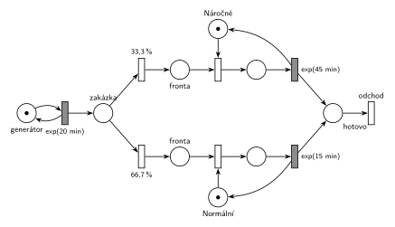

# 01.01 – Opravářská dílna

**Původ:** řešený příklad z přednášky (Hrubý), slajdy 157–164. Na přednášce 11. 10. 2024 ho označil za „typizovanou úlohu pro půlsemestrální písemku“.

## Zadání

> Do opravářské dílny přicházejí zákazníci v intervalech daných exponenciálním rozložením pravděpodobnosti se střední hodnotou 20 minut. V dílně jsou dva opraváři: jeden zpracovává normální zakázky a druhý náročné zakázky. Každá třetí zakázka je náročná. Vyřízení normální zakázky trvá 15 minut s exp. rozložením pravděpodobnosti, vyřízení náročné zakázky zabere 45 minut exp. Zákazník čeká na vyřízení své zakázky a pak systém opouští.
>
> Modelujte systém pomocí stochastické Petriho sítě.

Zdroje (cesty relativně ke složce `IMS - Modelování a simulace/`):

- `Přednášky - Prezentace 2025/IMS - Prezentace.pdf`: slajd 157 (zadání), 158–163 (postupná stavba), 164 (výsledná síť)
- `Přednášky - Video 2024/Přepisy/IMS_2024-10-11_1080p.txt` (výklad)

## Interpretace

Zobrazit interpretaci (nápověda)

- **„Každá třetí zakázka je náročná“** chápe přednášející jako pravděpodobnost 1/3 (na slajdu 33 % / 66 %; tady 33,3 % / 66,7 %, aby součet byl 100 %). Doslovné „každá třetí“ by šlo modelovat deterministicky čítačem: značka obíhá mezi třemi místy a každá třetí zakázka jde k náročnému opraváři. Na přednášce se to ale nepožadovalo.
- Každý opravář je zařízení s kapacitou 1 (místo s jednou značkou) a má vlastní frontu.
- Uvolnění opraváře je sloučené s časovaným přechodem opravy. Přednášející to výslovně ukazuje: „tady jsem to zabral a tady jsem to pracoval a uvolnil, zdrcel do jednoho přechodu“ (přepis přednášky).

## Řešení

Zobrazit řešení

| Požadavek | Prvek sítě |
|---|---|
| příchody exp(20 min) | *generátor* ⇄ `exp(20 min)` → *zakázka* |
| každá třetí náročná | okamžité přechody `33,3 %` / `66,7 %` z místa *zakázka* |
| opravář náročných zakázek, exp(45 min) | *Náročné* (1 značka), obsazení, `exp(45 min)` vrací značku |
| opravář normálních zakázek, exp(15 min) | *Normální* (1 značka), obsazení, `exp(15 min)` vrací značku |
| zákazník odchází | *hotovo* → přechod *odchod* bez výstupu |

Kontrola simulací: oba opraváři se vždy vrátí, všechny přechody se provádějí. Vytížení je asi 75 % (náročné) a 50 % (normální), fronty zůstávají omezené.

## Existující řešení

Zobrazit srovnání s existujícími řešeními

- **Slajd 164:** stejná síť. Generátor je tam nakreslený zkráceně jako přechod bez vstupního místa (slajd 151 ukazuje obě varianty); tady je ve smyčce s místem, což přednášející 18. 10. 2024 označil za „mírně korektnější“. Výstupní přechod je na slajdu také.

## Časté chyby

Zobrazit časté chyby

- Jedna společná fronta a jeden opravář s dobou obsluhy „buď 15, nebo 45“. Zadání má dva opraváře, každého pro jiný typ zakázek.
- Pravděpodobnosti, které nedávají dohromady 100 %.
- Zákazník „čeká na vyřízení své zakázky“: nemodeluje se zvlášť zakázka a zákazník, transakce je jedna.

