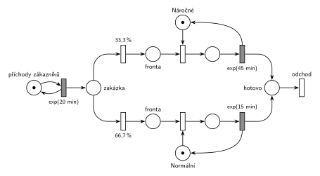

# 01–01 – Opravářská dílna

## Zadání

> Do opravářské dílny přicházejí zákazníci v intervalech daných exponenciálním rozložením pravděpodobnosti se střední hodnotou 20 minut. V dílně jsou dva opraváři: jeden zpracovává normální zakázky a druhý náročné zakázky. Každá třetí zakázka je náročná. Vyřízení normální zakázky trvá 15 minut s exp. rozložením pravděpodobnosti, vyřízení náročné zakázky zabere 45 minut exp. Zákazník čeká na vyřízení své zakázky a pak systém opouští.

## Nápověda

<details>
<summary>Zobrazit nápovědu</summary>

- **Příchody** modeluje místo s jednou značkou ve smyčce s časovaným přechodem `exp(20 min)`: každé provedení přechodu vloží do sítě nového zákazníka a značku vrátí, takže se odpočítává další příchod.
- **„Každá třetí zakázka je náročná“** se modeluje jako pravděpodobnost 1/3 (na slajdu 33 % / 66 %; tady 33,3 % / 66,7 %, aby součet byl 100 %). Doslovné „každá třetí“ by šlo modelovat deterministicky čítačem: značka obíhá mezi třemi místy a každá třetí zakázka jde k náročnému opraváři.
- Každý opravář je zařízení s kapacitou 1 (místo s jednou značkou) a má vlastní frontu.
- Uvolnění opraváře je sloučené s časovaným přechodem opravy: oprava a uvolnění jsou jeden přechod, který po skončení vrací značku opraváře.
- Zákazník **opouští systém** okamžitým přechodem bez výstupních hran.

</details>

## Petriho síť

<details>
<summary>Zobrazit Petriho síť</summary>



</details>

## SIMLIB

<details>
<summary>Zobrazit SIMLIB kód</summary>

Model je izomorfní k Petriho síti výše: každé místo, přechod a značka mají svůj protějšek v kódu.

```cpp
// 01–01 Opravářská dílna – model v SIMLIB/C++
#include "simlib.h"

// opraváři = místa se značkou opraváře (zařízení s kapacitou 1, každé má vlastní frontu)
Facility Narocne("Opravář náročných zakázek");
Facility Normalni("Opravář normálních zakázek");
Histogram Doba("Doba zákazníka v dílně [min]", 0, 15, 20);

class Zakaznik : public Process {      // transakce = značka, která prochází sítí
  void Behavior() {
    double prichod = Time;
    if (Random() < 1.0 / 3) {          // okamžité přechody 33,3 % / 66,7 %
      Seize(Narocne);                  // fronta + obsazení (bere značku opraváře)
      Wait(Exponential(45));           // časovaný přechod exp(45 min) ...
      Release(Narocne);                // ... který vrací značku opraváři
    } else {
      Seize(Normalni);
      Wait(Exponential(15));           // časovaný přechod exp(15 min)
      Release(Normalni);
    }
    Doba(Time - prichod);
  }                                    // konec Behavior = přechod „odchod“
};

class Generator : public Event {       // místo „příchody zákazníků“ ve smyčce s exp(20 min)
  void Behavior() {
    (new Zakaznik)->Activate();        // nová značka v místě „zakázka“
    Activate(Time + Exponential(20));  // další příchod
  }
};

int main() {
  Init(0, 60 * 1000);                  // modelový čas v minutách: 1000 hodin provozu
  (new Generator)->Activate();
  Run();
  Narocne.Output();
  Normalni.Output();
  Doba.Output();
}
```

| Petriho síť | SIMLIB |
|---|---|
| *příchody zákazníků* ⇄ `exp(20 min)` | událost `Generator`, která se znovu plánuje za `Exponential(20)` |
| značka (zákazník) | proces `Zakaznik` |
| `33,3 %` / `66,7 %` | `if (Random() < 1.0 / 3)` |
| *fronta* + obsazení opraváře | `Seize(Narocne)` (fronta je vnitřní fronta zařízení) |
| časovaný přechod se sloučeným uvolněním | `Wait(Exponential(45)); Release(Narocne);` |
| místa *Náročné* / *Normální* (1 značka) | `Facility Narocne`, `Facility Normalni` |
| přechod *odchod* | konec metody `Behavior()` |

**Kontrola simulací.** Petriho síť: oba opraváři se vždy vrátí, všechny přechody se provádějí, fronty zůstávají omezené (`make check`). SIMLIB model: v jednom běhu (1000 h) byl opravář náročných zakázek vytížen na 67 % a opravář normálních na 49 %; teoreticky je to 75 % a 50 % (1/60 zakázky za minutu × 45 min, 2/60 × 15 min), rozdíl je náhodný rozptyl jednoho běhu (`make simlib`).

</details>

## Časté chyby

<details>
<summary>Zobrazit časté chyby</summary>

- Jedna společná fronta a jeden opravář s dobou obsluhy „buď 15, nebo 45“. Zadání má dva opraváře, každého pro jiný typ zakázek.
- Pravděpodobnosti, které nedávají dohromady 100 %.
- Zákazník „čeká na vyřízení své zakázky“: nemodeluje se zvlášť zakázka a zákazník, transakce je jedna.

</details>

## Původ a zdroje

**Původ:** řešený příklad z přednášky (Hrubý), slajdy 157–164. Na přednášce 11. 10. 2024 ho označil za „typizovanou úlohu pro půlsemestrální písemku“.

**Zdroje:**

- `Přednášky - Prezentace 2025/IMS - Prezentace.pdf`: slajd 157 (zadání), 158–163 (postupná stavba), 164 (výsledná síť)
- `Přednášky - Video 2024/Přepisy/IMS_2024-10-11_1080p.txt` (výklad)

**Existující řešení:**

<details>
<summary>Zobrazit existující řešení</summary>

- **Slajd 164:** stejná síť. Generátor je tam nakreslený zkráceně jako přechod bez vstupního místa (slajd 151 ukazuje obě varianty); tady je ve smyčce s místem, což přednášející 18. 10. 2024 označil za „mírně korektnější“. Výstupní přechod je na slajdu také.

</details>
