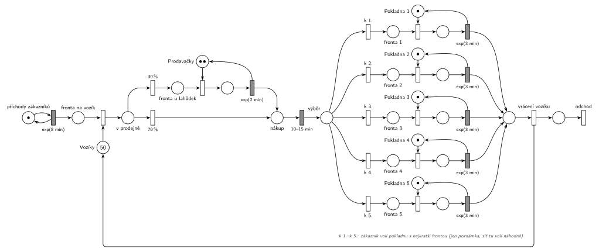

# 01–02 – Samoobsluha

## Zadání

> Do samoobsluhy přicházejí zákazníci v intervalech daných exponenciálním rozložením se středem 8 minut. Každý zákazník si nejprve opatří vozík. Vozíky se koncentrují na seřadišti a je jich celkem 50. Zákazník vstoupí do prodejny a 30% jde okamžitě k pultíku s lahůdkami, kde obsluhují dvě prodavačky. Obsloužení zákazníka zde trvá 2 minuty (exponenciálně) a pak zákazník pokračuje běžným nákupem. Běžný nákup trvá 10-15 minut rovnoměrně. Nakonec přistupuje k jedné z pěti pokladen. Vybírá si pokladnu podle nejkratší fronty. Doba obsluhy u pokladny se řídí exponenciálním rozložením se středem 3 minuty. Při odchodu ze systému zákazník vrací vozík.
>
> Zadání: analýza problému, model ve formě SPN, model ve formě SIMLIB

Podobné úlohy: [01–01 – Opravářská dílna](<../01–01 - Opravářská dílna/01–01 - Opravářská dílna.md>), [09–16 – Menza](<../09–16 - Menza/09–16 - Menza.md>).

## Interpretace

Zobrazit interpretaci (nápověda)

- **Vozíky** jsou sklad (Store) s 50 značkami. Místo před jejich zabráním je zároveň fronta na vozík; přednášející o něm říká, že „je současně i frontou k tomu skladu těch vozíků“. Vozík se vrací až při odchodu, takže v prodejně může být nejvýš 50 zákazníků. Při příchodu jednou za 8 minut se to prakticky neprojeví.
- **Lahůdky:** jedna fronta ke dvěma prodavačkám, tedy sklad se 2 značkami, ne dvě zařízení.
- **Běžný nákup** je časovaný přechod bez zdroje. Každý zákazník v místě *nákup* má vlastní odpočet (slajd 138), takže nakupují všichni souběžně a na nikoho nečekají.
- **Pokladny:** pět zařízení, ke každému stojí zvláštní fronta (analýza na slajdu 196). Na rozdíl od slajdu 198, kde jsou nakreslené jen dvě pokladny s poznámkou „blok Pokladna se opakuje pro Pokladny 3-5“, jsou tu nakreslené všechny.
- **„Podle nejkratší fronty“** se v SPN přímo vyjádřit nedá. Priority a pravděpodobnosti jsou pevná čísla a délky pěti front by se musely porovnávat každá s každou. Přednášející proto výběr na slajdu 198 jen označil poznámkou („přistupuje se k pokladně s nejkratší frontou“) a na přednášce řekl, že se to v Petriho síti „dá schematizovat pouze nějak symbolicky“. Tady stejně: přechody *k 1.* až *k 5.* bez parametru a poznámka u nich. Simulátor mezi nimi volí náhodně, takže fronty jsou v simulaci o něco delší než při skutečném výběru nejkratší fronty. Přesné pravidlo je až v SIMLIB (`QueueLen()`).
- Částečně by výběr šel zpřesnit přechodem s `p=1` pro každou pokladnu, který testuje volnou pokladnu (hrana tam a zpět, neblokující obsazení ze slajdu 153). Zákazník by pak šel přednostně k volné pokladně a jen když jsou všechny obsazené, volil by náhodně. Přednášející to nedělá.
- Uvolnění pokladny je sloučené s časovaným přechodem `exp(3 min)`: „Případně tady je s tou prací souběžně i ten release“ (přepis přednášky). Vrácení vozíku je samostatný okamžitý přechod (na slajdu `Leave(Voziky, 1)`), potom zákazník odchází.
- SIMLIB část zadání tu není řešená (řešení je ve Studijní opoře, s. 54–55).

## Petriho síť

Zobrazit Petriho síť

| Požadavek | Prvek sítě |
|---|---|
| příchody exp(8 min) | *generátor* ⇄ `exp(8 min)` → *fronta na vozík* |
| 50 vozíků na seřadišti | sklad *Vozíky* (50 značek), zabrání okamžitým přechodem |
| 30 % k lahůdkám | okamžité přechody `30 %` / `70 %` z místa *v prodejně* |
| dvě prodavačky, exp(2 min) | sklad *Prodavačky* (2 značky), obsazení, `exp(2 min)` vrací značku |
| běžný nákup 10–15 min | časovaný přechod `10–15 min` (rovnoměrně, souběžně pro všechny) |
| pět pokladen, každá s vlastní frontou | 5× *fronta i* → obsazení *Pokladny i* → `exp(3 min)` vrací značku |
| výběr podle nejkratší fronty | přechody *k 1.* až *k 5.* a poznámka (viz interpretace) |
| vrácení vozíku a odchod | *vrácení vozíku* (značka zpět do *Vozíků*) → *odchod* bez výstupu |

Kontrola simulací: platí *Vozíky* + zákazníci v prodejně = 50, prodavačky i všechny pokladny se vždy vrátí. K lahůdkám jde asi 30 % zákazníků, každá pokladna dostane asi pětinu. Fronty u pokladen zůstávají krátké (nejvýš 3) a na vozík nikdo nečeká. Souběžně nakupuje až asi 9 zákazníků.

## Časté chyby

Zobrazit časté chyby

- Pět pokladen jako jeden sklad s 5 značkami a jednou společnou frontou. Zadání i analýza na slajdu 196 mají ke každé pokladně zvláštní frontu.
- Vozík vrácený hned po vstupu do prodejny nebo po nákupu. Vrací se až při odchodu.
- Běžný nákup jako zařízení s jednou značkou. Zákazníci by pak nakupovali jeden po druhém.
- Lahůdky jako dvě zařízení se dvěma frontami. U pultíku stojí jedna fronta ke dvěma prodavačkám.

## Původ a zdroje

**Původ:** řešený příklad z přednášky, slajdy 195–198 (SIMLIB část přednášky). Stejný příklad s řešením v SIMLIB je ve Studijní opoře.

**Zdroje:**

- `Přednášky - Prezentace 2025/IMS - Prezentace.pdf`: slajd 195 (zadání), 196 (analýza), 197–198 (Petriho síť)
- `IMP - Studijní opora.pdf`, s. 53–55, oddíl 5.5.15 (stejné zadání, řešení v SIMLIB)
- `Přednášky - Video 2024/Přepisy/IMS_2024-10-18_1080p.txt` (výklad)

**Existující řešení:**

Zobrazit existující řešení

- **Slajdy 197–198:** stejná struktura. Rozdíly jsou jen v kreslení: generátor je přechod `exp(8)` bez vstupního místa (zkrácený tvar ze slajdu 151) a časované přechody jsou tu nakreslené bíle, na rozdíl od slajdů 136, 139 a 164. Pokladny jsou nakreslené jen dvě, výběr pokladny je modrý čárkovaný rámeček s poznámkou. Vrácení vozíku a výstupní přechod „exit…“ jsou stejné jako tady.
- **Studijní opora (s. 54–55):** řešení v SIMLIB: `Store Voziky(50)`, `Store Lahudky(2)`, `Facility Pokladny[5]`. Pokladnu vybírá cyklem podle `QueueLen()`; při shodě vyhraje pokladna s nižším číslem.

