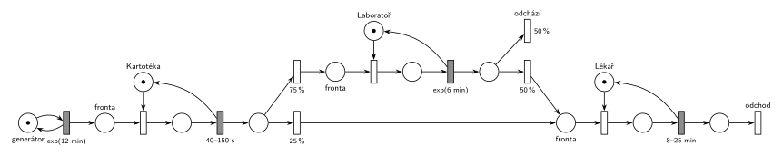

# 01–03 – Zdravotní středisko

**Původ:** řešený příklad z poznámek „Stochastické Petriho sítě“ ke cvičení MSI (Vojnar), které jsou na webu předmětu. Tady překreslený do notace IMS.

**Zdroje:**

- `Web předmětu/Petriho sítě - Stochastické (poznámky MSI).pdf`, str. 2 PDF (tištěné s. 3–4): oddíl 3 (zadání) a obr. 6 (řešení); obr. 3 a 5 (konvence)

## Zadání

> Budeme modelovat jednoduché zdravotní středisko:
>
> - Příchod pacienta každých 12 minut s exp. rozložením.
> - Všichni pacienti projdou kartotékou, což jim zabere rovnoměrně 40 až 150 sekund.
> - Poté 25% pacientů jde přímo k lékaři.
> - Zbývajících 75% pacientů jde nejdříve na odběr do laboratoře. To jim zabere v průměru 6 minut, načež polovina lidí odchází a druhá polovina pokračuje k lékaři.
> - U lékaře pacienti stráví rovnoměrně 8 až 25 minut.

Podobné úlohy: [01–01 – Opravářská dílna](<../01–01 - Opravářská dílna/01–01 - Opravářská dílna.md>), [09–18 – Nemocniční ambulance](<../09–18 - Nemocniční ambulance/09–18 - Nemocniční ambulance.md>).

## Interpretace

Zobrazit interpretaci (nápověda)

- **Jiná konvence v poznámkách MSI.** Při překreslení do notace IMS se mění:

  | Poznámky MSI | Notace IMS |
  |---|---|
  | bílý obdélník = exponenciální přechod se střední hodnotou (`720`) | šedý obdélník, čas napsaný celý: `exp(12 min)` |
  | šedý obdélník = jiné rozložení (`Uni(40,150)`) | šedý obdélník, `40–150 s` |
  | černá čárka = okamžitý přechod | tenký bílý obdélník |
  | váhy okamžitých přechodů (`75`/`25`, `50`/`50`), pravděpodobnost = váha / součet vah | procenta: `75 %` / `25 %`, `50 %` / `50 %` |
  | časy v sekundách | časy s jednotkami |

- **Kapacita časovaného přechodu.** V poznámkách MSI má časovaný přechod implicitně kapacitu serveru 1, takže *Index*, *Laboratory* a *Expert* jsou zařízení s frontou. V IMS běžný časovaný přechod počet současně obsluhovaných neomezuje (slajd 138). Proto má kartotéka, laboratoř i lékař vlastní místo s jednou značkou a obsazovací přechod. Stejnou úpravu ukazují poznámky MSI samy na obr. 7 (*Queue* → *BeingServed* + *Free* → *Expert*).
- **Laboratoř:** text říká „v průměru 6 minut“, obr. 6 má u přechodu *Laboratory* číslo 300 (tedy 5 minut). Síť se drží textu: `exp(6 min)`. Exponenciální rozložení plyne z bílého obdélníku na obrázku.
- **„Polovina lidí odchází“** platí jen pro pacienty z laboratoře. Přechod `50 %` *odchází* je zároveň výstupní (nemá výstupní hrany). K lékaři tak jde celkem 25 % + 37,5 % = 62,5 % pacientů.
- Generátor *Entrance* je v poznámkách přechod bez vstupního místa; tady je ve smyčce s místem. Za lékařem v poznámkách nic není (přechod *Expert* nemá výstup); tady je přidaný výstupní přechod *odchod*.

## Řešení

Zobrazit řešení

| Požadavek | Prvek sítě |
|---|---|
| příchod exp(12 min) | *generátor* ⇄ `exp(12 min)` → *fronta* ke kartotéce |
| kartotéka 40–150 s | *Kartotéka* (1 značka), obsazení, `40–150 s` vrací značku |
| 25 % přímo k lékaři, 75 % do laboratoře | okamžité přechody `25 %` / `75 %` |
| odběr v průměru 6 min | *Laboratoř* (1 značka), obsazení, `exp(6 min)` vrací značku |
| polovina odchází, polovina k lékaři | `50 %` *odchází* (výstupní) / `50 %` do fronty k lékaři |
| lékař 8–25 min | *Lékař* (1 značka), obsazení, `8–25 min` vrací značku |
| odchod od lékaře | místo → přechod *odchod* bez výstupu |

Kontrola simulací: všechna tři zařízení se vždy vrátí. Úzkým místem je lékař: vytížení asi (1/12) · 0,625 · 16,5 ≈ 86 %, takže fronta k lékaři občas naroste (v simulaci až asi na 25 pacientů), ale zůstává omezená. Laboratoř je vytížená asi na 38 %, kartotéka asi na 13 %.

## Existující řešení

Zobrazit srovnání s existujícími řešeními

- **Poznámky MSI, obr. 6:** stejný tok pacientů (*BeforeInd*, *AfterInd*, *BeforeLab*, *AfterLab*, *BeforeExp*). Liší se konvencí (viz interpretace) a tím, že zařízení nemají vlastní místa, protože kapacitu 1 zajišťuje implicitní kapacita serveru. U laboratoře je na obrázku 300 s místo 6 minut z textu.

## Časté chyby

Zobrazit časté chyby

- Převzít konvenci z poznámek MSI do IMS. Bílý obdélník je v IMS okamžitý přechod, ne exponenciální.
- Lékař jako samotný časovaný přechod bez místa se značkou. Podle sémantiky IMS by pak vyšetřoval libovolně mnoho pacientů najednou.
- Napsat k přechodům váhy `75`/`25` místo procent, nebo `50 %` počítat ze všech pacientů místo jen z těch, kteří prošli laboratoří.

