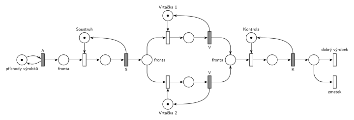

# 01–04 – Výrobní systém

## Zadání

> Výrobní systém – přicházející výrobky jsou zpracovány soustruhem, pak jednou ze dvou vrtaček a opouští systém po kontrole jako dobré nebo špatné.

Podobné úlohy: [01–05 – Kritická sekce](<../01–05 - Kritická sekce/01–05 - Kritická sekce.md>), [01–01 – Opravářská dílna](<../01–01 - Opravářská dílna/01–01 - Opravářská dílna.md>).

## Interpretace

Zobrazit interpretaci (nápověda)

- **P/T síť nemá čas.** Každá činnost stroje je dvojice událostí *start* a *stop* a mezi nimi místo „probíhá“ (P2, P5, P7, P10). Poznámky MSI k stochastickým sítím (obr. 1) ukazují, že taková dvojice odpovídá v SPN jednomu časovanému přechodu.
- **V notaci IMS** jsou proto všechny přechody kromě generátoru nakreslené jako okamžité (tenké bílé). Síť se dá číst jako SPN, ve které vše trvá nulový čas; struktura zůstává stejná jako v originále. Kdyby se zadaly doby obsluhy, *stop* by byl časovaný přechod a uvolnění stroje by se s ním sloučilo jako na slajdu 164.
- **Generátor:** v originále je *novy_mat* přechod bez vstupu. V P/T síti je to zdroj, který se může provést kdykoli. V SPN by okamžitý přechod bez vstupu vyráběl nekonečně mnoho výrobků v nulovém čase, proto je tu generátor časovaný, ve smyčce s místem a s intervalem `T`. Zadání ho neuvádí; simulace používá T = 10.
- **Stroje** jsou místa se značkou „volný“ (P3 soustruh, P6 a P8 vrtačky, P11 kontrola): *start* značku bere, *stop* ji vrací. Je to vzor zařízení v plném tvaru Seize–obsluha–Release (slajd 154), jen bez času.
- **Výběr vrtačky:** P4 je společná fronta k oběma vrtačkám. Když jsou volné obě, rozhodne se nedeterministicky (přechody bez parametru).
- **Výsledek kontroly** je také nedeterministický, zadání pravděpodobnost neuvádí. Poznámky samy doporučují omezit počet výrobků v systému, zavést časování a určit pravděpodobnosti jednotlivých cest.
- **Prohozené popisky:** na obr. 6 vede *kontr_uspech* → P12 → *zmetek* a *kontr_neuspech* → P13 → *vyrobek*. Úspěšná kontrola má dát dobrý výrobek, takže popisky výstupů jsou v originále prohozené. Tady je to opravené.
- Oba výstupy (dobrý výrobek, zmetek) jsou výstupní přechody bez výstupních hran.

## Řešení

Zobrazit řešení

| Požadavek | Prvek sítě |
|---|---|
| přicházející výrobky | *generátor* ⇄ `T` → P1 (v originále přechod *novy_mat* bez vstupu) |
| soustruh | P3 (1 značka), *start* → P2 → *stop* vrací značku |
| jedna ze dvou vrtaček | z P4 *start* vrtačky 1 (P6) nebo vrtačky 2 (P8), *stop* vrací značku |
| kontrola | P11 (1 značka), *start* → P10 → *úspěch* / *neúspěch*, oba vrací značku |
| odchod jako dobrý nebo špatný | P12 → *dobrý výrobek*, P13 → *zmetek* (výstupní přechody) |

Kontrola simulací: všechny stroje se vždy vrátí (P3 + P2 = 1, P6 + P5 = 1, P8 + P7 = 1, P11 + P10 = 1). Protože po generátoru vše trvá nulový čas, projde každý výrobek systémem okamžitě. Nedeterministické konflikty simulátor rozhoduje náhodně, takže každá vrtačka i každý výsledek kontroly vychází zhruba na polovinu.

## Časté chyby

Zobrazit časté chyby

- Stroj bez místa „volný“. Nic by pak nebránilo zpracovávat na soustruhu několik výrobků najednou.
- Při neúspěšné kontrole nevrátit značku kontroly (P11). Kontrola by se po prvním zmetku zablokovala; v originále vede proto od *kontr_neuspech* dlouhá hrana zpět do P11.
- Nakreslit generátor jako okamžitý přechod bez vstupu. V SPN by se prováděl pořád dokola v nulovém čase.

## Původ a zdroje

**Původ:** řešený příklad 1 z poznámek „Černobílé a barvené Petriho sítě“ ke cvičení MSI (Vojnar), které jsou na webu předmětu. P/T síť bez času, tady překreslená do notace IMS.

**Zdroje:**

- `Web předmětu/Petriho sítě - Černobílé a barvené (poznámky MSI).pdf`, str. 2 PDF (tištěná s. 3): oddíl 3, příklad 1 a obr. 6

**Existující řešení:**

Zobrazit existující řešení

- **Poznámky MSI, obr. 6:** stejná síť (místa P1–P13, přechody *soustr_start*, *vrt1_start*, …). Přechody jsou černé čárky (konvence P/T sítí v poznámkách), generátor je přechod bez vstupu a popisky *zmetek* / *vyrobek* jsou prohozené.

