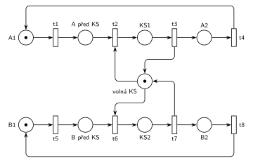

# 01–05 – Kritická sekce

## Zadání

> Uvažujme dva procesy se sdílenou kritickou sekcí: Proces 1 provede akci A1, potom kritickou sekci KS1, akci A2 a pak se jeho činnost opakuje. Proces 2 provádí cyklicky B1, KS2 a B2.

Podobné úlohy: [01–04 – Výrobní systém](<../01–04 - Výrobní systém/01–04 - Výrobní systém.md>). Stejný princip sdíleného prostředku mají čtenáři a písaři na slajdu 131.

## Interpretace

Zobrazit interpretaci (nápověda)

 

- **Akce jsou místa, přechody jsou události.** Značka v místě *A1* znamená „proces 1 právě provádí A1“. Přechod t1 je konec A1, t2 vstup do kritické sekce, t3 její opuštění, t4 konec A2 a návrat na začátek. Počáteční stav: oba procesy provádějí první akci.
- **Kritická sekce** je chráněná místem *volná KS* s jednou značkou (zámek, zařízení s kapacitou 1). Vstup (t2, t6) značku bere, výstup (t3, t7) ji vrací.
- **Vzájemné vyloučení** zaručuje P-invariant *volná KS* + *KS1* + *KS2* = 1: v kritické sekci nemohou být oba procesy současně.
- **Uzavřená síť:** procesy jen obíhají, nic nepřichází ani neodchází, takže síť nemá výstupní přechod.
- **Bez času:** přechody jsou nakreslené jako okamžité. Simulace se tu nespouští, protože okamžité přechody v cyklu by se v nulovém čase prováděly donekonečna. V SPN by akce A1, KS1, A2 (a B1, KS2, B2) měly trvání, takže konce akcí (t1, t3, t4, t5, t7, t8) by byly časované a vstupy do kritické sekce (t2, t6) by zůstaly okamžité.
- Síť nezaručuje férovost: když čekají oba procesy, rozhodne se mezi t2 a t6 nedeterministicky a jeden proces může druhého předbíhat pořád.

## Petriho síť

Zobrazit Petriho síť

 

| Požadavek | Prvek sítě |
|---|---|
| proces 1: A1, KS1, A2, opakuje se | cyklus *A1* → t1 → *A před KS* → t2 → *KS1* → t3 → *A2* → t4 → *A1* |
| proces 2: B1, KS2, B2 cyklicky | cyklus *B1* → t5 → *B před KS* → t6 → *KS2* → t7 → *B2* → t8 → *B1* |
| sdílená kritická sekce | *volná KS* (1 značka): t2 a t6 ji berou, t3 a t7 vracejí |

Kontrola: síť se nesimuluje (viz interpretace). Prohledáním stavového prostoru (15 dosažitelných značení) je ověřené, že ve všech značeních platí *volná KS* + *KS1* + *KS2* = 1, každý proces má právě jednu značku a síť nikdy neuvázne.

## Časté chyby

Zobrazit časté chyby

 

- Kritická sekce bez zámku (místa *volná KS*). Oba procesy by pak mohly být v kritické sekci současně.
- Nevrátit značku *volná KS* při výstupu z kritické sekce. Po prvním průchodu kritickou sekcí by oba procesy uvázly před ní.
- Jedna společná značka pro oba procesy. Každý proces je samostatný cyklus s vlastní značkou.

## Původ a zdroje

Zobrazit původ a zdroje

 

**Původ:** řešený příklad 2 z poznámek „Černobílé a barvené Petriho sítě“ ke cvičení MSI (Vojnar), které jsou na webu předmětu. P/T síť bez času, tady překreslená do notace IMS.

**Zdroje:**

- `Web předmětu/Petriho sítě - Černobílé a barvené (poznámky MSI).pdf`, str. 2 PDF (tištěná s. 3): oddíl 3, příklad 2 a obr. 7

**Existující řešení:**

- **Poznámky MSI, obr. 7:** stejná síť (místa *A1*, *A_pred_KS*, *A_v_KS*, *A2*, *volna_KS*, …, přechody t1–t8). Přechody jsou černé čárky (konvence P/T sítí v poznámkách); místa jsou tu pojmenovaná česky.

