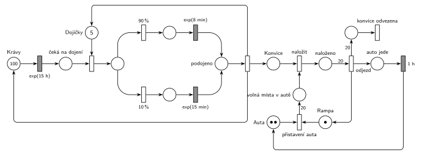

# 01–06 – Kravín

## Zadání

> **Příklad: kravín**
>
> - Kravín má 100 krav, 5 dojiček, 1 nakládací rampu, 2 auta
> - Krávy v intervalech exp(15h) potřebují podojit (dojička, 10% případů trvá exp (15min), jinak exp(8min)).
> - Vznikne konvice s mlékem. Nakládají se na rampě do auta (kapacita 20). Auto náklad odváží (1hod).
> - Identifikovat procesy.

⚠️ Zadání je heslovité (body slajdu). Kdy auto odjíždí a jak dlouho trvá naložení konvice, neříká; viz interpretace.

Podobné úlohy: [11–10 – Bagrista a nákladní auta](<../11–10 - Bagrista a nákladní auta/11–10 - Bagrista a nákladní auta.md>), [11–08 – Přepravní firma](<../11–08 - Přepravní firma/11–08 - Přepravní firma.md>).

## Interpretace

Zobrazit interpretaci (nápověda)

- **Procesy:** krávy (100, obíhají dokola), dojičky (sklad 5), konvice (transakce: vznikne podojením, odjede autem), auta (2, obíhají mezi rampou a cestou), rampa (zařízení s kapacitou 1).
- **exp(15 h) platí pro každou krávu zvlášť.** Časovaný přechod je přímo na místě *Krávy* se 100 značkami a podle slajdu 138 má každá značka vlastní odpočet. Celkem tak vychází asi 100 / 15 ≈ 6,7 dojení za hodinu. Generátor s jedním příchodem za 15 h pro celé stádo by s 5 dojičkami nedával smysl.
- **Dojení:** kráva zabere dojičku, pak se okamžitě rozhodne `90 %` / `10 %` a dojí se `exp(8 min)` nebo `exp(15 min)`. Rozhodnutí až po zabrání dojičky nic nemění, okamžité přechody trvají nulový čas.
- **Po podojení** jeden okamžitý přechod vrátí krávu i dojičku a vytvoří konvici (plný tvar Seize–obsluha–Release, slajd 154). Sloučit uvolnění s oběma časovanými přechody by znamenalo čtyři dlouhé zpětné hrany.
- **Nakládání:** auto se přistaví na rampu (potřebuje volné auto i volnou rampu) a přinese 20 značek *volná místa v autě*. Je to doplňkové místo místo kapacity místa. Každá konvice se naloží, když je volné místo; doba nakládání zadaná není, takže je okamžité. Konvice, které přijdou bez auta na rampě, čekají v místě *Konvice*.
- **Odjezd:** auto odjíždí až plné (hrana s váhou 20 z místa *naloženo*), uvolní rampu a za `1 h` je zpět. Hodina je tu celá cesta tam i zpět. Konvice opouštějí kravín s odjezdem auta (20 značek do výstupního přechodu). Šlo by je nechat odejít až po hodině, na modelu kravínu to nic nemění.
- Zadání chce hlavně „identifikovat procesy“; síť navíc ukazuje, jak spolu procesy synchronizují (sdílená dojička, auto na rampě).

## Řešení

Zobrazit řešení

| Požadavek | Prvek sítě |
|---|---|
| 100 krav, každá po exp(15 h) | *Krávy* (100 značek) → `exp(15 h)` (odpočet pro každou krávu) → *čeká na dojení* |
| 5 dojiček | sklad *Dojičky* (5 značek), obsazení |
| 10 % exp(15 min), jinak exp(8 min) | `90 %` → `exp(8 min)`, `10 %` → `exp(15 min)` → *podojeno* |
| vznikne konvice | okamžitý přechod vrátí krávu a dojičku a dá značku do *Konvice* |
| 1 rampa, 2 auta | *Rampa* (1), *Auta* (2) → *přistavení auta* → 20 × *volná místa v autě* |
| nakládání do auta (kapacita 20) | *naložit*: konvice + volné místo → *naloženo* |
| auto odváží náklad (1 h) | *odjezd* (váha 20) vrací rampu → *auto jede* → `1 h` → *Auta*; konvice → výstupní přechod |

Kontrola simulací: krav je vždy 100, dojičky se vždy vrátí, platí 20 · *Rampa* + *volná místa* + *naloženo* = 20 a 20 · (*Auta* + *auto jede*) + *volná místa* + *naloženo* = 40. Dojí se asi 6,6krát za hodinu, 10 % dojení je dlouhých. Auto se plní asi 3 hodiny a cesta trvá 1 hodinu, takže druhé auto je vždy připravené a konvice skoro nečekají.

## Časté chyby

Zobrazit časté chyby

- Krávy jako generátor `exp(15 h)` pro celé stádo. Interval patří každé krávě; časovaný přechod na místě se 100 značkami to vyjádří sám.
- Zabírat auto a rampu pro každou konvici zvlášť (tabule luppo). Auto i rampa patří k nakládání celé dávky 20 konvic.
- Zapomenout při odjezdu uvolnit rampu. Druhé auto by se pak nikdy nepřistavilo.
- Odjezd jen testovat (hrana s váhou 20 tam i zpět) a naložené konvice neodebrat. Auto by pak odjíždělo pořád znovu se stejným nákladem.

## Původ a zdroje

**Původ:** příklad z přednášky („Příklad: kravín“). Zachoval se jen jako výřez slajdu na studentské tabuli luppo spolu se studentským řešením. Ve slajdech 2025 ani v přepisech přednášek 2024 není, jde zřejmě o starší verzi přednášky.

**Zdroje:**

- `Fitcheats/Příprava na zkoušku/luppo - Tabule.png`, levý horní roh (výřez slajdu se zadáním a studentská síť v červeně ohraničené oblasti s poznámkou „No valid“)

**Existující řešení:**

Zobrazit existující řešení

- **Tabule luppo (studentské řešení):** leží v červeně ohraničené části tabule, ke které někdo připsal „No valid“ se šipkou.
  - Horní část je v pořádku a odpovídá síti výše: *krav* (100) → `Exp(15h)` přímo na místě s krávami → zabrání dojičky (5) → `90%` / `10%` → `Exp(8min)` / `Exp(15min)` → přechod *Mléko*, který vrací krávu i dojičku a vytváří mléko.
  - Spodní část je nepřehledná. Přechod *Nakládání* podle nakreslených hran bere s každou konvicí (*Mléko*) i rampu a auto. Rampa se vrací až při odjezdu, takže by se naložila jen první konvice a nakládání by uvázlo. *Kapacita* (20) se bere po jedné u přechodu „Je kap?“ a vrací se váhou 20 při odjezdu; protože je rampa jen jedna, stačí jedno společné místo. Odjezd (váha 20) vede přes místo do přechodu `1hod`, který vrací auto. Výstupní přechod pro konvice chybí.

