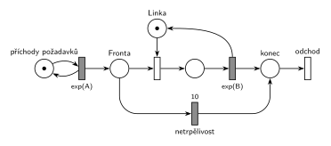

# Netrpělivé požadavky (02/01)

## Zadání

> Mějme systém M/M/1 s netrpělivými požadavky. Transakce po 10 časových jednotkách čekání ve frontě opouští bez obsluhy systém.

Podobné úlohy: [Netrpělivý první ve frontě](<../02 - Netrpělivý první ve frontě/02 - Netrpělivý první ve frontě.md>) (netrpělivý je jen první ve frontě), [Příklad s netrpělivou transakcí](<../03 - Příklad s netrpělivou transakcí/03 - Příklad s netrpělivou transakcí.md>) (vlastní příklad), [Kopírovací centrum](<../../09 - Obsluha zákazníků/10 - Kopírovací centrum/10 - Kopírovací centrum.md>) (netrpělivost ve slovní úloze).

## Nápověda

<details>
<summary>Zobrazit nápovědu</summary>
<br>

- **M/M/1:** *příchody požadavků* ⇄ `exp(A)` → *fronta* → obsazení *Linky* → `exp(B)`, který *Linku* vrací → *konec* → *odchod*. Příchody a obsluha nemají v zadání čísla, proto symboly `exp(A)` a `exp(B)`.
- **Netrpělivost = časovaný přechod `10` přímo na místě *fronta*.** Běžný časovaný přechod má pro každou značku ve vstupním místě vlastní odpočet (slajd 138), takže každý čekající odchází po 10 jednotkách svého čekání. Kdo se dřív dostane k lince, tomu okamžité obsazení vezme značku a jeho odpočet zanikne (slajd 139).
- **Proč zanikne zrovna jeho odpočet:** značky jsou nerozlišitelné, takže síť při obsazení ví jen to, že jeden z běžících odpočtů musí zaniknout, ne čí. Zanikne nejstarší, a to odpovídá frontě FIFO: k lince jde ten, kdo čeká nejdéle. Na tom záleží, protože trpělivost je pevná (`10`); u `exp(10)` by bylo jedno, který odpočet zanikne, protože exponenciální doba nemá paměť. Kdyby fronta nebyla FIFO (LIFO, priority), tahle síť by neuměla říct, kdo odejde. Podrobně v [Jak síť funguje](<../../../basics/Jak síť funguje.md>).
- **Měří se čekání ve frontě, ne obsluha.** Transakce v obsluze už netrpělivá není, proto časovač nesmí začínat až obsazením linky.
- **Doba čekání je pevná** („po 10 časových jednotkách“), tedy `10`, ne `exp(10)`. Jednotky zadání neuvádí, takže se nepíšou.
- **Odchod bez obsluhy:** *netrpělivost* vede do místa *konec*, odkud transakce odchází stejným přechodem *odchod* jako obsloužené. Dva samostatné výstupní přechody jsou také správně (hodí se, když se mají počítat zvlášť).

</details>

## Petriho síť

<details>
<summary>Zobrazit Petriho síť</summary>
<br>



</details>

## Časté chyby

<details>
<summary>Zobrazit časté chyby</summary>
<br>

- Časovač za obsazením linky (omezuje obsluhu, ne čekání).
- Netrpělivá větev, která vezme i značku *Linky* nebo ji nevrátí.
- `exp(10)` místo pevné doby `10`, případně jednotky (`10 s`), které zadání nemá.
- Netrpělivý přechod bez pokračování k výstupnímu přechodu: od roku 2022 se vyžaduje přechodem ukázat, kde transakce opouští systém.
- Odmítnutí při obsazené lince (okamžitý přechod s nižší prioritou místo časovaného): to je jiné chování, transakce vůbec nečeká.

</details>

## SIMLIB

<details>
<summary>Zobrazit SIMLIB kód</summary>
<br>

Model je izomorfní k Petriho síti výše: každé místo, přechod a značka mají svůj protějšek v kódu. Hodnoty `A = 10` a `B = 8` jsou doplněné, zadání je nedává. Linka je `Facility` (místo s jednou značkou), ne `Store`.

```cpp
// Netrpělivé požadavky – model v SIMLIB/C++
#include "simlib.h"

const double A = 10;                   // střední interval příchodů exp(A)
const double B = 8;                    // střední doba obsluhy exp(B)
const double TRPELIVOST = 10;          // přechod „netrpělivost“ (pevná doba)

Facility Linka("Linka");               // místo Linka s jednou značkou
int obslouzeno = 0, netrpelivych = 0;  // počty provedení přechodů odchod (po obsluze / po netrpělivosti)

class Netrpelivost : public Event {    // časovaný přechod „netrpělivost“ na místě Fronta
  Process *pozadavek;                  // čí odpočet to je
 public:
  Netrpelivost(Process *p) : pozadavek(p) { Activate(Time + TRPELIVOST); }
  void Behavior() {
    netrpelivych++;
    pozadavek->Cancel();               // vyjme požadavek z fronty a ukončí ho: konec → odchod
  }
};

class Pozadavek : public Process {     // transakce = značka, která prochází sítí
  void Behavior() {
    Event *netrp = new Netrpelivost(this);  // značka v místě Fronta: vlastní odpočet 10
    Seize(Linka);                      // Fronta + obsazení (bere značku Linky)
    delete netrp;                      // obsazení vzalo značku z Fronty, odpočet zaniká
    Wait(Exponential(B));              // časovaný přechod exp(B) ...
    Release(Linka);                    // ... který vrací značku Lince
    obslouzeno++;
  }                                    // konec Behavior = místo konec + přechod odchod
};

class Generator : public Event {       // místo „příchody požadavků“ ve smyčce s exp(A)
  void Behavior() {
    (new Pozadavek)->Activate();       // nová značka v místě Fronta
    Activate(Time + Exponential(A));   // další příchod
  }
};

int main() {
  Init(0, 1000000);                    // modelový čas v časových jednotkách
  (new Generator)->Activate();
  Run();
  Linka.Output();
  Print("Obslouženo: %d, odešlo bez obsluhy: %d (%.1f %%)\n", obslouzeno, netrpelivych,
        100.0 * netrpelivych / (obslouzeno + netrpelivych));
}
```

| Petriho síť | SIMLIB |
|---|---|
| *příchody požadavků* ⇄ `exp(A)` | událost `Generator`, která se znovu plánuje za `Exponential(A)` |
| značka (požadavek) | proces `Pozadavek` |
| *fronta* + obsazení *Linky* | `Seize(Linka)` (fronta je vnitřní fronta zařízení) |
| místo *Linka* (1 značka) | `Facility Linka` |
| časovaný přechod `exp(B)` se sloučeným uvolněním | `Wait(Exponential(B)); Release(Linka);` |
| odpočet *netrpělivost* `10` pro značku ve *frontě* | událost `Netrpelivost`, kterou každý požadavek naplánuje za 10 před `Seize` |
| obsazení vezme značku z *fronty*, odpočet zaniká | `delete netrp;` hned po `Seize` |
| provedení *netrpělivosti* (značka z *fronty* do *konec*) | `pozadavek->Cancel()`: vyjme proces z fronty linky a ukončí ho |
| *konec* → *odchod* | konec metody `Behavior()` nebo `Cancel()`; počítadla `obslouzeno`, `netrpelivych` |

**Kontrola simulací.** Petriho síť: *Linka* + obsluhovaná transakce = 1, všechny přechody se provádějí, fronta zůstává omezená (`make check`); při `A = 10`, `B = 8` odešla bez obsluhy zhruba čtvrtina transakcí a fronta měla nejvýš 6 čekajících. SIMLIB model: v jednom běhu (10⁶ časových jednotek) odešlo bez obsluhy 25,0 % požadavků a linka byla vytížena na 60,1 %. Teorie (M/M/1 s pevnou trpělivostí τ = 10: požadavek odejde, právě když nedokončená práce v systému při jeho příchodu přesáhne τ) dává 24,8 % a vytížení 0,1 · 0,752 · 8 = 60,1 % (`make simlib`).

</details>

## Původ a zdroje

<details>
<summary>Zobrazit původ a zdroje</summary>
<br>

**Původ:** zkouška 2023/24, 1. termín, skupina A, otázka 3, 10 bodů. Stejná úloha (jiná čísla, navíc SIMLIB, 15 bodů): zkouška 2017/18, 1. termín, skupina 8H (5. 1. 2018, čekání nejvýš 20) a skupina 7A (čekání nejvýš 10).

**Zdroje:**

- `Fitcheats/Zkoušky z minulých let/2023-24 - 1. termín A.pdf` (ručně opsané zadání, otázka 3)
- `Fitcheats/Zkoušky z minulých let/2017-18 - 1. termín A.pdf` (sken zadání skupiny 8H, otázka 1)
- `Fitcheats/Zkoušky z minulých let/2017-18 - 1. termín A.txt` (přepis zadání s 10 jednotkami, otázka 1)
- `Fitcheats/Příprava na zkoušku/FIT - Příprava 2018-19.pdf`, str. 18–19 (skupina 7A: studentská síť a SIMLIB) a str. 28 (skupina 8H: studentská síť)
- `Fitcheats/Příprava na zkoušku/xenix - Příprava.pdf`, str. 26 („M/M/1 s netrpělivými požadavky (čeká X)“, chybná síť)

**Existující řešení:**

- **Příprava 2018-19, str. 18–19 (7A):** stejná síť, netrpělivost vede do samostatného místa a výstupního přechodu. Čas je ale napsaný jako `10s`; komentář: „Bacha na jednotky u toho netrpělivého přechodu, tam aby asi sekundy být neměly (není specifikováno), jinak je to správně. (+3)“.
- **Příprava 2018-19, str. 28 (8H):** stejná síť s časovačem na frontě a dvěma výstupy, správně.
- **xenix, str. 26:** chybné. Časovač `X č.j.` začíná až přechodem obsazení linky (ten dává značku zároveň do obsluhy i do časovače), takže omezuje dobu obsluhy, ne čekání ve frontě. Navíc větev po vypršení časovače nevrací značku linky: po prvním vypršení se linka ztratí a systém se zastaví.

</details>

## Reference

- [Jak síť funguje](<../../../basics/Jak síť funguje.md>)
- [Notace a vzory](<../../../basics/Notace a vzory.md>)

<!-- -->

- [Studijní plán](<../../Studijní plán.md>)
- [Seznam úloh](<../../Seznam úloh.md>)
