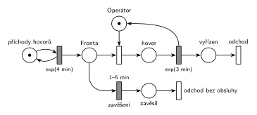

# Příklad s netrpělivou transakcí

## Zadání

> Vymyslete příklad systému hromadné obsluhy typu M/M/1, který bude demonstrovat netrpělivou transakci ve frontě u zařízení. Sestavte jeho model v Petriho síti a SIMLIBu.

Podobné úlohy: [Netrpělivé požadavky](<../01 - Netrpělivé požadavky/01 - Netrpělivé požadavky.md>) (zadaný systém, pevná doba čekání), [Netrpělivý první ve frontě](<../02 - Netrpělivý první ve frontě/02 - Netrpělivý první ve frontě.md>), [Příklad s prioritou procesu](<../../07 - Priority/01 - Příklad s prioritou procesu/01 - Příklad s prioritou procesu.md>).

## Nápověda

<details>
<summary>Zobrazit nápovědu</summary>
<br>

- **Vymyšlený příklad (patří do odpovědi slovy):** Zákaznická linka s jedním operátorem. Hovory přicházejí v intervalech `exp(4 min)`, hovor s operátorem trvá `exp(3 min)`. Každý volající má jinou trpělivost, rovnoměrně 1–5 min. Když ho operátor do té doby nespojí, zavěsí a odchází bez obsluhy.
- Příklad má být konkrétní: pojmenované zařízení (*Operátor*), čísla s jednotkami a jasné, kdy transakce odchází. Stačí jedno M/M/1 a jeden mechanismus, víc úloha nežádá.
- **M/M/1:** *příchody hovorů* ⇄ `exp(4 min)` → *fronta* → *spojení* (bere značku *Operátora*) → *hovor* → `exp(3 min)`, který *Operátora* vrací → *vyřízen* → *odchod*.
- **„Netrpělivá transakce ve frontě u zařízení“** = časovaný přechod přímo na místě *fronta* před zařízením. Každý čekající má vlastní odpočet (slajd 138). Spojení s operátorem značku vezme a odpočet zanikne (slajd 139).
- **Náhodná trpělivost `1–5 min`:** odpočet se losuje pro každou značku zvlášť, takže každý volající čeká jinak dlouho. Proti úloze [Netrpělivé požadavky](<../01 - Netrpělivé požadavky/01 - Netrpělivé požadavky.md>) (pevných 10) to ukazuje, že doba netrpělivosti může být i náhodná. Pevná doba by byla také správně.
- Zavěšení vede do místa *zavěsil* a odtud do výstupního přechodu *odchod bez obsluhy*. **Dva výstupní přechody** (*odchod* a *odchod bez obsluhy*) oddělují vyřízené a zavěšené hovory. V modelu se dají počítat zvlášť, což je u takového příkladu typická otázka (kolik volajících zavěsí).
- **Co netrpělivost není:** odchod hned při obsazeném zařízení (okamžitý přechod s nižší prioritou než obsazení). Transakce pak ve frontě vůbec nečeká; to je odmítnutí (anglicky *balking*), viz cranycrane níže.

</details>

## Petriho síť

<details>
<summary>Zobrazit Petriho síť</summary>
<br>



</details>

## Časté chyby

<details>
<summary>Zobrazit časté chyby</summary>
<br>

- Odmítnutí při obsazené lince místo časovaného odchodu z fronty (viz cranycrane).
- Časovač za obsazením zařízení: omezuje obsluhu, ne čekání ve frontě.
- Příklad bez konkrétních čísel a jednotek, nebo bez řečeného, kdy transakce odchází.
- Netrpělivý odchod bez výstupního přechodu.

</details>

## SIMLIB

<details>
<summary>Zobrazit SIMLIB kód</summary>
<br>

Model je izomorfní k Petriho síti výše: každé místo, přechod a značka mají svůj protějšek v kódu.

```cpp
// Zákaznická linka s netrpělivými volajícími – model v SIMLIB/C++
#include "simlib.h"

Facility Operator("Operátor");         // místo Operátor s jednou značkou
int vyrizeno = 0, zavesilo = 0;        // počty provedení přechodů odchod a odchod bez obsluhy

class Zaveseni : public Event {        // časovaný přechod „zavěšení“ 1–5 min na místě Fronta
  Process *volajici;                   // čí odpočet to je
 public:
  Zaveseni(Process *v) : volajici(v) { Activate(Time + Uniform(1, 5)); }  // vlastní trpělivost
  void Behavior() {
    zavesilo++;
    volajici->Cancel();                // vezme značku z Fronty: zavěsil → odchod bez obsluhy
  }
};

class Hovor : public Process {         // transakce = značka, která prochází sítí
  void Behavior() {
    Event *zaveseni = new Zaveseni(this);  // značka v místě Fronta: odpočet 1–5 min
    Seize(Operator);                   // Fronta + spojení (bere značku Operátora)
    delete zaveseni;                   // spojení vzalo značku z Fronty, odpočet zaniká
    Wait(Exponential(3));              // časovaný přechod exp(3 min) ...
    Release(Operator);                 // ... který vrací značku Operátorovi
    vyrizeno++;
  }                                    // konec Behavior = místo vyřízen + přechod odchod
};

class Generator : public Event {       // místo „příchody hovorů“ ve smyčce s exp(4 min)
  void Behavior() {
    (new Hovor)->Activate();           // nová značka v místě Fronta
    Activate(Time + Exponential(4));   // další hovor
  }
};

int main() {
  Init(0, 60 * 10000);                 // modelový čas v minutách: 10 000 hodin provozu
  (new Generator)->Activate();
  Run();
  Operator.Output();
  Print("Vyřízeno: %d, zavěsilo: %d (%.1f %%)\n", vyrizeno, zavesilo,
        100.0 * zavesilo / (vyrizeno + zavesilo));
}
```

| Petriho síť | SIMLIB |
|---|---|
| *příchody hovorů* ⇄ `exp(4 min)` | událost `Generator`, která se znovu plánuje za `Exponential(4)` |
| značka (volající) | proces `Hovor` |
| *fronta* + *spojení* | `Seize(Operator)` (fronta je vnitřní fronta zařízení) |
| místo *Operátor* (1 značka) | `Facility Operator` |
| časovaný přechod `exp(3 min)` se sloučeným uvolněním | `Wait(Exponential(3)); Release(Operator);` |
| odpočet *zavěšení* `1–5 min` pro značku ve *frontě* | událost `Zaveseni` naplánovaná za `Uniform(1, 5)` před `Seize` |
| spojení vezme značku z *fronty*, odpočet zaniká | `delete zaveseni;` hned po `Seize` |
| provedení *zavěšení* → *zavěsil* → *odchod bez obsluhy* | `volajici->Cancel()`: vyjme proces z fronty a ukončí ho; počítadlo `zavesilo` |
| *vyřízen* → *odchod* | konec metody `Behavior()`; počítadlo `vyrizeno` |

**Kontrola simulací.** Petriho síť: *Operátor* + probíhající hovor = 1, všechny přechody se provádějí, fronta zůstává krátká (nejvýš 7) (`make check`); zavěsilo 26,6 % volajících. SIMLIB model: v jednom běhu (10 000 hodin) zavěsilo 26,7 % volajících a operátor byl vytížen na 54,9 %. Teorie (volající zavěsí, právě když nedokončená práce v systému při jeho příchodu přesáhne jeho trpělivost) dává 26,8 % a vytížení 0,25 · (1 − 0,268) · 3 = 54,9 % (`make simlib`).

</details>

## Původ a zdroje

<details>
<summary>Zobrazit původ a zdroje</summary>
<br>

**Původ:** zkouška 2020/21, 3. termín, skupina C, otázka 2, 20 bodů (podle názvu souboru). Sbírka Řešené výpočetní příklady má stejnou fotku zadání u „2020 - 2. opravný - skupina C“ (další otázka je stejná, 4y'' + 3y' = 0) a ještě jednou u „2019/2020 1. opravný“. Úloha z dvojice „vymyslete příklad“; druhá je [Příklad s prioritou procesu](<../../07 - Priority/01 - Příklad s prioritou procesu/01 - Příklad s prioritou procesu.md>).

**Zdroje:**

- `Fitcheats/Zkoušky z minulých let/2020-21 - 3. termín C.pdf`, str. 2 (fotka zadání)
- `Fitcheats/Příprava na zkoušku/FIT - Řešené výpočetní příklady 2017-21.pdf`, str. 5–6 (studentské řešení „Automat na bagety“: síť a SIMLIB) a str. 31 (jen odkaz na SIMLIB, síť chybí)
- `Fitcheats/Příprava na zkoušku/Bug - Řešené otázky.pdf`, str. 10 (stejná síť jako „Automat na bagety“)
- `Fitcheats/Příprava na zkoušku/cranycrane - Kódy (generátory, Monte Carlo, Euler, RK, Petri + SIMLIB)/petri/4.png` a `4.cpp` (jiný výklad: odmítnutí při obsazené lince)

**Existující řešení:**

- **Řešené výpočetní příklady, str. 5–6, a Bug, str. 10 („Automat na bagety“, „Po 5 minutách čekání člověk odejde z fronty.“):** správně. Časovaný přechod `5m` vede přímo z fronty do místa před výstupním přechodem. Že časovač „visí na celé frontě“, nevadí: podle slajdu 138 má každá značka vlastní odpočet. Všechny přechody jsou ale nakreslené stejně, časované jdou poznat jen podle popisku.
- **Řešené výpočetní příklady, str. 31:** u tohoto zadání je jen odkaz na SIMLIB kód, síť chybí.
- **cranycrane, 4.png a 4.cpp:** jiný výklad. Obsazení linky má `P=1` a okamžitý přechod s nižší prioritou odvede transakci z fronty, kdykoli je linka obsazená (v kódu `if (linka.Busy()) return;`). Transakce tedy vůbec nečeká, odchází hned při příchodu. To je odmítnutí, ne netrpělivost ve frontě: systém se chová jako M/M/1 bez fronty a místo „fronty“ v síti nikdy nedrží značku déle než okamžik. Zadání výslovně říká „netrpělivou transakci ve frontě“, takže tenhle výklad bych u zkoušky nepoužil.

</details>

## Reference

- [Jak síť funguje](<../../../basics/Jak síť funguje.md>)
- [Notace a vzory](<../../../basics/Notace a vzory.md>)

<!-- -->

- [Studijní plán](<../../Studijní plán.md>)
- [Seznam úloh](<../../Seznam úloh.md>)
