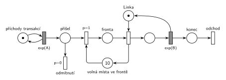

# Fronta omezená na 10

## Zadání

⚠️ Zadání je známé jen z přepisu ve sbírce Příprava 2018-19, originál zkoušky chybí.

> Nakreslete Petriho síť pro systém typu M/M/1 s frontou omezenou na 10 transakcí.

Podobné úlohy: [Netrpělivé požadavky](<../01 - Netrpělivé požadavky/01 - Netrpělivé požadavky.md>) (stejný termín, jiné skupiny), [MM3 bez fronty s opakováním](<../05 - MM3 bez fronty s opakováním/05 - MM3 bez fronty s opakováním.md>) (odmítnutí bez fronty), [Přerušení příchodů při plné frontě](<../../05 - Délka fronty a kapacita/05 - Přerušení příchodů při plné frontě/05 - Přerušení příchodů při plné frontě.md>).

## Nápověda

<details>
<summary>Zobrazit nápovědu</summary>
<br>

- **M/M/1:** *příchody transakcí* ⇄ `exp(A)` → *přišel* → *vstup* → *fronta* → obsazení *Linky* → `exp(B)`, který *Linku* vrací → *konec* → *odchod*. Příchody a obsluha nemají čísla, proto `exp(A)` a `exp(B)`.
- **Plná fronta = odmítnutí:** příchozí transakce čeká v místě *přišel* jen okamžik. *Vstup* má `p=1`, takže se provede vždy, když je volné místo. *Odmítnutí* (`p=0`) přijde na řadu jen při plné frontě a transakce hned opouští systém. Bez priority by se mezi oběma přechody losovalo i při volném místě.
- *Odmítnutí* je výstupní přechod: i odmítnutá transakce opouští systém a má to být vidět.
- **Omezení přes doplňkové místo:** *volná místa ve frontě* s 10 značkami. Vstup do *fronty* jednu značku vezme, obsazení *Linky* ji vrátí. Platí *fronta* + *volná místa ve frontě* = 10. Kapacita místa (`c=10`) se v kurzové notaci nepoužívá.
- **Do fronty se počítají jen čekající**, obsluhovaná transakce ne. Kdyby se mělo omezit 10 transakcí v celém systému, vracela by značku až dokončená obsluha (`exp(B)`).

</details>

## Petriho síť

<details>
<summary>Zobrazit Petriho síť</summary>
<br>



</details>

## Časté chyby

<details>
<summary>Zobrazit časté chyby</summary>
<br>

- Kapacita místa místo doplňkového místa.
- Značka doplňku vrácená až koncem obsluhy, i když se omezuje jen fronta (pak je limit 10 na celý systém, ne na frontu).
- Vstup a odmítnutí bez priorit: transakce by byla odmítnuta i při volném místě.
- Odmítnutá transakce, která zůstane viset v místě, nebo zmizí bez výstupního přechodu.

</details>

## SIMLIB

<details>
<summary>Zobrazit SIMLIB kód</summary>
<br>

Model je izomorfní k Petriho síti výše: každé místo, přechod a značka mají svůj protějšek v kódu. Hodnoty `A = 5` a `B = 6` jsou doplněné, zadání je nedává. Linka je `Facility` (místo s jednou značkou), ne `Store`; na to míří poznámka „pozor na volbu typu příslušné obslužné linky“.

```cpp
// Fronta omezená na 10 – model v SIMLIB/C++
#include "simlib.h"

const double A = 5;                    // střední interval příchodů exp(A)
const double B = 6;                    // střední doba obsluhy exp(B) (přetížená linka)

Facility Linka("Linka");               // místo Linka s jednou značkou
Store Volno("Volná místa ve frontě", 10);  // doplněk Fronty: 10 značek
int obslouzeno = 0, odmitnuto = 0;     // počty provedení přechodů odchod a odmítnutí

class Transakce : public Process {     // transakce = značka, která prochází sítí
  void Behavior() {
    if (Volno.Full()) {                // místo přišel: vstup p=1 nemůže, provede se odmítnutí p=0
      odmitnuto++;
      return;                          // přechod odmítnutí (odchod ze systému)
    }
    Enter(Volno, 1);                   // vstup p=1: bere značku volného místa → Fronta
    Seize(Linka);                      // Fronta + obsazení (bere značku Linky) ...
    Leave(Volno, 1);                   // ... a vrací značku volného místa
    Wait(Exponential(B));              // časovaný přechod exp(B) ...
    Release(Linka);                    // ... který vrací značku Lince
    obslouzeno++;
  }                                    // konec Behavior = místo konec + přechod odchod
};

class Generator : public Event {       // místo „příchody transakcí“ ve smyčce s exp(A)
  void Behavior() {
    (new Transakce)->Activate();       // nová značka v místě přišel
    Activate(Time + Exponential(A));   // další příchod
  }
};

int main() {
  Init(0, 1000000);                    // modelový čas v časových jednotkách
  (new Generator)->Activate();
  Run();
  Linka.Output();                      // fronta linky = místo Fronta (nejvýš 10)
  Volno.Output();
  Print("Obslouženo: %d, odmítnuto: %d (%.1f %%)\n", obslouzeno, odmitnuto,
        100.0 * odmitnuto / (obslouzeno + odmitnuto));
}
```

| Petriho síť | SIMLIB |
|---|---|
| *příchody transakcí* ⇄ `exp(A)` | událost `Generator`, která se znovu plánuje za `Exponential(A)` |
| značka (transakce) v místě *přišel* | nový proces `Transakce` na začátku `Behavior()` |
| *volná místa ve frontě* (10 značek) | `Store Volno(10)`: volná kapacita = značky v místě, obsazená = transakce ve *frontě* |
| *odmítnutí* `p=0` | `if (Volno.Full()) { …; return; }` |
| *vstup* `p=1` | `Enter(Volno, 1)` (při volném místě nečeká) |
| *fronta* + obsazení *Linky*, které vrací volné místo | `Seize(Linka); Leave(Volno, 1);` |
| místo *Linka* (1 značka), `exp(B)` se sloučeným uvolněním | `Facility Linka`, `Wait(Exponential(B)); Release(Linka);` |
| *konec* → *odchod* | konec metody `Behavior()` |

Bez doplňkového skladu by stačila podmínka `if (Linka.QueueLen() >= 10)`, která přímo testuje délku fronty linky; `Store Volno` je ale přesný protějšek místa *volná místa ve frontě*.

**Kontrola simulací.** Petriho síť: *fronta* + *volná místa ve frontě* = 10, *Linka* + obsluhovaná transakce = 1, všechny přechody se provádějí (`make check`); s přetíženou linkou (`A = 5`, `B = 6`) se fronta často zaplní a odmítnuto bylo 18,7 % příchozích. SIMLIB model: v jednom běhu (10⁶ časových jednotek) bylo odmítnuto 18,6 % transakcí, linka byla vytížena na 97,5 % a ve frontě čekalo průměrně 6,5 transakce. Teorie (M/M/1/11, ρ = 1,2: 10 míst ve frontě a 1 v obsluze) dává pravděpodobnost odmítnutí (1 − ρ)ρ¹¹ / (1 − ρ¹²) = 18,8 %, vytížení 97,5 % a průměrnou frontu 6,5 (`make simlib`).

</details>

## Původ a zdroje

<details>
<summary>Zobrazit původ a zdroje</summary>
<br>

**Původ:** zkouška 2017/18, 1. termín, skupina 8C, otázka 1, 15 bodů.

**Původní znění:**

> a) Nakreslete Petriho síť pro systém typu M/M/1 s frontou omezenou na 10 transakcí
> b) Napište program v SIMLIBU pro systém z předchozího bodu (pozor na volbu typu příslušné obslužné linky)

**Zdroje:**

- `Fitcheats/Příprava na zkoušku/FIT - Příprava 2018-19.pdf`, str. 32–33 (opsané zadání, studentská síť a SIMLIB)
- `Fitcheats/Příprava na zkoušku/xenix - Příprava.pdf`, str. 26 („M/M/1 s frontou omezenou na 10 transakcí“, síť)

**Existující řešení:**

- **Příprava 2018-19, str. 32–33 („Prosim o kontrolu (MK)“):** místo za generátorem, z něj přechod `p=1` do místa fronty s poznámkou `c=10` a druhý přechod dolů jako odmítnutí. Funkčně správně, ale omezení je zapsané kapacitou místa. To kurzová notace nepoužívá; doplňkové místo s 10 značkami je čitelnější a je hned vidět, kdo místo ve frontě uvolňuje. Místo linky je popsané „Obsluha“.
- **xenix, str. 26:** stejná síť jako tady: doplňkové místo `10`, vstup `p=1`, obsazení linky vrací značku do `10`, odmítnutí s nižší prioritou bez výstupu. Okamžité přechody jsou tu černé a časované bílé, tedy opačně než na slajdech, kde jsou časované vyplněné.

</details>

## Reference

- [Jak síť funguje](<../../../basics/Jak síť funguje.md>)
- [Notace a vzory](<../../../basics/Notace a vzory.md>)
- [Seznam úloh](<../../Seznam úloh.md>)
