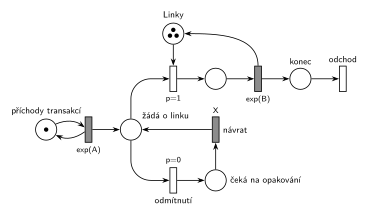

# MM3 bez fronty s opakováním

Úloha 02/05

## Zadání

> Mějme systém M/M/3 bez fronty. Neobsloužené transakce se do systému vrací po X časových jednotkách. Systém modelujte pomocí Petriho sítě.

Podobné úlohy: [Fronta omezená na 10](<../04 - Fronta omezená na 10/04 - Fronta omezená na 10.md>) (odmítnutí při plné frontě, bez návratu), [MM3 – zastavení příchodů](<../../05 - Délka fronty a kapacita/06 - MM3 – zastavení příchodů/06 - MM3 – zastavení příchodů.md>) (M/M/3 jako místo se 3 značkami).

## Nápověda

<details>
<summary>Zobrazit nápovědu</summary>
<br>

- **M/M/3:** *příchody transakcí* ⇄ `exp(A)` → *žádá o linku* → *obsazení* (bere značku *Linek*) → `exp(B)`, který linku vrací → *konec* → *odchod*. Příchody a obsluha nemají čísla, proto `exp(A)` a `exp(B)`.
- **Tři linky = jedno místo *Linky* se 3 značkami** (Store s kapacitou 3). Obsazení bere jednu značku, konec obsluhy ji vrací.
- **Bez fronty:** transakce v místě *žádá o linku* nečeká. *Obsazení* má `p=1`, takže pokud je některá linka volná, transakce ji hned obsadí. Jinak se provede *odmítnutí* (`p=0`).
- **Návrat po X:** odmítnutá transakce jde do *čeká na opakování* a časovaný přechod *návrat* `X` ji vrátí do *žádá o linku*. Doba je pevná („po X časových jednotkách“), ne `exp(X)`. Každá čekající značka má vlastní odpočet (slajd 138), takže na návrat může čekat víc transakcí najednou.
- Vrácená transakce prochází stejným rozhodnutím: když jsou linky zase obsazené, odejde znovu na X. Počet pokusů zadání neomezuje.
- Odmítnutá transakce systém **neopouští** (vrací se), takže za *odmítnutím* není výstupní přechod. Jediný výstup je po obsluze.

</details>

## Petriho síť

<details>
<summary>Zobrazit Petriho síť</summary>
<br>



</details>

## Časté chyby

<details>
<summary>Zobrazit časté chyby</summary>
<br>

- Chybějící odmítnutí: transakce pak v *žádá o linku* čekají na uvolnění linky, což je M/M/3 s frontou.
- Odmítnutí se stejnou prioritou jako obsazení: losovalo by se i při volné lince.
- Tři samostatné linky bez důvodu (zadání nerozlišuje, která linka obslouží).
- `exp(X)` místo pevné doby X.
- Odmítnutá transakce poslaná na výstup: zadání říká, že se vrací.

</details>

## SIMLIB

<details>
<summary>Zobrazit SIMLIB kód</summary>
<br>

Model je izomorfní k Petriho síti výše: každé místo, přechod a značka mají svůj protějšek v kódu. Hodnoty `A = 3`, `B = 5` a `X = 4` jsou doplněné, zadání je nedává.

```cpp
// M/M/3 bez fronty s opakováním – model v SIMLIB/C++
#include "simlib.h"

const double A = 3;                    // střední interval příchodů exp(A)
const double B = 5;                    // střední doba obsluhy exp(B)
const double X = 4;                    // doba do opakování (pevná)

Store Linky("Linky", 3);               // místo Linky se 3 značkami (M/M/3)
int pokusu = 0, odmitnuto = 0;         // počty provedení přechodů obsazení + odmítnutí a odmítnutí

class Transakce : public Process {     // transakce = značka, která prochází sítí
  void Behavior() {
    pokusu++;                          // značka v místě žádá o linku
    while (Linky.Full()) {             // obsazení p=1 nemůže, provede se odmítnutí p=0
      odmitnuto++;
      Wait(X);                         // čeká na opakování + časovaný přechod návrat X
      pokusu++;                        // zpět v místě žádá o linku
    }
    Enter(Linky, 1);                   // obsazení p=1 (bere značku linky, nikdy nečeká)
    Wait(Exponential(B));              // časovaný přechod exp(B) ...
    Leave(Linky, 1);                   // ... který vrací značku linky
  }                                    // konec Behavior = místo konec + přechod odchod
};

class Generator : public Event {       // místo „příchody transakcí“ ve smyčce s exp(A)
  void Behavior() {
    (new Transakce)->Activate();       // nová značka v místě žádá o linku
    Activate(Time + Exponential(A));   // další příchod
  }
};

int main() {
  Init(0, 1000000);                    // modelový čas v časových jednotkách
  (new Generator)->Activate();
  Run();
  Linky.Output();                      // fronta skladu zůstane prázdná: systém bez fronty
  Print("Pokusů o linku: %d, odmítnuto: %d (%.1f %%)\n", pokusu, odmitnuto,
        100.0 * odmitnuto / pokusu);
}
```

| Petriho síť | SIMLIB |
|---|---|
| *příchody transakcí* ⇄ `exp(A)` | událost `Generator`, která se znovu plánuje za `Exponential(A)` |
| značka (transakce) v *žádá o linku* | proces `Transakce` na začátku `Behavior()` a po každém návratu |
| místo *Linky* (3 značky) | `Store Linky(3)` |
| *odmítnutí* `p=0` (všechny linky obsazené) | podmínka cyklu `while (Linky.Full())` |
| *čeká na opakování* → *návrat* `X` → *žádá o linku* | `Wait(X);` a další průchod cyklem |
| *obsazení* `p=1` | `Enter(Linky, 1)` (cyklus skončí jen při volné lince, takže nikdy nečeká) |
| `exp(B)`, který linku vrací | `Wait(Exponential(B)); Leave(Linky, 1);` |
| *konec* → *odchod* | konec metody `Behavior()` |

**Kontrola simulací.** Petriho síť: *Linky* + obsluhované transakce = 3, v *žádá o linku* nikdy víc než jedna značka, tedy nikdo tam nečeká (`make check`); při `A = 3`, `B = 5`, `X = 4` bylo odmítnuto 36,1 % pokusů. SIMLIB model: v jednom běhu (10⁶ časových jednotek) bylo odmítnuto 35,9 % pokusů a v průměru byly obsazené 1,67 linky. Protože se nakonec obslouží každá transakce, má to být přesně λ · B = 5 / 3 ≈ 1,67 (`make simlib`).

</details>

## Původ a zdroje

<details>
<summary>Zobrazit původ a zdroje</summary>
<br>

**Původ:** zkouška 2023/24, 1. termín, skupina B, otázka 3, 10 bodů. Zadání je známé z ručního opisu (čitelného).

**Zdroje:**

- `Fitcheats/Zkoušky z minulých let/2023-24 - 1. termín B.pdf`, str. 1 (ručně opsané zadání)
- `Fitcheats/Příprava na zkoušku/cranycrane - Kódy (generátory, Monte Carlo, Euler, RK, Petri + SIMLIB)/petri/6.png` a `6.cpp` (studentská síť a SIMLIB; zadání je jen v komentáři kódu)

**Existující řešení:**

- **cranycrane, 6.png:** stejná struktura: obsazení `p=1` z místa se 3 značkami, přechod s nižší prioritou do místa čekání a zpět časovaným přechodem. Chyby:
  - návrat má čas `Exp(x)`, ale zadání chce pevnou dobu X (kód `6.cpp` má správně `Wait(X)`, síť a kód si tedy neodpovídají);
  - po obsluze končí síť místem bez výstupního přechodu, není vidět, kde transakce opouští systém;
  - přechod odmítnutí nemá napsanou prioritu (implicitně 0, to stačí, ale u zkoušky je lepší ji napsat).

</details>

## Reference

- [Jak síť funguje](<../../../basics/Jak síť funguje.md>)
- [Notace a vzory](<../../../basics/Notace a vzory.md>)

<!-- -->

- [Studijní plán](<../../Studijní plán.md>)
- [Seznam úloh](<../../Seznam úloh.md>)
