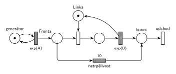

# 02–01 – Netrpělivé požadavky

## Zadání

⚠️ Zadání 2023/24 je známé jen z ručního opisu na čtverečkovaném papíře; slovosled druhé věty není úplně jistý.

> Mějme systém M/M/1 s netrpělivými požadavky. Transakce po 10 časových jednotkách čekání ve frontě opouští bez obsluhy systém. Systém modelujte prostředky petriho sítě.

Zkouška 2017/18, skupina 8H (sken):

> (a) Nakreslete Petriho síť pro systém typu M/M/1 s netrpělivými požadavky (požadavek čeká nanejvýš 20 časových jednotek) (b) Napište program v SIMLIBu pro systém z přechozího bodu (Pozor na volbu typu obslužné linky!).

Skupina 7A má stejné znění s „nanejvýš 10 časových jednotek“.

Podobné úlohy: [02–02 – Netrpělivý první ve frontě](<../02–02 - Netrpělivý první ve frontě/02–02 - Netrpělivý první ve frontě.md>) (netrpělivý je jen první ve frontě), [02–03 – Příklad s netrpělivou transakcí](<../02–03 - Příklad s netrpělivou transakcí/02–03 - Příklad s netrpělivou transakcí.md>) (vlastní příklad), [09–10 – Kopírovací centrum](<../09–10 - Kopírovací centrum/09–10 - Kopírovací centrum.md>) (netrpělivost ve slovní úloze).

## Interpretace

Zobrazit interpretaci (nápověda)

- **Netrpělivost = časovaný přechod `10` přímo na místě *Fronta*.** Běžný časovaný přechod má pro každou značku ve vstupním místě vlastní odpočet (slajd 138), takže každý čekající odchází po 10 jednotkách svého čekání. Kdo se dřív dostane k lince, tomu okamžité obsazení vezme značku a jeho odpočet zanikne (slajd 139).
- **Měří se čekání ve frontě, ne obsluha.** Transakce v obsluze už netrpělivá není, proto časovač nesmí začínat až obsazením linky.
- **Doba čekání je pevná** („nanejvýš 10“), tedy `10`, ne `exp(10)`. Jednotky zadání neuvádí, takže se nepíšou.
- Příchody a obsluha nemají v zadání čísla, proto symboly `exp(A)` a `exp(B)`.
- Obsloužené i netrpělivé transakce tu odcházejí stejným přechodem *odchod*. Dva samostatné výstupní přechody jsou také správně (hodí se, když se mají počítat zvlášť).
- SIMLIB část otázky tu není řešená.

## Řešení

Zobrazit řešení

| Požadavek | Prvek sítě |
|---|---|
| M/M/1 | *generátor* ⇄ `exp(A)` → *Fronta* → obsazení *Linky* → `exp(B)` (vrací *Linku*) → *odchod* |
| transakce čeká ve frontě nejvýš 10 | *netrpělivost* `10` z *Fronty* do *konec* |
| odchod bez obsluhy | *netrpělivost* → *konec* → *odchod* |

Kontrola simulací: *Linka* + obsluhovaná transakce = 1. Při `A = 10`, `B = 8` odešla bez obsluhy zhruba čtvrtina transakcí, fronta zůstala krátká (nejvýš 6).

Pro variantu 2017/18 8H stačí přepsat `10` na `20`.

## Časté chyby

Zobrazit časté chyby

- Časovač za obsazením linky (omezuje obsluhu, ne čekání).
- Netrpělivá větev, která vezme i značku *Linky* nebo ji nevrátí.
- `exp(10)` místo pevné doby `10`, případně jednotky (`10 s`), které zadání nemá.
- Netrpělivý přechod bez pokračování k výstupnímu přechodu: od roku 2022 se vyžaduje přechodem ukázat, kde transakce opouští systém.
- Odmítnutí při obsazené lince (okamžitý přechod s nižší prioritou místo časovaného): to je jiné chování, transakce vůbec nečeká.

## Původ a zdroje

**Původ:** zkouška 2023/24, 1. termín, skupina A, otázka 3, 10 bodů. Stejná úloha (jiná čísla, navíc SIMLIB, 15 bodů): zkouška 2017/18, 1. termín, skupina 8H (5. 1. 2018, čekání nejvýš 20) a skupina 7A (čekání nejvýš 10).

**Zdroje:**

- `Fitcheats/Zkoušky z minulých let/2023-24 - 1. termín A.pdf` (ručně opsané zadání, otázka 3)
- `Fitcheats/Zkoušky z minulých let/2017-18 - 1. termín A.pdf` (sken zadání skupiny 8H, otázka 1)
- `Fitcheats/Zkoušky z minulých let/2017-18 - 1. termín A.txt` (přepis zadání s 10 jednotkami, otázka 1)
- `Fitcheats/Příprava na zkoušku/FIT - Příprava 2018-19.pdf`, str. 18–19 (skupina 7A: studentská síť a SIMLIB) a str. 28 (skupina 8H: studentská síť)
- `Fitcheats/Příprava na zkoušku/xenix - Příprava.pdf`, str. 26 („M/M/1 s netrpělivými požadavky (čeká X)“, chybná síť)

**Existující řešení:**

Zobrazit existující řešení

- **Příprava 2018-19, str. 18–19 (7A):** stejná síť, netrpělivost vede do samostatného místa a výstupního přechodu. Čas je ale napsaný jako `10s`; komentář: „Bacha na jednotky u toho netrpělivého přechodu, tam aby asi sekundy být neměly (není specifikováno), jinak je to správně. (+3)“.
- **Příprava 2018-19, str. 28 (8H):** stejná síť s časovačem na frontě a dvěma výstupy, správně.
- **xenix, str. 26:** chybné. Časovač `X č.j.` začíná až přechodem obsazení linky (ten dává značku zároveň do obsluhy i do časovače), takže omezuje dobu obsluhy, ne čekání ve frontě. Navíc větev po vypršení časovače nevrací značku linky: po prvním vypršení se linka ztratí a systém se zastaví.

