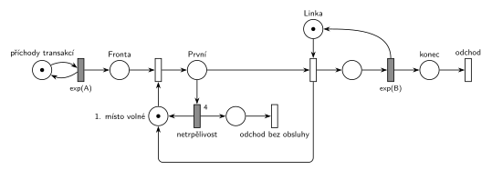

# 02–02 – Netrpělivý první ve frontě

## Zadání

> Mějme SHO typu M/M/1. Fronta k lince má to specifikum, že transakce, která je první ve frontě, je netrpělivá, takže po 4 časových jednotkách čekání frontu (a systém celkově) opouští. Systém modelujte Petriho sítí.

2019/20, skupina Y: „Systém typu M/M/1 s tím specifikem, že vždy transakce, která je prvním prvkem fronty, je netrpělivá a po X č.j. čekání opouští systém.“

⚠️ Zadání 2017/18 je jen ze vzpomínky studenta (slovensky): „Petriho siet m/m/1 (automat na kafe). Fronta bola specificka tym, ze vzdy jej prvy clen je netrpezlivy, a ak nedostane linku do 5 casovych jednotiek, opusta system. (bola tam napoveda, ze sa da fronta rozlozit do 2 miest PS).“

Podobné úlohy: [02–01 – Netrpělivé požadavky](<../02–01 - Netrpělivé požadavky/02–01 - Netrpělivé požadavky.md>) (netrpěliví jsou všichni čekající), [09–20 – Pražírna kávy](<../09–20 - Pražírna kávy/09–20 - Pražírna kávy.md>) (stejný mechanismus ve slovní úloze).

## Interpretace

Zobrazit interpretaci (nápověda)

- **Fronta rozdělená do dvou míst** (nápověda z roku 2017/18): *Fronta* pro ostatní čekající a *První* pro transakci v čele. Časovaný přechod `4` visí jen na místě *První*. Kdyby visel na *Frontě*, měl by vlastní odpočet každý čekající (slajd 138) a šlo by o [02–01](<../02–01 - Netrpělivé požadavky/02–01 - Netrpělivé požadavky.md>).
- **Doplněk *1. místo volné*** (1 značka) zajistí, že v *První* je nejvýš jedna transakce. Bez něj by přechod *postup* přesunul do *První* celou frontu.
- Značku doplňku vrací **obsazení linky** (obsluhovaná transakce už ve frontě není a v čele je hned další) a **netrpělivý odchod**.
- **Odpočet začíná, až se transakce dostane do čela.** Na „4 časové jednotky čekání“ se počítá jen čekání v čele, předchozí čekání ve *Frontě* ne. Jiné čtení (celková doba čekání) se v Petriho síti modeluje špatně a nápověda o dvou místech míří na toto řešení.
- Když je linka volná, transakce projde *První* a obsadí linku ve stejném okamžiku. Odpočet se vůbec nerozběhne.
- Doba je pevná: `4` (2017/18: `5`, 2019/20: `X`). Příchody a obsluha nemají čísla, proto `exp(A)` a `exp(B)`.

## Řešení

Zobrazit řešení

| Požadavek | Prvek sítě |
|---|---|
| M/M/1 | *generátor* ⇄ `exp(A)` → *Fronta* → … → obsazení *Linky* → `exp(B)` (vrací *Linku*) → *odchod* |
| první ve frontě zvlášť | *postup* (bere *1. místo volné*) → *První* |
| po 4 jednotkách v čele opouští systém | *netrpělivost* `4` z *První* → *konec* a zpět *1. místo volné* |
| obsazení linky uvolní čelo fronty | obsazení *Linky* vrací *1. místo volné* |
| transakce opouští systém | *odchod* |

Kontrola simulací: *Linka* + obsluhovaná transakce = 1, *1. místo volné* + *První* = 1. Při `A = 5`, `B = 4` odešla bez obsluhy asi čtvrtina transakcí.

## Časté chyby

Zobrazit časté chyby

- Časovač přímo na *Frontě*: netrpěliví jsou pak všichni čekající, ne jen první.
- Místo *První* bez doplňku: do čela se přesune celá fronta a odpočet běží všem.
- Značka doplňku vrácená až koncem obsluhy: během obsluhy pak v čele nikdo není a čekající nejsou netrpěliví vůbec.
- Netrpělivý odchod, který nevrátí značku doplňku: čelo fronty se zablokuje a síť se zastaví.
- Časovač za obsazením linky (omezuje obsluhu, ne čekání).

## Původ a zdroje

**Původ:** zkouška 2024/25, 2. termín (20. 1. 2025), skupina E, otázka 3, 10 bodů. Stejná úloha (jiná čísla): zkouška 2019/20, 2. termín, skupina Y, otázka 3, 10 bodů (X č. j.) a zkouška 2017/18, 2. termín, skupina A, otázka 1, 10 bodů (automat na kávu, 5 jednotek).

**Zdroje:**

- `Fitcheats/Zkoušky z minulých let/2024-25 - 2. termín E.pdf`, str. 2 (fotka zadání se studentským řešením)
- `Fitcheats/Zkoušky z minulých let/2019-20 - 2. termín Y.pdf`, str. 2 (fotka zadání)
- `Fitcheats/Zkoušky z minulých let/2017-18 - 2. termín A.txt` (vzpomínka studenta, otázka 1)

**Existující řešení:**

Zobrazit existující řešení

- **Studentské řešení na zkouškovém archu 2024/25 E** (bez bodového hodnocení): stejná struktura jako tady. Fronta je rozdělená do dvou míst, místo se značkou pod přechodem *postup* funguje jako *1. místo volné* a vrací se z obsazení linky i z přechodu `4 jč.`. Netrpělivý odchod vede do místa před výstupním přechodem. Výhrady jsou jen k notaci: všechny přechody jsou nakreslené stejně jako tenké čárky, takže časované (`EXP(x)`, `EXP(Y)`, `4 jč.`) jdou poznat jen podle popisku, a místa nemají názvy.
- K zadáním 2017/18 a 2019/20 žádné řešení není.

