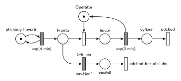

# 02–03 – Příklad s netrpělivou transakcí

## Zadání

> Vymyslete příklad systému hromadné obsluhy typu M/M/1, který bude demonstrovat netrpělivou transakci ve frontě u zařízení. Sestavte jeho model v Petriho síti a SIMLIBu.

Podobné úlohy: [02–01 – Netrpělivé požadavky](<../02–01 - Netrpělivé požadavky/02–01 - Netrpělivé požadavky.md>) (zadaný systém, pevná doba čekání), [02–02 – Netrpělivý první ve frontě](<../02–02 - Netrpělivý první ve frontě/02–02 - Netrpělivý první ve frontě.md>), [07–01 – Příklad s prioritou procesu](<../07–01 - Příklad s prioritou procesu/07–01 - Příklad s prioritou procesu.md>).

## Interpretace

Zobrazit interpretaci (nápověda)

 

- **Vymyšlený příklad (patří do odpovědi slovy):** Zákaznická linka s jedním operátorem. Hovory přicházejí v intervalech `exp(4 min)`, hovor s operátorem trvá `exp(3 min)`. Každý volající má jinou trpělivost, rovnoměrně 1–5 min. Když ho operátor do té doby nespojí, zavěsí a odchází bez obsluhy.
- Příklad má být konkrétní: pojmenované zařízení (*Operátor*), čísla s jednotkami a jasné, kdy transakce odchází. Stačí jedno M/M/1 a jeden mechanismus, víc úloha nežádá.
- **„Netrpělivá transakce ve frontě u zařízení“** = časovaný přechod přímo na místě *Fronta* před zařízením. Každý čekající má vlastní odpočet (slajd 138). Spojení s operátorem značku vezme a odpočet zanikne (slajd 139).
- **Náhodná trpělivost `1–5 min`:** odpočet se losuje pro každou značku zvlášť, takže každý volající čeká jinak dlouho. Proti [02–01](<../02–01 - Netrpělivé požadavky/02–01 - Netrpělivé požadavky.md>) (pevných 10) to ukazuje, že doba netrpělivosti může být i náhodná. Pevná doba by byla také správně.
- **Dva výstupní přechody** (*odchod* a *odchod bez obsluhy*) oddělují vyřízené a zavěšené hovory. V modelu se dají počítat zvlášť, což je u takového příkladu typická otázka (kolik volajících zavěsí).
- **Co netrpělivost není:** odchod hned při obsazeném zařízení (okamžitý přechod s nižší prioritou než obsazení). Transakce pak ve frontě vůbec nečeká; to je odmítnutí (anglicky *balking*), viz cranycrane níže.
- SIMLIB část otázky tu není řešená.

## Petriho síť

Zobrazit Petriho síť

 

| Požadavek | Prvek sítě |
|---|---|
| M/M/1: hovory `exp(4 min)`, jeden operátor, hovor `exp(3 min)` | *generátor* ⇄ `exp(4 min)` → *Fronta* → obsazení *Operátora* → `exp(3 min)` (vrací *Operátora*) |
| netrpělivý volající ve frontě | *zavěšení* `1–5 min` přímo z *Fronty* |
| vyřízený hovor opouští systém | *vyřízen* → *odchod* |
| zavěšený hovor opouští systém | *zavěsil* → *odchod bez obsluhy* |

Kontrola simulací: *Operátor* + probíhající hovor = 1, fronta krátká (nejvýš 6). Zavěsilo asi 28 % volajících.

## Časté chyby

Zobrazit časté chyby

 

- Odmítnutí při obsazené lince místo časovaného odchodu z fronty (viz cranycrane).
- Časovač za obsazením zařízení: omezuje obsluhu, ne čekání ve frontě.
- Příklad bez konkrétních čísel a jednotek, nebo bez řečeného, kdy transakce odchází.
- Netrpělivý odchod bez výstupního přechodu.

## Původ a zdroje

Zobrazit původ a zdroje

 

**Původ:** zkouška 2020/21, 3. termín, skupina C, otázka 2, 20 bodů (podle názvu souboru). Sbírka Řešené výpočetní příklady má stejnou fotku zadání u „2020 - 2. opravný - skupina C“ (další otázka je stejná, 4y'' + 3y' = 0) a ještě jednou u „2019/2020 1. opravný“. Úloha z dvojice „vymyslete příklad“; druhá je [07–01 – Příklad s prioritou procesu](<../07–01 - Příklad s prioritou procesu/07–01 - Příklad s prioritou procesu.md>).

**Zdroje:**

- `Fitcheats/Zkoušky z minulých let/2020-21 - 3. termín C.pdf`, str. 2 (fotka zadání)
- `Fitcheats/Příprava na zkoušku/FIT - Řešené výpočetní příklady 2017-21.pdf`, str. 5–6 (studentské řešení „Automat na bagety“: síť a SIMLIB) a str. 31 (jen odkaz na SIMLIB, síť chybí)
- `Fitcheats/Příprava na zkoušku/Bug - Řešené otázky.pdf`, str. 10 (stejná síť jako „Automat na bagety“)
- `Fitcheats/Příprava na zkoušku/cranycrane - Kódy (generátory, Monte Carlo, Euler, RK, Petri + SIMLIB)/petri/4.png` a `4.cpp` (jiný výklad: odmítnutí při obsazené lince)

**Existující řešení:**

- **Řešené výpočetní příklady, str. 5–6, a Bug, str. 10 („Automat na bagety“, „Po 5 minutách čekání člověk odejde z fronty.“):** správně. Časovaný přechod `5m` vede přímo z fronty do místa před výstupním přechodem. Že časovač „visí na celé frontě“, nevadí: podle slajdu 138 má každá značka vlastní odpočet. Všechny přechody jsou ale nakreslené stejně, časované jdou poznat jen podle popisku.
- **Řešené výpočetní příklady, str. 31:** u tohoto zadání je jen odkaz na SIMLIB kód, síť chybí.
- **cranycrane, 4.png a 4.cpp:** jiný výklad. Obsazení linky má `P=1` a okamžitý přechod s nižší prioritou odvede transakci z fronty, kdykoli je linka obsazená (v kódu `if (linka.Busy()) return;`). Transakce tedy vůbec nečeká, odchází hned při příchodu. To je odmítnutí, ne netrpělivost ve frontě: systém se chová jako M/M/1 bez fronty a místo „fronty“ v síti nikdy nedrží značku déle než okamžik. Zadání výslovně říká „netrpělivou transakci ve frontě“, takže tenhle výklad bych u zkoušky nepoužil.

