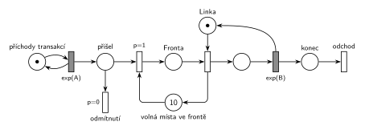

# 02–04 – Fronta omezená na 10

## Zadání

⚠️ Zadání je známé jen z přepisu ve sbírce Příprava 2018-19, originál zkoušky chybí.

> a) Nakreslete Petriho síť pro systém typu M/M/1 s frontou omezenou na 10 transakcí
> b) Napište program v SIMLIBU pro systém z předchozího bodu (pozor na volbu typu příslušné obslužné linky)

Podobné úlohy: [02–01 – Netrpělivé požadavky](<../02–01 - Netrpělivé požadavky/02–01 - Netrpělivé požadavky.md>) (stejný termín, jiné skupiny), [02–05 – MM3 bez fronty s opakováním](<../02–05 - MM3 bez fronty s opakováním/02–05 - MM3 bez fronty s opakováním.md>) (odmítnutí bez fronty), [05–05 – Přerušení příchodů při plné frontě](<../05–05 - Přerušení příchodů při plné frontě/05–05 - Přerušení příchodů při plné frontě.md>).

## Interpretace

Zobrazit interpretaci (nápověda)

 

- **Omezení přes doplňkové místo:** *volná místa ve frontě* s 10 značkami. Vstup do *Fronty* jednu značku vezme, obsazení *Linky* ji vrátí. Platí *Fronta* + *volná místa ve frontě* = 10. Kapacitu místa (`c=10`) Hrubý nepoužívá.
- **Do fronty se počítají jen čekající**, obsluhovaná transakce ne. Kdyby se mělo omezit 10 transakcí v celém systému, vracela by značku až dokončená obsluha (`exp(B)`).
- **Plná fronta = odmítnutí:** příchozí transakce čeká v místě *přišel* jen okamžik. *Vstup* má `p=1`, takže se provede vždy, když je volné místo. *Odmítnutí* (`p=0`) přijde na řadu jen při plné frontě a transakce hned opouští systém. Bez priority by se mezi oběma přechody losovalo i při volném místě.
- *Odmítnutí* je výstupní přechod: i odmítnutá transakce opouští systém a má to být vidět.
- Příchody a obsluha nemají čísla, proto `exp(A)` a `exp(B)`.
- SIMLIB část otázky tu není řešená.

## Petriho síť

Zobrazit Petriho síť

 

| Požadavek | Prvek sítě |
|---|---|
| M/M/1 | *generátor* ⇄ `exp(A)` → … → *Fronta* → obsazení *Linky* → `exp(B)` (vrací *Linku*) → *odchod* |
| fronta nejvýš 10 | *volná místa ve frontě* (10): *vstup* bere, obsazení *Linky* vrací |
| při plné frontě transakce odchází | *odmítnutí* (`p=0`, bez výstupu) |
| transakce opouští systém | *odchod*, *odmítnutí* |

Kontrola simulací: *Fronta* + *volná místa ve frontě* = 10, *Linka* + obsluhovaná transakce = 1. S přetíženou linkou (`A = 5`, `B = 6`) se fronta často zaplní a asi 18 % příchozích je odmítnuto.

## Časté chyby

Zobrazit časté chyby

 

- Kapacita místa místo doplňkového místa.
- Značka doplňku vrácená až koncem obsluhy, i když se omezuje jen fronta (pak je limit 10 na celý systém, ne na frontu).
- Vstup a odmítnutí bez priorit: transakce by byla odmítnuta i při volném místě.
- Odmítnutá transakce, která zůstane viset v místě, nebo zmizí bez výstupního přechodu.

## Původ a zdroje

Zobrazit původ a zdroje

 

**Původ:** zkouška 2017/18, 1. termín, skupina 8C, otázka 1, 15 bodů.

**Zdroje:**

- `Fitcheats/Příprava na zkoušku/FIT - Příprava 2018-19.pdf`, str. 32–33 (opsané zadání, studentská síť a SIMLIB)
- `Fitcheats/Příprava na zkoušku/xenix - Příprava.pdf`, str. 26 („M/M/1 s frontou omezenou na 10 transakcí“, síť)

**Existující řešení:**

- **Příprava 2018-19, str. 32–33 („Prosim o kontrolu (MK)“):** místo za generátorem, z něj přechod `p=1` do místa fronty s poznámkou `c=10` a druhý přechod dolů jako odmítnutí. Funkčně správně, ale omezení je zapsané kapacitou místa. To kurzová notace nepoužívá; doplňkové místo s 10 značkami je čitelnější a je hned vidět, kdo místo ve frontě uvolňuje. Místo linky je popsané „Obsluha“.
- **xenix, str. 26:** stejná síť jako tady: doplňkové místo `10`, vstup `p=1`, obsazení linky vrací značku do `10`, odmítnutí s nižší prioritou bez výstupu. Okamžité přechody jsou tu černé a časované bílé, tedy opačně než na slajdech, kde jsou časované vyplněné.

