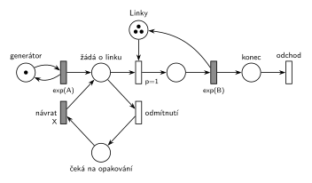

# 02–05 – MM3 bez fronty s opakováním

## Zadání

⚠️ Zadání je známé z ručního opisu (čitelného).

> Mějme systém M/M/3 bez fronty. Neobsloužené transakce se do systému vrací po X časových jednotkách. Systém modelujte pomocí Petriho sítě.

Podobné úlohy: [02–04 – Fronta omezená na 10](<../02–04 - Fronta omezená na 10/02–04 - Fronta omezená na 10.md>) (odmítnutí při plné frontě, bez návratu), [05–06 – MM3 – zastavení příchodů](<../05–06 - MM3 – zastavení příchodů/05–06 - MM3 – zastavení příchodů.md>) (M/M/3 jako místo se 3 značkami).

## Interpretace

Zobrazit interpretaci (nápověda)

- **Tři linky = jedno místo *Linky* se 3 značkami** (Store s kapacitou 3). Obsazení bere jednu značku, konec obsluhy ji vrací.
- **Bez fronty:** transakce v místě *žádá o linku* nečeká. *Obsazení* má `p=1`, takže pokud je některá linka volná, transakce ji hned obsadí. Jinak se provede *odmítnutí* (`p=0`).
- **Návrat po X:** odmítnutá transakce jde do *čeká na opakování* a časovaný přechod `X` ji vrátí do *žádá o linku*. Doba je pevná („po X časových jednotkách“), ne `exp(X)`. Každá čekající značka má vlastní odpočet (slajd 138), takže na návrat může čekat víc transakcí najednou.
- Vrácená transakce prochází stejným rozhodnutím: když jsou linky zase obsazené, odejde znovu na X. Počet pokusů zadání neomezuje.
- Odmítnutá transakce systém **neopouští** (vrací se), takže za *odmítnutím* není výstupní přechod. Jediný výstup je po obsluze.
- Příchody a obsluha nemají čísla, proto `exp(A)` a `exp(B)`.

## Petriho síť

Zobrazit Petriho síť

| Požadavek | Prvek sítě |
|---|---|
| M/M/3 | *generátor* ⇄ `exp(A)` → obsazení *Linek* (3 značky) → `exp(B)` (vrací linku) → *odchod* |
| bez fronty | *obsazení* `p=1`, jinak hned *odmítnutí* `p=0` |
| neobsloužená transakce se vrací po X | *odmítnutí* → *čeká na opakování* → *návrat* `X` → *žádá o linku* |
| transakce opouští systém | *odchod* |

Kontrola simulací: *Linky* + obsluhované transakce = 3, v *žádá o linku* nikdy víc než jedna značka (nikdo tam nečeká). Při `A = 3`, `B = 5`, `X = 4` je asi každý třetí pokus odmítnut; na návrat čekalo nejvýš 11 transakcí.

## Časté chyby

Zobrazit časté chyby

- Chybějící odmítnutí: transakce pak v *žádá o linku* čekají na uvolnění linky, což je M/M/3 s frontou.
- Odmítnutí se stejnou prioritou jako obsazení: losovalo by se i při volné lince.
- Tři samostatné linky bez důvodu (zadání nerozlišuje, která linka obslouží).
- `exp(X)` místo pevné doby X.
- Odmítnutá transakce poslaná na výstup: zadání říká, že se vrací.

## Původ a zdroje

**Původ:** zkouška 2023/24, 1. termín, skupina B, otázka 3, 10 bodů.

**Zdroje:**

- `Fitcheats/Zkoušky z minulých let/2023-24 - 1. termín B.pdf`, str. 1 (ručně opsané zadání)
- `Fitcheats/Příprava na zkoušku/cranycrane - Kódy (generátory, Monte Carlo, Euler, RK, Petri + SIMLIB)/petri/6.png` a `6.cpp` (studentská síť a SIMLIB; zadání je jen v komentáři kódu)

**Existující řešení:**

Zobrazit existující řešení

- **cranycrane, 6.png:** stejná struktura: obsazení `p=1` z místa se 3 značkami, přechod s nižší prioritou do místa čekání a zpět časovaným přechodem. Chyby:
  - návrat má čas `Exp(x)`, ale zadání chce pevnou dobu X (kód `6.cpp` má správně `Wait(X)`, síť a kód si tedy neodpovídají);
  - po obsluze končí síť místem bez výstupního přechodu, není vidět, kde transakce opouští systém;
  - přechod odmítnutí nemá napsanou prioritu (implicitně 0, to stačí, ale u zkoušky je lepší ji napsat).

