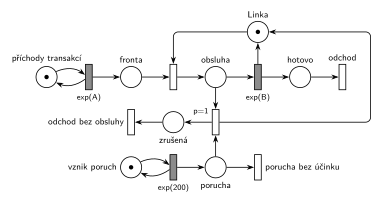

# Porucha zruší obsluhu

## Zadání

⚠️ Původní zadání se nedochovalo, jen studentský přepis (slovensky):

> Systém M/M/1 kde exponenciálně se středem 200 časových jednotek sa vyskytne porucha, ktorá LEN zruší obsluhu a nič iné. Nakresliť k tomu Petriho sieť a napísať to v SIMLIBE.

Podobné úlohy:

- [Porucha vrací transakci do fronty](<../02 - Porucha vrací transakci do fronty/02 - Porucha vrací transakci do fronty.md>): přerušená transakce se vrací do fronty
- [Porucha zničí obsluhu nebo počká](<../06 - Porucha zničí obsluhu nebo počká/06 - Porucha zničí obsluhu nebo počká.md>): stejná síť bez zániku poruchy
- [Porucha s opravou, transakce odchází](<../04 - Porucha s opravou, transakce odchází/04 - Porucha s opravou, transakce odchází.md>): porucha navíc zabere linku na dobu opravy

## Nápověda

<details>
<summary>Zobrazit nápovědu</summary>
<br>

- **M/M/1:** *příchody transakcí* ve smyčce s `exp(A)`, *fronta*, obsazení *Linky*, obsluha `exp(B)`, která *Linku* vrací, a *odchod*. Časy příchodů a obsluhy zadání neuvádí, proto `exp(A)` a `exp(B)`.
- **Poruchy** vznikají v intervalech `exp(200)`: místo *vznik poruch* ve smyčce s časovaným přechodem, každé provedení vloží značku do místa *porucha*.
- **„LEN zruší obsluhu a nič iné“:** porucha nemá žádnou dobu trvání (linka je hned znovu volná) a zrušená obsluha se neopakuje. Přechod `p=1` vezme *poruchu* a obsluhovanou transakci (místo *obsluha*), vrátí značku *Lince* a transakci pošle do místa *zrušená*, odkud odchází ze systému neobsloužená vlastním výstupním přechodem *odchod bez obsluhy*. Kdyby se měla vracet do fronty, je to úloha [Porucha vrací transakci do fronty](<../02 - Porucha vrací transakci do fronty/02 - Porucha vrací transakci do fronty.md>). Pozor: v zadání 2024/25 ([Porucha s opravou, návrat do fronty](<../03 - Porucha s opravou, návrat do fronty/03 - Porucha s opravou, návrat do fronty.md>)) se slovem „zrušena“ myslí právě návrat do fronty, takže samotné sloveso o osudu transakce nerozhoduje. Tady ho určuje dovětek „a nič iné“.
- Zrušení funguje díky sémantice časovaného přechodu (slajd 139): během odpočtu `exp(B)` je značka stále v místě *obsluha* a okamžitý přechod si ji vezme dřív.
- **Porucha, která přijde, když linka nic neobsluhuje**, nemá žádný účinek a zanikne (*porucha bez účinku*, `p=0`, bez výstupu). Jinak by se poruchy hromadily a rušily obsluhy, které začnou později.
- **Priorita `p=1`** na zrušení: když linka obsluhuje, musí porucha obsluhu zrušit, a ne tiše zaniknout (oba okamžité přechody jsou v tu chvíli proveditelné).

</details>

## Petriho síť

<details>
<summary>Zobrazit Petriho síť</summary>
<br>



</details>

## Časté chyby

<details>
<summary>Zobrazit časté chyby</summary>
<br>

- Chybějící zánik poruchy, když linka nepracuje: poruchy se hromadí a ruší pozdější obsluhy.
- Zrušení bez vrácení značky *Lince*: linka se ztratí a systém se zastaví.
- Zrušená transakce zmizí bez výstupního přechodu. Odchod ze systému má být v síti vidět i pro neobslouženou transakci.
- Porucha modelovaná jako transakce, která se řadí do fronty k lince: čeká, až obsluha skončí, a nic nezruší.
- V SIMLIBu porucha jako proces se `Seize(Linka, 1)` bez dalšího: přerušená transakce čeká ve frontě přerušených a po uvolnění linky obsluhu dokončí, takže se nic nezruší.

</details>

## SIMLIB

<details>
<summary>Zobrazit SIMLIB kód</summary>
<br>

Model je izomorfní k Petriho síti výše: každé místo, přechod a značka mají svůj protějšek v kódu.

```cpp
// Porucha zruší obsluhu – model v SIMLIB/C++
#include "simlib.h"

const double A = 10, B = 6;              // symboly ze sítě (zadání je nemá)

Facility Linka("Linka");                 // místo Linka (zařízení s kapacitou 1)
Histogram Doba("Doba obsloužené transakce v systému", 0, 10, 20);
long zruseno = 0, bez_ucinku = 0;        // kolikrát se provedly přechody poruchy

class Transakce;
Transakce *obsluhovana = nullptr;        // místo „obsluha“ (nullptr = bez značky)

class Transakce : public Process {       // transakce = značka, která prochází sítí
 public:
  bool zrusena = false;
  void Behavior() {
    double prichod = Time;
    Seize(Linka);                        // obsazení: Fronta + Linka → obsluha
    obsluhovana = this;
    Wait(Exponential(B));                // časovaný přechod exp(B), porucha ho může zrušit
    obsluhovana = nullptr;
    Release(Linka);                      // exp(B) i zrušení vrací Linku
    if (zrusena)                         // místo „zrušená“
      return;                            // přechod „odchod bez obsluhy“
    Doba(Time - prichod);
  }                                      // konec Behavior = přechod „odchod“
};

class Porucha : public Event {           // „vznik poruch“ ve smyčce s exp(200)
  void Behavior() {                      // porucha = značka v místě „porucha“ (jen okamžik)
    if (obsluhovana) {                   // přechod p=1: porucha + obsluha
      obsluhovana->zrusena = true;
      obsluhovana->Activate();           // zruší odpočet exp(B): Wait skončí hned
      obsluhovana = nullptr;
      zruseno++;
    } else {
      bez_ucinku++;                      // přechod „porucha bez účinku“ (p=0)
    }
    Activate(Time + Exponential(200));   // další porucha
  }
};

class Generator : public Event {         // „příchody transakcí“ ve smyčce s exp(A)
  void Behavior() {
    (new Transakce)->Activate();         // nová značka v místě „Fronta“
    Activate(Time + Exponential(A));
  }
};

int main() {
  Init(0, 1000000);                      // modelový čas v časových jednotkách sítě
  (new Generator)->Activate();
  (new Porucha)->Activate(Exponential(200));
  Run();
  Linka.Output();
  Doba.Output();
  Print("Poruchy: %ld zrušily obsluhu, %ld bez účinku\n", zruseno, bez_ucinku);
}
```

| Petriho síť | SIMLIB |
|---|---|
| *příchody transakcí* ⇄ `exp(A)` | událost `Generator`, která se znovu plánuje za `Exponential(A)` |
| značka (transakce) | proces `Transakce` |
| *fronta* + obsazení *Linky* | `Seize(Linka)` (fronta je vnitřní fronta zařízení) |
| místo *Linka* (1 značka) | `Facility Linka` |
| místo *obsluha* | ukazatel `obsluhovana` (`nullptr` = místo je prázdné) |
| `exp(B)` se sloučeným uvolněním *Linky* | `Wait(Exponential(B)); Release(Linka);` |
| *vznik poruch* ⇄ `exp(200)`, značka v místě *porucha* | událost `Porucha`, která se znovu plánuje za `Exponential(200)`; porucha nemá trvání, v místě je jen okamžik |
| zrušení (`p=1`) | větev `if (obsluhovana)`: `Activate()` ukončí `Wait` hned (odpočet `exp(B)` zanikne), příznak `zrusena` |
| výstup zrušení do *Linky* | transakce ve stejném okamžiku zavolá `Release(Linka)` |
| *zrušená* → *odchod bez obsluhy* | `if (zrusena) return;` |
| *porucha bez účinku* (`p=0`) | větev `else` |
| přechod *odchod* | konec metody `Behavior()` |

Porucha je tu událost, ne proces se `Seize(Linka, 1)`: nemá dobu trvání a přerušení v SIMLIBu (fronta přerušených) by obsluhu po uvolnění jen dokončilo.

**Kontrola simulací.** Petriho síť: *Linka* + *obsluha* = 1, v místě *porucha* je nejvýš jedna značka a všechny přechody se provádějí (`make check`). SIMLIB model: v jednom běhu (10⁶ časových jednotek, A = 10, B = 6) byla linka vytížená na 58,3 % a 2 916 z 5 000 poruch (58 %) zrušilo obsluhu, tedy 2,9 % transakcí odešlo neobsloužených. Teoreticky obsluha končí dokončením nebo poruchou, dřív z obou, takže trvá průměrně 1 / (1/6 + 1/200) = 5,83 a vytížení je 0,1 × 5,83 = 58,3 %; porucha zastihne linku obsazenou se stejnou pravděpodobností a zruší 6/206 = 2,9 % obsluh (`make simlib`).

</details>

## Původ a zdroje

<details>
<summary>Zobrazit původ a zdroje</summary>
<br>

**Původ:** zkouška 2017/18, 1. termín, skupina Z, otázka 1 (body neuvedené).

**Původní znění:**

> Systém M/M/1 kde s exp(200) sa vyskytne porucha, ktorá LEN zruší obsluhu a nič iné. Nakresliť k tomu Petriho sieť a napísať to v SIMLIBE.

**Zdroje:**

- `Fitcheats/Zkoušky z minulých let/2017-18 - 1. termín Z.txt`, otázka 1 (studentský přepis zadání)
- `Fitcheats/Příprava na zkoušku/xenix - Příprava.pdf`, str. 26 („M/M/1 exp(200) porucha zruší obsluhu“: studentská síť)

**Existující řešení:**

- **xenix, str. 26:** poruchy `exp(200)`, přechod `p=0` pro poruchu bez účinku, přechod `p=1` vrací *Linku* a dlouhou hranou s popiskem „návrat zrušeného procesu“ posílá transakci zpět do fronty. Síť je sama o sobě správná, ale řeší jinou úlohu ([Porucha vrací transakci do fronty](<../02 - Porucha vrací transakci do fronty/02 - Porucha vrací transakci do fronty.md>)). Chybí jí výstupní přechod: obsloužená transakce končí v místě bez odchodu.

</details>

## Reference

- [Jak síť funguje](<../../../basics/Jak síť funguje.md>)
- [Notace a vzory](<../../../basics/Notace a vzory.md>)
- [Seznam úloh](<../../Seznam úloh.md>)
