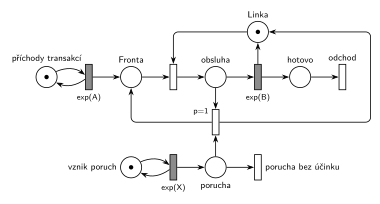

# Porucha vrací transakci do fronty

## Zadání

> Pro následující systém nakreslete jeho model v Petriho síti. Systém typu M/M/1. V intervalech exponenciálně se středem X časových jednotek dochází na lince k poruše, která přeruší případnou právě probíhající obsluhu a transakce se vrací do fronty.

Podobné úlohy:

- [Porucha s opravou, návrat do fronty](<../03 - Porucha s opravou, návrat do fronty/03 - Porucha s opravou, návrat do fronty.md>): porucha navíc zabere linku na dobu R
- [Porucha zruší obsluhu](<../01 - Porucha zruší obsluhu/01 - Porucha zruší obsluhu.md>): porucha jen zruší obsluhu
- [Porucha s opravou, transakce odchází](<../04 - Porucha s opravou, transakce odchází/04 - Porucha s opravou, transakce odchází.md>): přerušená transakce odchází
- [Kritická havárie](<../05 - Kritická havárie/05 - Kritická havárie.md>)

## Nápověda

<details>
<summary>Zobrazit nápovědu</summary>
<br>

- **M/M/1:** *příchody transakcí* ve smyčce s `exp(A)`, *fronta*, obsazení *Linky*, obsluha `exp(B)`, která *Linku* vrací, a *odchod*. Časy příchodů a obsluhy zadání neuvádí, proto `exp(A)` a `exp(B)`.
- **Poruchy** vznikají v intervalech `exp(X)`: místo *vznik poruch* ve smyčce s časovaným přechodem, každé provedení vloží značku do místa *porucha*.
- **Doba poruchy** v zadání není, takže porucha jen přeruší obsluhu a linka je hned znovu volná: přechod `p=1` vezme *poruchu* a obsluhovanou transakci (místo *obsluha*), transakci vrátí do *fronty* a značku *Lince*. Obsluhu později začne znovu od začátku.
- Přerušení funguje díky sémantice časovaného přechodu (slajd 139): během odpočtu `exp(B)` zůstává značka v místě *obsluha*. Okamžitý přechod má přednost před časovaným, takže si značku vezme a plánované dokončení obsluhy zanikne.
- **„Případnou“ obsluhu:** porucha, která přijde ve chvíli, kdy linka nic neobsluhuje, nemá žádný účinek. Proto je tu přechod *porucha bez účinku* (`p=0`, bez výstupu). Bez něj by se značky v místě *porucha* hromadily a příští obsluha by byla přerušena okamžitě po začátku.
- **Priorita `p=1`** na přerušení zajistí, že když je linka obsazená, porucha obsluhu přeruší, a ne že tiše zanikne (oba okamžité přechody jsou v tu chvíli proveditelné).
- Kam do fronty se transakce vrací (na začátek, nebo na konec), Petriho síť nerozliší: místo neuchovává pořadí značek.
- Hrana, která vrací *Linku*, vede kolem odchodu: přerušení je pod řadou M/M/1 a *Linka* nad ní, takže jinak by se čáry křížily.

</details>

## Petriho síť

<details>
<summary>Zobrazit Petriho síť</summary>
<br>



</details>

## Časté chyby

<details>
<summary>Zobrazit časté chyby</summary>
<br>

- Chybějící zánik poruchy, když linka nepracuje (poruchy se hromadí).
- Přerušení bez vrácení značky *Lince*: linka se ztratí a systém se zastaví.
- Přerušená transakce poslaná na *odchod*. To je jiná úloha ([Porucha s opravou, transakce odchází](<../04 - Porucha s opravou, transakce odchází/04 - Porucha s opravou, transakce odchází.md>)).
- Porucha modelovaná jako „další transakce“, která se řadí do fronty k lince. Pak čeká, až obsluha skončí, a nic nepřeruší.
- V SIMLIBu porucha jako proces se `Seize(Linka, 1)`: SIMLIB odloží přerušenou transakci do fronty přerušených a po uvolnění linky její obsluhu jen **dokončí** (zbývající čas), místo aby se vrátila do fronty a začala znovu.

</details>

## SIMLIB

<details>
<summary>Zobrazit SIMLIB kód</summary>
<br>

Model je izomorfní k Petriho síti výše: každé místo, přechod a značka mají svůj protějšek v kódu.

```cpp
// Porucha vrací transakci do fronty – model v SIMLIB/C++
#include "simlib.h"

const double A = 10, B = 6, X = 50;      // symboly ze sítě (zadání je nemá)

Facility Linka("Linka");                 // místo Linka (zařízení s kapacitou 1)
Histogram Doba("Doba transakce v systému", 0, 10, 20);
long preruseno = 0, bez_ucinku = 0;      // kolikrát se provedly přechody poruchy

class Transakce;
Transakce *obsluhovana = nullptr;        // místo „obsluha“ (nullptr = bez značky)

class Transakce : public Process {       // transakce = značka, která prochází sítí
 public:
  bool prerusena = false;
  void Behavior() {
    double prichod = Time;
    do {
      prerusena = false;
      Seize(Linka);                      // obsazení: Fronta + Linka → obsluha
      obsluhovana = this;
      Wait(Exponential(B));              // časovaný přechod exp(B), porucha ho může zrušit
      obsluhovana = nullptr;
      Release(Linka);                    // exp(B) i přerušení vrací Linku
    } while (prerusena);                 // přerušená transakce se vrací do Fronty
    Doba(Time - prichod);
  }                                      // konec Behavior = přechod „odchod“
};

class Porucha : public Event {           // „vznik poruch“ ve smyčce s exp(X)
  void Behavior() {                      // porucha = značka v místě „porucha“ (jen okamžik)
    if (obsluhovana) {                   // přechod p=1: porucha + obsluha
      obsluhovana->prerusena = true;
      obsluhovana->Activate();           // zruší odpočet exp(B): Wait skončí hned
      obsluhovana = nullptr;
      preruseno++;
    } else {
      bez_ucinku++;                      // přechod „porucha bez účinku“ (p=0)
    }
    Activate(Time + Exponential(X));     // další porucha
  }
};

class Generator : public Event {         // „příchody transakcí“ ve smyčce s exp(A)
  void Behavior() {
    (new Transakce)->Activate();         // nová značka v místě „Fronta“
    Activate(Time + Exponential(A));
  }
};

int main() {
  Init(0, 1000000);                      // modelový čas v časových jednotkách sítě
  (new Generator)->Activate();
  (new Porucha)->Activate(Exponential(X));
  Run();
  Linka.Output();
  Doba.Output();
  Print("Poruchy: %ld přerušily obsluhu, %ld bez účinku\n", preruseno, bez_ucinku);
}
```

| Petriho síť | SIMLIB |
|---|---|
| *příchody transakcí* ⇄ `exp(A)` | událost `Generator`, která se znovu plánuje za `Exponential(A)` |
| značka (transakce) | proces `Transakce` |
| *fronta* + obsazení *Linky* | `Seize(Linka)` (fronta je vnitřní fronta zařízení) |
| místo *Linka* (1 značka) | `Facility Linka` |
| místo *obsluha* | ukazatel `obsluhovana` (`nullptr` = místo je prázdné) |
| `exp(B)` se sloučeným uvolněním *Linky* | `Wait(Exponential(B)); Release(Linka);` |
| *vznik poruch* ⇄ `exp(X)`, značka v místě *porucha* | událost `Porucha`, která se znovu plánuje za `Exponential(X)`; porucha nemá trvání, v místě je jen okamžik |
| přerušení (`p=1`) | větev `if (obsluhovana)`: `Activate()` ukončí `Wait` hned (odpočet `exp(B)` zanikne), příznak `prerusena` |
| výstupy přerušení: *Linka* a *fronta* | transakce ve stejném okamžiku zavolá `Release(Linka)` a cyklem `do … while` se vrátí k `Seize(Linka)` |
| *porucha bez účinku* (`p=0`) | větev `else` |
| přechod *odchod* | konec metody `Behavior()` |

Porucha je tu událost, ne proces se `Seize(Linka, 1)`: nemá dobu trvání a přerušení v SIMLIBu (fronta přerušených) by obsluhu po uvolnění jen dokončilo, kdežto tady začíná znovu.

**Kontrola simulací.** Petriho síť: *Linka* + *obsluha* = 1, v místě *porucha* je nejvýš jedna značka a všechny přechody se provádějí (`make check`). SIMLIB model: v jednom běhu (10⁶ časových jednotek, A = 10, B = 6, X = 50) byla linka vytížená na 60,1 % a 12 171 z 20 138 poruch (60 %) přerušilo obsluhu. Teoreticky je vytížení 0,1 × 6 = 60 %: exponenciální obsluha nemá paměť, takže opakované obsluhy dají dohromady zase průměrně 6, a porucha zastihne linku obsazenou se stejnou pravděpodobností. Průměrná doba v systému 15,4 odpovídá M/M/1: 1 / (1/6 − 1/10) = 15 (`make simlib`).

</details>

## Původ a zdroje

<details>
<summary>Zobrazit původ a zdroje</summary>
<br>

**Původ:** zkouška 2019/20, 1. opravný termín, skupina B, otázka 3, 10 bodů.

**Původní znění:**

> Pro následující systém nakreslete jeho model v Petriho síti. Systém typu M/M/1. V intervalech exp(X) dochází na lince k poruše, která přeruší případnou právě probíhající obsluhu a transakce se vrací do fronty.

**Zdroje:**

- `Fitcheats/Příprava na zkoušku/FIT - Řešené výpočetní příklady 2017-21.pdf`, str. 29 („2020 - 1OP. SK B“: fotka zadání a studentské řešení s komentáři)
- `Fitcheats/Příprava na zkoušku/cranycrane - Kódy (generátory, Monte Carlo, Euler, RK, Petri + SIMLIB)/petri/3.png` a `3.cpp`

**Existující řešení:**

- **Řešené výpočetní příklady, str. 29:** stejná síť, ale **bez přechodu pro zánik poruchy**. Komentář pod řešením to správně kritizuje: „Porucha by neměla nastat, když neprobíhá obsluha, resp. by se neměly moct poruchy řadit do fronty…“
- **cranycrane, 3.png:** obsahuje i přechod s nižší prioritou pro zánik poruchy, tedy totéž co tady. Pozor na SIMLIB kód v `3.cpp`: vytváří novou transakci místo vrácení původní a `Release` volá proces, který linku nevlastní.

</details>
