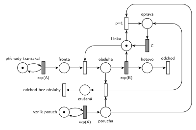

# Porucha s opravou, transakce odchází

Úloha 03/04

## Zadání

> Petriho sieť MM1, kde v intervaloch exponenciálně se středem X časových jednotek dochádza k poruchám obslužnej linky. Oprava poruchy zaberie C jednotiek času. Ak sa chyba prejaví počas obsluhy transakcie, potom táto trans. okamžite bez náhrady opúšta systém. S využitím notácie knižnice SIMLIB napíš pseudokód pre procesy transakcií a obsluhy chyby. Modely MUSIA byť izomorfné.

Skupina A (zřejmě totéž): „M/M/1, porucha exponenciálně se středem X časových jednotek, trvanie poruchy C jednotiek + SIMLIB (proces, porucha)“.

Podobné úlohy:

- [Kritická havárie](<../05 - Kritická havárie/05 - Kritická havárie.md>): stejná úloha s čísly (2025/26)
- [Porucha s opravou, návrat do fronty](<../03 - Porucha s opravou, návrat do fronty/03 - Porucha s opravou, návrat do fronty.md>): přerušená transakce se vrací do fronty
- [Porucha zruší obsluhu](<../01 - Porucha zruší obsluhu/01 - Porucha zruší obsluhu.md>): totéž bez doby opravy

## Nápověda

<details>
<summary>Zobrazit nápovědu</summary>
<br>

- **M/M/1:** *příchody transakcí* ve smyčce s `exp(A)`, *fronta*, obsazení *Linky*, obsluha `exp(B)`, která *Linku* vrací, a *odchod*. Časy příchodů a obsluhy zadání neuvádí, proto `exp(A)` a `exp(B)`.
- **Poruchy** vznikají v intervalech `exp(X)`: místo *vznik poruch* ve smyčce s časovaným přechodem, každé provedení vloží značku do místa *porucha*.
- **Oprava zabere linku na dobu C** (i když linka zrovna nic neobsluhuje): porucha si vezme *Linku* do místa *oprava* a časovaný přechod `C` ji vrátí, jako transakce s vyšší prioritou obsluhy (v SIMLIBu `Seize(Linka, 1)`).
- **Volná linka:** přechod `p=1` nahoře spojí *poruchu* s *Linkou* a začne oprava. Priorita je nutná: porucha, která čekala během předchozí opravy, musí linku po jejím skončení dostat dřív než transakce čekající ve *frontě*.
- **Obsazená linka:** přechod dole vezme *poruchu* a obsluhovanou transakci (místo *obsluha*), linku předá rovnou do *opravy* (*Linka* + *obsluha* + *oprava* = 1) a transakci pošle do místa *zrušená*. Odpočet `exp(B)` přitom zanikne (slajd 139).
- **Přerušená transakce „bez náhrady opúšta systém“:** z místa *zrušená* má vlastní výstupní přechod *odchod bez obsluhy*.
- Stejně správná je varianta ve dvou krocích: přerušení vrátí značku *Lince* a poruchu nechá v místě *porucha* (hrana tam a zpět), hned potom ji přechod `p=1` spojí s volnou *Linkou*. Tady je kreslená v jednom kroku, protože síť je jednodušší.
- **Porucha během opravy** počká a linku zabere hned po skončení opravy (další oprava `C`), stejně jako proces poruchy v SIMLIBu čekající ve frontě k zařízení. Kdo chce, aby zanikla, přidá přechod *porucha bez účinku* s `p=0` jako v úloze [Porucha vrací transakci do fronty](<../02 - Porucha vrací transakci do fronty/02 - Porucha vrací transakci do fronty.md>).
- **Izomorfní modely:** každému přechodu sítě odpovídá krok v procesu transakce nebo poruchy (viz SIMLIB).

</details>

## Petriho síť

<details>
<summary>Zobrazit Petriho síť</summary>
<br>



</details>

## Časté chyby

<details>
<summary>Zobrazit časté chyby</summary>
<br>

- Porucha zabere jen obsazenou linku a při volné lince zanikne. Oprava ale trvá `C` vždy.
- Zabrání volné linky bez priority: porucha čekající během opravy prohraje s transakcí z *fronty*.
- Přerušená transakce se vrací do fronty: to je úloha [Porucha s opravou, návrat do fronty](<../03 - Porucha s opravou, návrat do fronty/03 - Porucha s opravou, návrat do fronty.md>).
- Přerušená transakce zmizí bez výstupního přechodu.
- V SIMLIBu jen `Seize(Linka, 1)`: přerušená transakce zůstane ve frontě přerušených a po opravě obsluhu **dokončí** (zbývající čas). Aby odešla bez náhrady, musí ji porucha z této fronty vyřadit.

</details>

## SIMLIB

<details>
<summary>Zobrazit SIMLIB kód</summary>
<br>

Model je izomorfní k Petriho síti výše: každé místo, přechod a značka mají svůj protějšek v kódu.

```cpp
// Porucha s opravou, transakce odchází – model v SIMLIB/C++
#include "simlib.h"

const double A = 10, B = 6, X = 100, C = 5;  // A, B: symboly ze sítě (zadání je nemá)

Facility Linka("Linka");                 // místo Linka (zařízení s kapacitou 1)
Histogram Doba("Doba obsloužené transakce v systému", 0, 10, 20);
long poruchy = 0, zruseno = 0;

class Transakce;
Transakce *obsluhovana = nullptr;        // místo „obsluha“ (nullptr = bez značky)

class Transakce : public Process {       // transakce = značka, která prochází sítí
 public:
  bool zrusena = false;
  void Behavior() {
    double prichod = Time;
    Seize(Linka);                        // obsazení: Fronta + Linka → obsluha
    obsluhovana = this;
    Wait(Exponential(B));                // časovaný přechod exp(B), porucha ho může přerušit
    if (zrusena)                         // místo „zrušená“ (Linku už má porucha)
      return;                            // přechod „odchod bez obsluhy“
    obsluhovana = nullptr;
    Release(Linka);                      // exp(B) vrací Linku
    Doba(Time - prichod);
  }                                      // konec Behavior = přechod „odchod“
};

class Porucha : public Process {         // porucha = značka v místě „porucha“
  void Behavior() {
    poruchy++;
    Transakce *t = obsluhovana;          // probíhající obsluha, nebo nullptr
    Seize(Linka, 1);                     // priorita obsluhy 1: přerušení obsazené Linky,
                                         // u volné Linky zabrání p=1 (předběhne Frontu)
    if (t) {                             // přechod přerušení: transakce odchází
      t->Out();                          // SIMLIB by ji nechal ve frontě přerušených
      t->zrusena = true;                 // a po opravě by obsluhu jen dokončil
      t->Activate();
      obsluhovana = nullptr;
      zruseno++;
    }
    Wait(C);                             // místo „oprava“ + časovaný přechod C ...
    Release(Linka);                      // ... který vrací Linku
  }
};

class GeneratorPoruch : public Event {   // „vznik poruch“ ve smyčce s exp(X)
  void Behavior() {
    (new Porucha)->Activate();
    Activate(Time + Exponential(X));
  }
};

class Generator : public Event {         // „příchody transakcí“ ve smyčce s exp(A)
  void Behavior() {
    (new Transakce)->Activate();         // nová značka v místě „Fronta“
    Activate(Time + Exponential(A));
  }
};

int main() {
  Init(0, 1000000);                      // modelový čas v časových jednotkách sítě
  (new Generator)->Activate();
  (new GeneratorPoruch)->Activate(Exponential(X));
  Run();
  Linka.Output();
  Doba.Output();
  Print("Poruchy: %ld, z toho zrušily obsluhu: %ld\n", poruchy, zruseno);
}
```

| Petriho síť | SIMLIB |
|---|---|
| *příchody transakcí* ⇄ `exp(A)` | událost `Generator`, která se znovu plánuje za `Exponential(A)` |
| značka (transakce) | proces `Transakce` |
| *fronta* + obsazení *Linky* | `Seize(Linka)` (fronta je vnitřní fronta zařízení) |
| místo *Linka* (1 značka) | `Facility Linka` |
| místo *obsluha* | ukazatel `obsluhovana` (`nullptr` = místo je prázdné) |
| `exp(B)` se sloučeným uvolněním *Linky* | `Wait(Exponential(B)); Release(Linka);` |
| *vznik poruch* ⇄ `exp(X)` | událost `GeneratorPoruch`, která se znovu plánuje za `Exponential(X)` |
| značka v místě *porucha* | proces `Porucha` |
| zabrání volné *Linky* (`p=1`) | `Seize(Linka, 1)`: priorita obsluhy 1 řadí poruchu ve frontě zařízení před transakce |
| přerušení (porucha + *obsluha* → *oprava* + *zrušená*) | `Seize(Linka, 1)` u obsazené linky: SIMLIB vezme linku obsluhované transakci; `t->Out()` ji vyjme z fronty přerušených a `Activate()` s příznakem `zrusena` ji probudí |
| *zrušená* → *odchod bez obsluhy* | `if (zrusena) return;` (bez `Release`, linku má porucha) |
| místo *oprava* + časovaný přechod `C` | `Wait(C); Release(Linka);` v procesu `Porucha` |
| přechod *odchod* | konec metody `Behavior()` transakce |

**Kontrola simulací.** Petriho síť: *Linka* + *obsluha* + *oprava* = 1, všechny přechody se provádějí a každá porucha vede k jedné opravě (`make check`). SIMLIB model: v jednom běhu (10⁶ časových jednotek, A = 10, B = 6, X = 100, C = 5) zrušilo obsluhu 5 729 z 10 072 poruch (57 %) a linka byla obsazená 61,8 % času (transakce i opravy). Teoreticky obsluha končí dokončením nebo poruchou, dřív z obou, takže trvá průměrně 1 / (1/6 + 1/100) = 5,66; transakce vytíží linku na 0,1 × 5,66 = 56,6 % (se stejnou pravděpodobností porucha zastihne obsluhu) a opravy na C/X = 5 %, celkem 61,6 % (`make simlib`).

</details>

## Původ a zdroje

<details>
<summary>Zobrazit původ a zdroje</summary>
<br>

**Původ:** zkouška 2021/22, 1. termín, nejspíš skupina A, otázka 1, 15 bodů (podle přepisu neznámé skupiny).

**Původní znění** (studentské přepisy, slovensky; originál se nedochoval; podrobný přepis je od neznámé skupiny):

> Petriho sieť MM1, kde v intervaloch Exp(X) dochádza k poruchám obslužnej linky. Oprava poruchy zaberie C jednotiek času. Ak sa chyba prejaví počas obsluhy transakcie, potom táto trans. okamžite bez náhrady opúšta systém. S využitím notácie knižnice SIMLIB napíš pseudokód pre procesy transakcií a obsluhy chyby. Modely MUSIA byť izomorfné.

Skupina A: „M/M/1, porucha s Exp(X), trvanie poruchy C jednotiek + SIMLIB (proces, porucha)“.

**Zdroje:**

- `Fitcheats/Zkoušky z minulých let/2021-22 - 1. termín.txt`: skupina A, otázka 1 (krátký přepis) a „Neznáma skupina (pravdepodobne jedna z vyššie spísaných)“, otázka 1 (podrobný přepis)
- `Fitcheats/Příprava na zkoušku/fifinas - Tabule ze streamu.pdf`, str. 2 („A) M/M/1, porucha s Exp(x) na C jednotek“: síť a SIMLIB ze streamu)

**Existující řešení:**

- **fifinas, str. 2:** volnou linku zabere porucha přechodem s `p=1` (*porucha* + *Linka*), obsazenou linku druhým přechodem (*porucha* + obsluhovaná transakce, červeně zakroužkovaný). Oba vedou do místa před časovaným přechodem `C`, který vrací *Linku*. Přerušená transakce zmizí. To je stejná logika jako tady. Chybí výstupní přechody: obsloužená i přerušená transakce mizí bez viditelného odchodu (dnes se odchod vyžaduje). SIMLIB na tabuli: `Seize(linka, 2); Wait(C); Release(linka);`.

</details>

## Reference

- [Jak síť funguje](<../../../basics/Jak síť funguje.md>)
- [Notace a vzory](<../../../basics/Notace a vzory.md>)

<!-- -->

- [Studijní plán](<../../Studijní plán.md>)
- [Seznam úloh](<../../Seznam úloh.md>)
