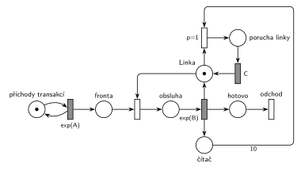

# Každá 10. transakce vyvolá poruchu

## Zadání

⚠️ Původní zadání se nedochovalo, jen studentský přepis (slovensky):

> M/M/1 Každá 10. transakcia ktorá prejde systémom vyvola poruchu na linke, ktorá trvá čas C. + Simlib

Podobné úlohy:

- [Údržba po každé 10. obsluze](<../../04 - Údržba a spánek/06 - Údržba po každé 10. obsluze/06 - Údržba po každé 10. obsluze.md>): stejná konstrukce, místo poruchy údržba
- [Porucha s opravou, návrat do fronty](<../03 - Porucha s opravou, návrat do fronty/03 - Porucha s opravou, návrat do fronty.md>): stejné zabrání linky na dobu poruchy, spouští ho generátor
- [MD1 – prodlužování po 10 obsluhách](<../../06 - Doba obsluhy podle stavu/01 - MD1 – prodlužování po 10 obsluhách/01 - MD1 – prodlužování po 10 obsluhách.md>): čítač 10 obsluh

## Nápověda

<details>
<summary>Zobrazit nápovědu</summary>
<br>

- **M/M/1:** místo *příchody transakcí* ve smyčce s `exp(A)` → *fronta* → obsazení *Linky* → *obsluha* → `exp(B)` (vrací *Linku*) → *hotovo* → *odchod*. Časy příchodů a obsluhy zadání neuvádí (`exp(A)`, `exp(B)`).
- **„Prejde systémom“** = dokončí obsluhu. Každé dokončení (`exp(B)`) přidá značku do *čítače*. Přechod *porucha* s hranou váhy 10 se provede u desáté transakce a zároveň čítač vynuluje (odebere všech 10 značek).
- **Porucha zabere linku na dobu C:** přechod *porucha* (*čítač* s váhou 10 + *Linka*) → *porucha linky* → `C` → *Linka*. Porucha vzniká ve chvíli, kdy desátá transakce linku uvolní, takže nic nepřerušuje.
- **Priorita `p=1`:** po dokončení 10. obsluhy je *Linka* volná a ve *frontě* může čekat další transakce. Bez priority by mohla linku obsadit dřív než porucha a porucha by se odložila až za její obsluhu.
- Obsluhu po čítači nijak neupravujeme: uvolnění zůstává sloučené s `exp(B)` jako v ostatních sítích, porucha si linku vezme hned potom.
- Doba poruchy `C` je konstanta.

</details>

## Petriho síť

<details>
<summary>Zobrazit Petriho síť</summary>
<br>



</details>

## Časté chyby

<details>
<summary>Zobrazit časté chyby</summary>
<br>

- Čítač jen otestovaný (hrana s váhou 10 tam i zpět), takže se nevynuluje: porucha pak nastane po každé další transakci.
- Porucha bez priority: linku po desáté obsluze obsadí další transakce.
- Porucha, která linku nezabere (jen čeká `C`): obsluha pokračuje, jako by se nic nestalo.
- Počítání příchodů místo dokončených obsluh.

</details>

## SIMLIB

<details>
<summary>Zobrazit SIMLIB kód</summary>
<br>

Model je izomorfní k Petriho síti výše: každé místo, přechod a značka mají svůj protějšek v kódu. Zadání chtělo i SIMLIB.

```cpp
// Každá 10. transakce vyvolá poruchu – model v SIMLIB/C++
#include "simlib.h"

const double A = 10, B = 6, C = 5;     // příchody, obsluha (zadání je nedává) a doba poruchy

Facility Linka("Linka");               // místo „Linka“ (1 značka)
int citac = 0;                         // místo „čítač“
long poruch = 0;

class Porucha : public Process {       // přechod „porucha“ p=1 → „porucha linky“ → C
  void Behavior() override {
    Seize(Linka, 1);                   // p=1: vyšší priorita obsluhy, linku dostane dřív než transakce
    poruch++;
    Wait(C);                           // časovaný přechod C ...
    Release(Linka);                    // ... vrací značku Linky
  }
};

class Transakce : public Process {     // transakce = značka, která prochází sítí
  void Behavior() override {
    Seize(Linka);                      // Fronta + obsazení, transakce je v místě „obsluha“
    Wait(Exponential(B));              // časovaný přechod exp(B) ...
    if (++citac == 10) {               // ... přidá značku do čítače; hrana s váhou 10:
      citac = 0;                       // čítač se vynuluje ...
      (new Porucha)->Activate();       // ... a provede se přechod „porucha“
    }
    Release(Linka);                    // ... a vrací značku Linky
  }                                    // „hotovo“ → konec Behavior = přechod „odchod“
};

class Generator : public Event {       // místo „příchody transakcí“ ve smyčce s exp(A)
  void Behavior() override {
    (new Transakce)->Activate();       // nová značka v místě „Fronta“
    Activate(Time + Exponential(A));   // další příchod
  }
};

int main() {
  Init(0, 100000);                     // modelový čas v časových jednotkách (č. j.)
  (new Generator)->Activate();
  Run();
  Print("Poruch: %ld\n", poruch);
  Linka.Output();
}
```

| Petriho síť | SIMLIB |
|---|---|
| *příchody transakcí* ⇄ `exp(A)` | událost `Generator`, která se znovu plánuje za `Exponential(A)` |
| značka (transakce) | proces `Transakce` |
| *fronta* + obsazení *Linky* | `Seize(Linka)` (fronta je vnitřní fronta zařízení) |
| časovaný přechod `exp(B)` se sloučeným uvolněním | `Wait(Exponential(B))` a pak `Release(Linka)` |
| *čítač*, hrana s váhou 10 | `int citac`, `if (++citac == 10) { citac = 0; … }` |
| přechod *porucha* `p=1` + *porucha linky* + `C` | proces `Porucha`: `Seize(Linka, 1); Wait(C); Release(Linka);` |
| *hotovo* → *odchod* | konec metody `Behavior()` |

`Seize(Linka, 1)` je priorita obsluhy: kdyby linku ve stejném okamžiku obsadila transakce z fronty, porucha ji přeruší a transakce po poruše dostane celou svou obsluhu, takže výsledek je stejný jako při `p=1` v síti.

**Kontrola simulací.** Petriho síť: *Linka* + obsluhovaná transakce + *porucha linky* = 1, *čítač* nepřesáhne 10 a poruch je přesně desetina dokončených obsluh (`make check`). SIMLIB model: v jednom běhu (100 000 č. j.) nastalo 998 poruch a linka byla obsazená (obsluhou nebo poruchou) 64,7 % času; teoreticky 1/10 × 6 (obsluha) + 1/100 × 5 (porucha) = 65 % (`make simlib`).

</details>

## Původ a zdroje

<details>
<summary>Zobrazit původ a zdroje</summary>
<br>

**Původ:** zkouška 2021/22, 1. termín, skupina B, otázka 1 (body neuvedené).

**Zdroje:**

- `Fitcheats/Zkoušky z minulých let/2021-22 - 1. termín.txt`, skupina B, otázka 1 (studentský přepis zadání)
- `Fitcheats/Příprava na zkoušku/fifinas - Tabule ze streamu.pdf`, str. 3 („B) M/M/1 každá 10. vyvolá poruchu ⇒ C“: síť a SIMLIB ze streamu)

**Existující řešení:**

- **fifinas, str. 3:** `Exp(b)` posílá značku do čítače *Cnt* a do místa „uvolnění“. Přechod s hranou váhy 10 z *Cnt* vezme i značku z uvolnění a přes místo a čas `C` vrátí *Linku*. Jinak značka z uvolnění jde rovnou do *Linky*. Tedy totéž s uvolněním odděleným od obsluhy: porucha „zdrží“ desátou transakci na lince, jak to dělá i SIMLIB kód na tabuli (`if (done >= 10) { Wait(C); done = 0; }` před `Release`). Popisek priority je na tabuli u obou přechodů nejednoznačný. Musí ji mít přechod s váhou 10, jinak by se uvolnění provedlo vždy bez poruchy. Chybí výstupní přechod.

</details>
