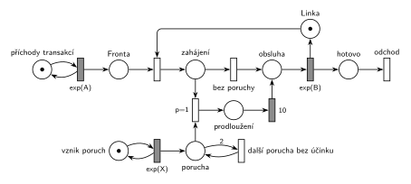

# Porucha prodlouží další obsluhu

Úloha 03/08

## Zadání

> Nakreslete Petriho síť pro systém typu M/M/1. V intervalech exponenciálně se středem X časových jednotek se na lince vyskytne porucha, která způsobí, že první následující transakce bude mít dobu obsluhy o 10 časových jednotek delší.

Podobné úlohy:

- [Porucha prodlouží obsluhu o 2](<../09 - Porucha prodlouží obsluhu o 2/09 - Porucha prodlouží obsluhu o 2.md>): prodlužuje se právě probíhající obsluha
- [Porucha zničí obsluhu nebo počká](<../06 - Porucha zničí obsluhu nebo počká/06 - Porucha zničí obsluhu nebo počká.md>): porucha také čeká na další obsluhu
- [MD1 – prodlužování po 10 obsluhách](<../../06 - Doba obsluhy podle stavu/01 - MD1 – prodlužování po 10 obsluhách/01 - MD1 – prodlužování po 10 obsluhách.md>)

## Nápověda

<details>
<summary>Zobrazit nápovědu</summary>
<br>

- **M/M/1:** místo *příchody transakcí* ve smyčce s `exp(A)` → *fronta* → obsazení *Linky* → *zahájení* → … → *obsluha* → `exp(B)` (vrací *Linku*) → *hotovo* → *odchod*. Časy příchodů a obsluhy zadání neuvádí, proto `exp(A)` a `exp(B)`.
- **Poruchy** vznikají v místě *vznik poruch* ve smyčce s `exp(X)` a čekají v místě *porucha*.
- **„První následující transakce“** = první transakce, která po vzniku poruchy *začne* obsluhu. Probíhající obsluhu porucha nemění. Proto se o prodloužení rozhoduje v okamžiku obsazení linky (místo *zahájení*): `p=1` (*zahájení* + *porucha*) vybere prodlouženou cestu, pokud čeká porucha, jinak `p=0` (*bez poruchy*).
- **Prodloužení o 10** = konstantní časovaný přechod `10` (místo *prodloužení*) před běžnou obsluhou `exp(B)`. Transakce celou dobu drží *Linku*, takže obsluha trvá `10 + exp(B)`.
- **Poruchy se nesmí hromadit:** dvě poruchy před začátkem obsluhy prodlouží stejnou (první následující) transakci, ne dvě po sobě jdoucí. Přechod *další porucha bez účinku* proto dvě čekající poruchy sloučí v jednu (hrana s váhou 2 dovnitř, 1 ven). V místě *porucha* je tak nejvýš jedna značka. Totéž jde udělat doplňkovým místem „bez poruchy“.
- Prodloužení se neopakuje: porucha během prodloužené obsluhy čeká na další transakci.

</details>

## Petriho síť

<details>
<summary>Zobrazit Petriho síť</summary>
<br>



</details>

## Časté chyby

<details>
<summary>Zobrazit časté chyby</summary>
<br>

- Hromadění poruch: každá porucha prodlouží jinou transakci.
- Prodloužení probíhající obsluhy místo následující (to je úloha [Porucha prodlouží obsluhu o 2](<../09 - Porucha prodlouží obsluhu o 2/09 - Porucha prodlouží obsluhu o 2.md>)).
- Prodloužení modelované jako `exp(B + 10)` nebo jako `exp(10)`: zadání říká o 10 časových jednotek delší, tedy konstantu přičtenou k náhodné době obsluhy.
- Rozhodnutí o prodloužení až po skončení obsluhy: porucha vzniklá během obsluhy by pak prodloužila tu probíhající.
- Stejné písmeno pro střední dobu příchodů a interval poruch.

</details>

## SIMLIB

<details>
<summary>Zobrazit SIMLIB kód</summary>
<br>

Model je izomorfní k Petriho síti výše: každé místo, přechod a značka mají svůj protějšek v kódu.

```cpp
// Porucha prodlouží další obsluhu – model v SIMLIB/C++
#include "simlib.h"

const double A = 10, B = 6, X = 50;    // příchody, obsluha a interval poruch (zadání čísla nedává)

Facility Linka("Linka");               // místo „Linka“ (1 značka)
bool porucha = false;                  // místo „porucha“ (nejvýš 1 značka)
long poruch = 0, prodlouzenych = 0, obsluh = 0;

class VznikPoruch : public Event {     // místo „vznik poruch“ ve smyčce s exp(X)
  void Behavior() override {
    poruch++;
    porucha = true;                    // značka do „porucha“; druhá se sloučí s první
    Activate(Time + Exponential(X));   // (přechod „další porucha bez účinku“)
  }
};

class Transakce : public Process {     // transakce = značka, která prochází sítí
  void Behavior() override {
    Seize(Linka);                      // Fronta + obsazení, transakce je v místě „zahájení“
    if (porucha) {                     // p=1: zahájení + porucha
      porucha = false;
      prodlouzenych++;
      Wait(10);                        // „prodloužení“ → časovaný přechod 10
    }                                  // jinak p=0: „bez poruchy“
    Wait(Exponential(B));              // „obsluha“ → časovaný přechod exp(B) ...
    Release(Linka);                    // ... vrací značku Linky
    obsluh++;
  }                                    // „hotovo“ → konec Behavior = přechod „odchod“
};

class Generator : public Event {       // místo „příchody transakcí“ ve smyčce s exp(A)
  void Behavior() override {
    (new Transakce)->Activate();       // nová značka v místě „Fronta“
    Activate(Time + Exponential(A));   // další příchod
  }
};

int main() {
  Init(0, 100000);                     // modelový čas v časových jednotkách (č. j.)
  (new Generator)->Activate();
  (new VznikPoruch)->Activate(Exponential(X));
  Run();
  Print("Poruch: %ld, prodloužených obsluh: %ld z %ld\n", poruch, prodlouzenych, obsluh);
  Linka.Output();
}
```

| Petriho síť | SIMLIB |
|---|---|
| *příchody transakcí* ⇄ `exp(A)` | událost `Generator`, která se znovu plánuje za `Exponential(A)` |
| *vznik poruch* ⇄ `exp(X)` → *porucha* | událost `VznikPoruch`, která nastaví `porucha = true` |
| *další porucha bez účinku* (váha 2 dovnitř, 1 ven) | `bool porucha`: druhé `porucha = true` nic nezmění |
| značka (transakce) | proces `Transakce` |
| *fronta* + obsazení *Linky* → *zahájení* | `Seize(Linka)` (fronta je vnitřní fronta zařízení) |
| `p=1` → *prodloužení* → `10` / *bez poruchy* `p=0` | `if (porucha) { porucha = false; Wait(10); }` |
| *obsluha* → `exp(B)` (vrací *Linku*) | `Wait(Exponential(B)); Release(Linka);` |
| *hotovo* → *odchod* | konec metody `Behavior()` |

**Kontrola simulací.** Petriho síť: *Linka* + transakce na lince (*zahájení*, *prodloužení*, *obsluha*) = 1, v místě *porucha* je nejvýš jedna značka. Každá porucha buď prodlouží jednu obsluhu, nebo splyne s už čekající (`make check`). SIMLIB model: v jednom běhu (100 000 č. j.) vzniklo 2006 poruch a prodlouženo bylo 1705 z 10 032 obsluh (zbylé poruchy splynuly s čekající). Linka byla obsazená 77,3 % času, což sedí s 1/10 × 6 + 1705 × 10 / 100 000 = 77,1 % (`make simlib`).

</details>

## Původ a zdroje

<details>
<summary>Zobrazit původ a zdroje</summary>
<br>

**Původ:** zkouška 2017/18, 3. termín (2. 2. 2018), skupina 8A, otázka 3, 10 bodů.

**Původní znění:**

> Nakreslete Petriho síť pro systém typu M/M/1. V intervalech daných exp(X) se na lince vyskytne porucha, která způsobí, že první následující transakce bude mít dobu obsluhy o 10 časových jednotek delší.

**Zdroje:**

- `Fitcheats/Zkoušky z minulých let/2017-18 - 3. termín A.pdf`, str. 1 (sken zadání)
- `Fitcheats/Příprava na zkoušku/FIT - Příprava 2018-19.pdf`, str. 48 („2. opravný termín 2017/2018 - skupina A“, Př. 3: studentské řešení s komentáři)

**Existující řešení:**

- **Příprava 2018-19, str. 48:** stejná struktura jako tady: po obsazení linky místo, z něj přechod `p=1` (vezme i poruchu) přes čas `10` a přechod bez priority přímo k `exp(y)`. Komentáře se neshodnou. Zelený: „Za mě je to dobře, akorát bych si dával pozor na popisky těch časovaných přechodů. Exp(x) je dle zadání jen pro generování poruch…“ (síť používá `exp(x)` pro příchody i `Exp(X)` pro poruchy). Červený: „Za mě je to špatně, protože těch poruch se tam může nakumulovat víc, což neodpovídá zadání.“ Červený má pravdu: bez sloučení prodlouží dvě poruchy dvě transakce. Jinak je síť v pořádku, včetně výstupního přechodu.

</details>

## Reference

- [Jak síť funguje](<../../../basics/Jak síť funguje.md>)
- [Notace a vzory](<../../../basics/Notace a vzory.md>)

<!-- -->

- [Studijní plán](<../../Studijní plán.md>)
- [Seznam úloh](<../../Seznam úloh.md>)
