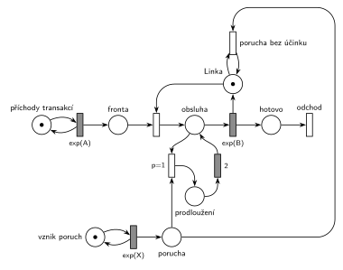

# Porucha prodlouží obsluhu o 2

## Zadání

> 2.(10b) Modelujte Petriho sítí systém M/M/1 s následujícím specifikem: v intervalech exponenciálně se středem X časových jednotek se v systému projeví porucha, která prodlouží případnou právě probíhající obsluhu o 2 časové jednotky.
>
> 3.(10b) Pseudokód podle 2. bodu zadání.

Podobné úlohy:

- [Porucha prodlouží probíhající obsluhu o 5](<../10 - Porucha prodlouží probíhající obsluhu o 5/10 - Porucha prodlouží probíhající obsluhu o 5.md>): stejná úloha s jinými čísly
- [Porucha prodlouží další obsluhu](<../08 - Porucha prodlouží další obsluhu/08 - Porucha prodlouží další obsluhu.md>): prodlužuje se následující obsluha
- [Porucha vrací transakci do fronty](<../02 - Porucha vrací transakci do fronty/02 - Porucha vrací transakci do fronty.md>): stejné přerušení, transakce jde do fronty

## Nápověda

<details>
<summary>Zobrazit nápovědu</summary>
<br>

- **M/M/1:** místo *příchody transakcí* ve smyčce s `exp(A)` → *fronta* → obsazení *Linky* → *obsluha* → `exp(B)` (vrací *Linku*) → *hotovo* → *odchod*. Poruchy vznikají v místě *vznik poruch* ve smyčce s `exp(X)` a čekají v místě *porucha*.
- **Jak prodloužit běžící časovaný přechod:** v Petriho síti nejde k běžícímu odpočtu `exp(B)` „přičíst“ 2. Jde ho ale přerušit: přechod `p=1` si vezme značku obsluhované transakce (slajd 139, stejně jako v úloze [Porucha vrací transakci do fronty](<../02 - Porucha vrací transakci do fronty/02 - Porucha vrací transakci do fronty.md>)) a pošle ji do místa *prodloužení*. Po 2 časových jednotkách se transakce vrátí do obsluhy a `exp(B)` začne odpočítávat znovu.
- **Proč je to správně:** exponenciální rozdělení je bez paměti. Zbývající doba obsluhy přerušené v libovolném okamžiku má opět rozdělení `exp(B)`, nezávisle na tom, kolik už uběhlo. Nový odpočet `exp(B)` je tedy statisticky totéž co pokračování starého a celková obsluha = dosavadní doba + 2 + zbytek. U konstantní nebo rovnoměrné doby obsluhy (M/D/1) by tento trik nefungoval, tam je potřeba konstrukce popsaná v úloze [Porucha prodlouží probíhající obsluhu o 5](<../10 - Porucha prodlouží probíhající obsluhu o 5/10 - Porucha prodlouží probíhající obsluhu o 5.md>).
- **„Případnou“ obsluhu:** porucha při volné lince nemá účinek a zanikne. Přechod *porucha bez účinku* ale nesmí být jen obyčejný přechod `p=0` jako v úloze [Porucha vrací transakci do fronty](<../02 - Porucha vrací transakci do fronty/02 - Porucha vrací transakci do fronty.md>): zahodil by i poruchu, která přijde během prodloužení (obsluha přitom pořád probíhá). Proto testuje, že je *Linka* volná (hrana z *Linky* a zpět). Porucha během prodloužení tak počká a hned po něm obsluhu přeruší znovu: prodloužení se sečtou.
- Přerušení s `p=1` a zánik s testem *Linky* nikdy nejsou proveditelné zároveň, priorita je tu jen pro přehlednost a shodu s úlohou [Porucha vrací transakci do fronty](<../02 - Porucha vrací transakci do fronty/02 - Porucha vrací transakci do fronty.md>).
- Časy příchodů a obsluhy zadání neuvádí, proto `exp(A)` a `exp(B)`.

</details>

## Petriho síť

<details>
<summary>Zobrazit Petriho síť</summary>
<br>



</details>

## Časté chyby

<details>
<summary>Zobrazit časté chyby</summary>
<br>

- Časovaný přechod `2` zapojený za `exp(B)` „pro jistotu“ u každé obsluhy: prodlouží se i obsluhy bez poruchy.
- Porucha, která prodlouží až další obsluhu (to je úloha [Porucha prodlouží další obsluhu](<../08 - Porucha prodlouží další obsluhu/08 - Porucha prodlouží další obsluhu.md>)).
- Přerušená transakce, která po prodloužení nepokračuje v obsluze, ale jde do fronty nebo odchází.
- Chybějící zánik poruchy při volné lince: poruchy se hromadí a prodlouží pozdější obsluhy.
- Zánik poruchy jako obyčejný přechod `p=0`: porucha během prodloužení se ztratí.

</details>

## SIMLIB

<details>
<summary>Zobrazit SIMLIB kód</summary>
<br>

Model je izomorfní k Petriho síti výše: každé místo, přechod a značka mají svůj protějšek v kódu. Odpovídá i na navazující otázku 3 (pseudokód podle SIMLIBu).

```cpp
// Porucha prodlouží obsluhu o 2 – model v SIMLIB/C++
#include "simlib.h"

const double A = 10, B = 6;            // příchody a obsluha (zadání je nedává)
const double X = 20;                   // střední interval poruch (zadání ho nedává)
const double D = 2;                    // prodloužení obsluhy

Facility Linka("Linka");               // místo „Linka“ (1 značka)
long sUcinkem = 0, bezUcinku = 0;

class Porucha : public Process {       // značka v místě „porucha“
  void Behavior() override {
    if (!Linka.Busy()) {               // volná Linka: přechod „porucha bez účinku“
      bezUcinku++;
      return;
    }
    sUcinkem++;
    Seize(Linka, 1);                   // přerušení p=1: vezme linku obsluhované transakci
                                       // (během jiného prodloužení počká a přeruší hned po něm)
    Wait(D);                           // „prodloužení“ → časovaný přechod 2
    Release(Linka);                    // transakce se vrací do obsluhy
  }
};

class VznikPoruch : public Event {     // místo „vznik poruch“ ve smyčce s exp(X)
  void Behavior() override {
    (new Porucha)->Activate();         // nová značka v místě „porucha“
    Activate(Time + Exponential(X));
  }
};

class Transakce : public Process {     // transakce = značka, která prochází sítí
  void Behavior() override {
    Seize(Linka);                      // Fronta + obsazení, transakce je v místě „obsluha“
    Wait(Exponential(B));              // časovaný přechod exp(B); přerušení ho pozastaví ...
    Release(Linka);                    // ... a po skončení vrací značku Linky
  }                                    // „hotovo“ → konec Behavior = přechod „odchod“
};

class Generator : public Event {       // místo „příchody transakcí“ ve smyčce s exp(A)
  void Behavior() override {
    (new Transakce)->Activate();       // nová značka v místě „Fronta“
    Activate(Time + Exponential(A));   // další příchod
  }
};

int main() {
  Init(0, 100000);                     // modelový čas v časových jednotkách (č. j.)
  (new Generator)->Activate();
  (new VznikPoruch)->Activate(Exponential(X));
  Run();
  Print("Poruch s účinkem: %ld, bez účinku: %ld\n", sUcinkem, bezUcinku);
  Linka.Output();
}
```

| Petriho síť | SIMLIB |
|---|---|
| *příchody transakcí* ⇄ `exp(A)` | událost `Generator`, která se znovu plánuje za `Exponential(A)` |
| *vznik poruch* ⇄ `exp(X)` → *porucha* | událost `VznikPoruch`, která vytvoří proces `Porucha` |
| značka (transakce) | proces `Transakce` |
| *fronta* + obsazení *Linky* | `Seize(Linka)` (fronta je vnitřní fronta zařízení) |
| *obsluha* → `exp(B)` (vrací *Linku*) | `Wait(Exponential(B)); Release(Linka);` |
| přerušení `p=1` → *prodloužení* → `2` → zpět do *obsluhy* | `Seize(Linka, 1); Wait(D); Release(Linka);`: priorita obsluhy přeruší `Wait` transakce, ta pak dokončí zbytek obsluhy |
| *porucha bez účinku* (test volné *Linky*) | `if (!Linka.Busy())` |
| *hotovo* → *odchod* | konec metody `Behavior()` |

Síť po prodloužení spouští `exp(B)` znovu, SIMLIB pokračuje se zbytkem původní doby. Pro exponenciální obsluhu je to totéž (bezpaměťovost).

**Kontrola simulací.** Petriho síť: *Linka* + obsluhovaná transakce + *prodloužení* = 1, všechny přechody se provádějí; každá porucha buď prodlouží obsluhu, nebo zanikne při volné lince, a v místě *porucha* čekají nejvýš dvě poruchy (druhá přišla během prodloužení) (`make check`). SIMLIB model (`X = 20`): v jednom běhu (100 000 č. j.) prodloužilo obsluhu 3313 z 4979 poruch (66,5 %) a linka byla obsazená 67,0 % času. Teoreticky je linka obsazená ρ = 0,6 + ρ × 2/20 (obsluha plus 2 č. j. za každou poruchu při obsazené lince), tedy ρ = 0,6 / 0,9 = 66,7 %, a s účinkem je stejný podíl poruch (`make simlib`).

</details>

## Původ a zdroje

<details>
<summary>Zobrazit původ a zdroje</summary>
<br>

**Původ:** zkouška 2020/21, 1. opravný termín (11:00), otázka 2, 10 bodů. Soubor se zadáním se jmenuje „1. termín“, ale otázky jsou totožné s termínem „2021 - 1. opravný 11:00“ v Řešených výpočetních příkladech.

**Původní znění** (dochované jen jako ruční přepis):

> 2.(10b) Modelujte Petriho sítí systém M/M/1 s následujícím specifikem: v intervalech daných exponenciálním rozložením se středem X časových jednotek se v systému projeví porucha, která prodlouží případnou právě probíhající obsluhu o 2 čas. jednotky.

**Zdroje:**

- `Fitcheats/Zkoušky z minulých let/2020-21 - 1. termín.pdf`, str. 1 (ručně přepsané celé zadání)
- `Fitcheats/Příprava na zkoušku/FIT - Řešené výpočetní příklady 2017-21.pdf`, str. 37 („2021 - 1. opravný 11:00“, jen text zadání a odkaz na pseudokód)

**Existující řešení:**

- K této úloze žádná nakreslená síť není. Řešené výpočetní příklady (str. 37) mají jen odkaz na pseudokód.

</details>

## Reference

- [Jak síť funguje](<../../../basics/Jak síť funguje.md>)
- [Notace a vzory](<../../../basics/Notace a vzory.md>)
- [Seznam úloh](<../../Seznam úloh.md>)
