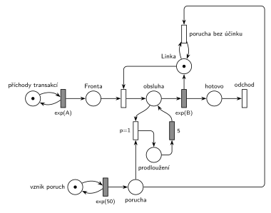

# Porucha prodlouží probíhající obsluhu o 5

## Zadání

⚠️ Původní zadání se nedochovalo, jen studentský přepis (slovensky):

> 2. (10b) Petriho sieť pre M/M/1 kde vzniká porucha v intervaloch exponenciálne so stredom 50 časových jednotiek, ktorá predĺži momentálny proces o 5 časových jednotiek. Ak pri vytvorení poruchy momentálne neprebieha žiadny proces tak sa nepredlžuje nič.

Podobné úlohy:

- [Porucha prodlouží obsluhu o 2](<../09 - Porucha prodlouží obsluhu o 2/09 - Porucha prodlouží obsluhu o 2.md>): stejná úloha (2020/21, 1. opravný termín) s čísly X a 2
- [Porucha prodlouží další obsluhu](<../08 - Porucha prodlouží další obsluhu/08 - Porucha prodlouží další obsluhu.md>): prodlužuje se následující obsluha

## Interpretace

<details>
<summary>Zobrazit interpretaci (nápověda)</summary>
<br>

- **M/M/1:** místo *příchody transakcí* ve smyčce s `exp(A)` → *fronta* → obsazení *Linky* → *obsluha* → `exp(B)` (vrací *Linku*) → *hotovo* → *odchod*. Poruchy vznikají v místě *vznik poruch* ve smyčce s `exp(50)` a čekají v místě *porucha*.
- **„Momentálny proces“** = právě probíhající obsluha. Síť je stejná jako v úloze [Porucha prodlouží obsluhu o 2](<../09 - Porucha prodlouží obsluhu o 2/09 - Porucha prodlouží obsluhu o 2.md>), jen s `exp(50)` a prodloužením `5`.
- **Prodloužení běžící obsluhy:** přechod `p=1` obsluhu přeruší (vezme značku transakce), transakce počká 5 časových jednotek v místě *prodloužení* a pak se vrátí do obsluhy, kde `exp(B)` začne znovu. Díky bezpaměťovosti exponenciálního rozdělení má zbytek obsluhy pořád rozdělení `exp(B)`, takže celková obsluha = dosavadní doba + 5 + zbytek.
- **„Ak … neprebieha žiadny proces, tak sa nepredlžuje nič“:** *porucha bez účinku* zanikne jen při volné *Lince* (hrana z *Linky* a zpět). Porucha během prodloužení počká a obsluhu prodlouží znovu.
- **Obecnější konstrukce (i pro konstantní obsluhu, M/D/1),** kde se bezpaměťovost nevyužívá: porucha při obsazené lince přidá značku do místa *dluh*. Po skončení obsluhy přejde transakce do místa *hotovo*, odkud přechod `p=1` (*hotovo* + *dluh*) vede přes čas `5` zpět do *hotovo* a přechod `p=0` uvolní *Linku* a pošle transakci k odchodu. Prodloužení se tak přičtou na konci, celková doba je stejná. Uvolnění linky už ale nejde sloučit s časovaným přechodem obsluhy.
- Časy příchodů a obsluhy zadání neuvádí, proto `exp(A)` a `exp(B)`.

</details>

## Petriho síť

<details>
<summary>Zobrazit Petriho síť</summary>
<br>



</details>

## Časté chyby

<details>
<summary>Zobrazit časté chyby</summary>
<br>

- Prodloužení až následující obsluhy (úloha [Porucha prodlouží další obsluhu](<../08 - Porucha prodlouží další obsluhu/08 - Porucha prodlouží další obsluhu.md>)).
- Přerušení obsluhy bez návratu do ní: transakce po prodloužení odejde nebo jde do fronty.
- Zánik poruchy jako obyčejný přechod `p=0`: porucha během prodloužení se ztratí.
- Tento postup (restart `exp(B)`) použitý pro konstantní dobu obsluhy: odpočet by začal znovu od začátku a obsluha by se prodloužila víc než o 5.

</details>

## SIMLIB

<details>
<summary>Zobrazit SIMLIB kód</summary>
<br>

Model je izomorfní k Petriho síti výše: každé místo, přechod a značka mají svůj protějšek v kódu. Odpovídá i na navazující otázku 3 (pseudokód podle SIMLIBu).

```cpp
// Porucha prodlouží probíhající obsluhu o 5 – model v SIMLIB/C++
#include "simlib.h"

const double A = 10, B = 6;            // příchody a obsluha (zadání je nedává)
const double X = 50;                   // střední interval poruch
const double D = 5;                    // prodloužení obsluhy

Facility Linka("Linka");               // místo „Linka“ (1 značka)
long sUcinkem = 0, bezUcinku = 0;

class Porucha : public Process {       // značka v místě „porucha“
  void Behavior() override {
    if (!Linka.Busy()) {               // volná Linka: přechod „porucha bez účinku“
      bezUcinku++;
      return;
    }
    sUcinkem++;
    Seize(Linka, 1);                   // přerušení p=1: vezme linku obsluhované transakci
                                       // (během jiného prodloužení počká a přeruší hned po něm)
    Wait(D);                           // „prodloužení“ → časovaný přechod 5
    Release(Linka);                    // transakce se vrací do obsluhy
  }
};

class VznikPoruch : public Event {     // místo „vznik poruch“ ve smyčce s exp(50)
  void Behavior() override {
    (new Porucha)->Activate();         // nová značka v místě „porucha“
    Activate(Time + Exponential(X));
  }
};

class Transakce : public Process {     // transakce = značka, která prochází sítí
  void Behavior() override {
    Seize(Linka);                      // Fronta + obsazení, transakce je v místě „obsluha“
    Wait(Exponential(B));              // časovaný přechod exp(B); přerušení ho pozastaví ...
    Release(Linka);                    // ... a po skončení vrací značku Linky
  }                                    // „hotovo“ → konec Behavior = přechod „odchod“
};

class Generator : public Event {       // místo „příchody transakcí“ ve smyčce s exp(A)
  void Behavior() override {
    (new Transakce)->Activate();       // nová značka v místě „Fronta“
    Activate(Time + Exponential(A));   // další příchod
  }
};

int main() {
  Init(0, 100000);                     // modelový čas v časových jednotkách (č. j.)
  (new Generator)->Activate();
  (new VznikPoruch)->Activate(Exponential(X));
  Run();
  Print("Poruch s účinkem: %ld, bez účinku: %ld\n", sUcinkem, bezUcinku);
  Linka.Output();
}
```

| Petriho síť | SIMLIB |
|---|---|
| *příchody transakcí* ⇄ `exp(A)` | událost `Generator`, která se znovu plánuje za `Exponential(A)` |
| *vznik poruch* ⇄ `exp(50)` → *porucha* | událost `VznikPoruch`, která vytvoří proces `Porucha` |
| značka (transakce) | proces `Transakce` |
| *fronta* + obsazení *Linky* | `Seize(Linka)` (fronta je vnitřní fronta zařízení) |
| *obsluha* → `exp(B)` (vrací *Linku*) | `Wait(Exponential(B)); Release(Linka);` |
| přerušení `p=1` → *prodloužení* → `5` → zpět do *obsluhy* | `Seize(Linka, 1); Wait(D); Release(Linka);`: priorita obsluhy přeruší `Wait` transakce, ta pak dokončí zbytek obsluhy |
| *porucha bez účinku* (test volné *Linky*) | `if (!Linka.Busy())` |
| *hotovo* → *odchod* | konec metody `Behavior()` |

Síť po prodloužení spouští `exp(B)` znovu, SIMLIB pokračuje se zbytkem původní doby. Pro exponenciální obsluhu je to totéž (bezpaměťovost).

**Kontrola simulací.** Petriho síť: *Linka* + obsluhovaná transakce + *prodloužení* = 1, všechny přechody se provádějí, asi dvě třetiny poruch prodlouží obsluhu, zbytek zanikne při volné lince (`make check`). SIMLIB model: v jednom běhu (100 000 č. j.) prodloužilo obsluhu 1354 z 2066 poruch (65,5 %) a linka byla obsazená 66,8 % času. Teoreticky je linka obsazená ρ = 0,6 + ρ × 5/50 (obsluha plus 5 č. j. za každou poruchu při obsazené lince), tedy ρ = 0,6 / 0,9 = 66,7 %, a s účinkem je stejný podíl poruch (`make simlib`).

</details>

## Původ a zdroje

<details>
<summary>Zobrazit původ a zdroje</summary>
<br>

**Původ:** zkouška 2020/21, náhradní termín (COVID), otázka 2, 10 bodů.

**Původní znění:**

> 2. (10b) Petriho sieť pre M/M/1 kde vzniká porucha každých Exp(50), ktorá predĺži momentálny proces o 5 j.č. Ak pri vytvorení poruchy momentálne neprebieha žiadny proces tak sa nepredlžuje nič.

**Zdroje:**

- `Fitcheats/Příprava na zkoušku/FIT - Řešené výpočetní příklady 2017-21.pdf`, str. 38 („2021 - náhradný COVID termín“, jen text zadání, bez řešení)

**Existující řešení:**

- K této úloze žádné řešení není.

</details>
