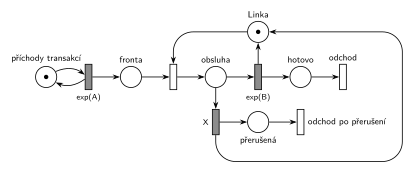

# Přerušení příliš dlouhé obsluhy (03/11)

## Zadání

> Pro následující systém nakreslete jeho model v Petriho síti. Systém typu M/M/1. Pokud právě probíhající obsluha přesáhne délku X časových jednotek, pak je přerušena a její transakce opouští systém.

Podobné úlohy:

- [Porucha zruší obsluhu](<../01 - Porucha zruší obsluhu/01 - Porucha zruší obsluhu.md>): stejný tvar, obsluhu ukončí porucha místo časového limitu
- [Netrpělivé požadavky](<../../02 - Netrpělivost a omezená fronta/01 - Netrpělivé požadavky/01 - Netrpělivé požadavky.md>): časový limit na čekání ve frontě
- [Údržba po dlouhé obsluze](<../../04 - Údržba a spánek/05 - Údržba po dlouhé obsluze/05 - Údržba po dlouhé obsluze.md>)

## Nápověda

<details>
<summary>Zobrazit nápovědu</summary>
<br>

- **M/M/1:** místo *příchody transakcí* ve smyčce s `exp(A)` → *fronta* → obsazení *Linky* → *obsluha* → `exp(B)` (vrací *Linku*) → *hotovo* → *odchod*. Časy příchodů a obsluhy zadání neuvádí, proto `exp(A)` a `exp(B)`.
- **Časový limit = druhý časovaný přechod na stejném místě.** Z místa *obsluha* vedou dva časované přechody: `exp(B)` (konec obsluhy) a `X` (limit). Oba začnou odpočítávat ve chvíli, kdy transakce obsadí linku. Který doběhne dřív, ten si značku vezme a druhý odpočet zanikne (slajdy 137 a 139).
- Obsluha tedy skončí normálně, je-li `exp(B) < X`. Jinak ji po `X` č. j. přeruší limit: vrátí *Linku* a transakce odchází přes *přerušená* → *odchod po přerušení*.
- `X` je konstanta (délka ze zadání), ne `exp(X)`.
- Žádná priorita ani porucha tu není potřeba. Na rozdíl od netrpělivosti ve frontě ([Netrpělivé požadavky](<../../02 - Netrpělivost a omezená fronta/01 - Netrpělivé požadavky/01 - Netrpělivé požadavky.md>)) je limit na místě obsluhy, kde je vždy nejvýš jedna značka.

</details>

## Petriho síť

<details>
<summary>Zobrazit Petriho síť</summary>
<br>



</details>

## Časté chyby

<details>
<summary>Zobrazit časté chyby</summary>
<br>

- Limit jako okamžitý přechod nebo `exp(X)`: zadání dává pevnou délku `X`.
- Limit bez vrácení *Linky*: po prvním přerušení se systém zastaví.
- Limit napojený na *frontu* místo na obsluhu: to je netrpělivost ve frontě ([Netrpělivé požadavky](<../../02 - Netrpělivost a omezená fronta/01 - Netrpělivé požadavky/01 - Netrpělivé požadavky.md>)).
- Přerušená transakce, která se vrací do fronty: zadání chce, aby opustila systém.

</details>

## SIMLIB

<details>
<summary>Zobrazit SIMLIB kód</summary>
<br>

Model je izomorfní k Petriho síti výše: každé místo, přechod a značka mají svůj protějšek v kódu.

```cpp
// Přerušení příliš dlouhé obsluhy – model v SIMLIB/C++
#include "simlib.h"

const double A = 10, B = 6, X = 10;    // příchody, obsluha (zadání je nedává) a limit

Facility Linka("Linka");               // místo „Linka“ (1 značka)
long obslouzenych = 0, prerusenych = 0;

class Transakce : public Process {     // transakce = značka, která prochází sítí
 public:
  bool prerusena = false;
  void Behavior() override;
};

class Limit : public Event {           // časovaný přechod X na místě „obsluha“
  Transakce *t;
 public:
  Limit(Transakce *t) : t(t) { Activate(Time + X); }
  void Behavior() override {
    t->prerusena = true;               // X doběhl dřív: vezme značku transakce ...
    t->Activate();                     // ... a odpočet exp(B) zanikne (Wait skončí hned)
  }
};

void Transakce::Behavior() {
  Seize(Linka);                        // Fronta + obsazení, transakce je v místě „obsluha“
  Limit *limit = new Limit(this);      // oba odpočty začínají obsazením linky
  Wait(Exponential(B));                // časovaný přechod exp(B)
  if (!prerusena)
    limit->Cancel();                   // exp(B) doběhl dřív: odpočet X zaniká
  Release(Linka);                      // exp(B) i X vracejí značku Linky
  if (prerusena)
    prerusenych++;                     // „přerušená“ → přechod „odchod po přerušení“
  else
    obslouzenych++;                    // „hotovo“ → přechod „odchod“
}                                      // konec Behavior = výstupní přechod

class Generator : public Event {       // místo „příchody transakcí“ ve smyčce s exp(A)
  void Behavior() override {
    (new Transakce)->Activate();       // nová značka v místě „Fronta“
    Activate(Time + Exponential(A));   // další příchod
  }
};

int main() {
  Init(0, 100000);                     // modelový čas v časových jednotkách (č. j.)
  (new Generator)->Activate();
  Run();
  Print("Obsloužených: %ld, přerušených: %ld (%.1f %%)\n", obslouzenych, prerusenych,
        100.0 * prerusenych / (obslouzenych + prerusenych));
  Linka.Output();
}
```

| Petriho síť | SIMLIB |
|---|---|
| *příchody transakcí* ⇄ `exp(A)` | událost `Generator`, která se znovu plánuje za `Exponential(A)` |
| značka (transakce) | proces `Transakce` |
| *fronta* + obsazení *Linky* | `Seize(Linka)` (fronta je vnitřní fronta zařízení) |
| časovaný přechod `exp(B)` z místa *obsluha* | `Wait(Exponential(B))` |
| časovaný přechod `X` z místa *obsluha* | událost `Limit` naplánovaná za `X` po obsazení; přeruší `Wait` přes `t->Activate()` |
| zánik druhého odpočtu | `limit->Cancel()`, resp. přerušené `Wait` |
| oba přechody vracejí *Linku* | `Release(Linka)` |
| *hotovo* → *odchod*, *přerušená* → *odchod po přerušení* | větve `if (prerusena)` a konec metody `Behavior()` |

**Kontrola simulací.** Petriho síť: *Linka* + obsluhovaná transakce = 1, provádějí se oba odchody (`make check`). SIMLIB model: v jednom běhu (100 000 č. j.) bylo přerušeno 19,0 % obsluh, teoreticky P(exp(6) > 10) = e^(−10/6) = 18,9 %; linka byla vytížena na 49,5 %, teoreticky 1/10 × 6 × (1 − e^(−10/6)) = 48,7 % (`make simlib`).

</details>

## Původ a zdroje

<details>
<summary>Zobrazit původ a zdroje</summary>
<br>

**Původ:** zkouška 2019/20, 2. termín (29. 1. 2020; v Řešených výpočetních příkladech „2020 - 1. opravný“), skupina Z, otázka 3, 10 bodů.

**Původní znění:**

> Pro následující systém nakreslete jeho model v Petriho síti. Systém typu M/M/1. Pokud právě probíhající obsluha přesáhne délku X č.j., pak je přerušena a její transakce opouští systém.

**Zdroje:**

- `Fitcheats/Zkoušky z minulých let/2019-20 - 2. termín Z.pdf`, str. 3 (fotka zadání)
- `Fitcheats/Příprava na zkoušku/FIT - Řešené výpočetní příklady 2017-21.pdf`, str. 27 („2020 - 1. opravný“, otázka 3: studentské řešení)
- `Fitcheats/Příprava na zkoušku/cranycrane - Kódy (generátory, Monte Carlo, Euler, RK, Petri + SIMLIB)/petri/2.png` a `2.cpp`

**Existující řešení:**

- **Řešené výpočetní příklady, str. 27:** stejná síť: z místa obsluhy časovaný přechod `exp(x)` a časovaný přechod `X`, ten vrací linku dlouhou hranou kolem celé sítě a transakce jím odchází. V diskuzi „Ano: +2“. Jen značení je matoucí: obsluha je `exp(x)` a limit `X`, příchody `exp(y)`.
- **cranycrane, 2.png:** totéž, limit `X` vrací linku (zeleně) a vede přes místo k odchodu. Přechody jsou nakreslené jen jako čárky, takže časovaný a okamžitý nejdou rozlišit. V `2.cpp` je obsluha `Wait(min(Exponential(B), X))` (zapsané přes `if`), ale generátor nikdy nevytvoří transakci (chybí `(new Rob_neco)->Activate()`), takže program nic nesimuluje.

</details>

## Reference

- [Jak síť funguje](<../../../basics/Jak síť funguje.md>)
- [Notace a vzory](<../../../basics/Notace a vzory.md>)

<!-- -->

- [Studijní plán](<../../Studijní plán.md>)
- [Seznam úloh](<../../Seznam úloh.md>)
