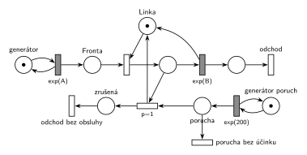

# 03–01 – Porucha zruší obsluhu

## Zadání

⚠️ Původní zadání se nedochovalo, jen studentský přepis (slovensky):

> Systém M/M/1 kde s exp(200) sa vyskytne porucha, ktorá LEN zruší obsluhu a nič iné. Nakresliť k tomu Petriho sieť a napísať to v SIMLIBE.

Podobné úlohy:

- [03–02 – Porucha vrací transakci do fronty](<../03–02 - Porucha vrací transakci do fronty/03–02 - Porucha vrací transakci do fronty.md>): přerušená transakce se vrací do fronty
- [03–06 – Porucha zničí obsluhu nebo počká](<../03–06 - Porucha zničí obsluhu nebo počká/03–06 - Porucha zničí obsluhu nebo počká.md>): stejná síť bez zániku poruchy
- [03–04 – Porucha s opravou, transakce odchází](<../03–04 - Porucha s opravou, transakce odchází/03–04 - Porucha s opravou, transakce odchází.md>): porucha navíc zabere linku na dobu opravy

## Interpretace

Zobrazit interpretaci (nápověda)

- **„LEN zruší obsluhu a nič iné“:** porucha nemá žádnou dobu trvání (linka je hned znovu volná) a zrušená obsluha se neopakuje. Transakce tedy odchází ze systému neobsloužená, vlastním výstupním přechodem *odchod bez obsluhy*. Kdyby se měla vracet do fronty, je to úloha [03–02 – Porucha vrací transakci do fronty](<../03–02 - Porucha vrací transakci do fronty/03–02 - Porucha vrací transakci do fronty.md>). Pozor: v zadání 2024/25 (03–03) se slovem „zrušena“ myslí právě návrat do fronty, takže samotné sloveso o osudu transakce nerozhoduje. Tady ho určuje dovětek „a nič iné“.
- **Porucha, která přijde, když linka nic neobsluhuje**, nemá žádný účinek a zanikne (*porucha bez účinku*, p=0). Jinak by se poruchy hromadily a rušily obsluhy, které začnou později.
- **Priorita `p=1`** na zrušení: když linka obsluhuje, musí porucha obsluhu zrušit, a ne tiše zaniknout (oba okamžité přechody jsou v tu chvíli proveditelné).
- Zrušení funguje díky sémantice časovaného přechodu (slajd 139): během odpočtu `exp(B)` je značka stále v místě před ním a okamžitý přechod si ji vezme dřív.
- Časy příchodů a obsluhy zadání neuvádí, proto `exp(A)` a `exp(B)`.
- SIMLIB část otázky tu není řešená.

## Petriho síť

Zobrazit Petriho síť

| Požadavek | Prvek sítě |
|---|---|
| M/M/1 | *generátor* ⇄ `exp(A)` → *Fronta* → obsazení *Linky* → `exp(B)` (vrací *Linku*) → *odchod* |
| porucha s exp(200) | *generátor poruch* ⇄ `exp(200)` → *porucha* |
| porucha zruší probíhající obsluhu | `p=1`: *porucha* + obsluhovaná transakce → *Linka* + *zrušená* |
| zrušená transakce opouští systém | *zrušená* → *odchod bez obsluhy* |
| porucha bez obsluhy nic nedělá | *porucha* → *porucha bez účinku* (p=0, bez výstupu) |

Kontrola simulací: *Linka* + obsluhovaná transakce = 1, v místě *porucha* je nejvýš jedna značka. Zhruba 60 % poruch zruší obsluhu (linka je vytížená asi na 60 %), zbytek zanikne bez účinku.

## Časté chyby

Zobrazit časté chyby

- Chybějící zánik poruchy, když linka nepracuje: poruchy se hromadí a ruší pozdější obsluhy.
- Zrušení bez vrácení značky *Lince*: linka se ztratí a systém se zastaví.
- Zrušená transakce zmizí bez výstupního přechodu. Odchod ze systému má být v síti vidět i pro neobslouženou transakci.
- Porucha modelovaná jako transakce, která se řadí do fronty k lince: čeká, až obsluha skončí, a nic nezruší.

## Původ a zdroje

**Původ:** zkouška 2017/18, 1. termín, skupina Z, otázka 1 (body neuvedené).

**Zdroje:**

- `Fitcheats/Zkoušky z minulých let/2017-18 - 1. termín Z.txt`, otázka 1 (studentský přepis zadání)
- `Fitcheats/Příprava na zkoušku/xenix - Příprava.pdf`, str. 26 („M/M/1 exp(200) porucha zruší obsluhu“: studentská síť)

**Existující řešení:**

Zobrazit existující řešení

- **xenix, str. 26:** poruchy `exp(200)`, přechod `p=0` pro poruchu bez účinku, přechod `p=1` vrací *Linku* a dlouhou hranou s popiskem „návrat zrušeného procesu“ posílá transakci zpět do fronty. Síť je sama o sobě správná, ale řeší jinou úlohu (03–02). Chybí jí výstupní přechod: obsloužená transakce končí v místě bez odchodu.

