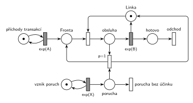

# 03–02 – Porucha vrací transakci do fronty

**Původ:** zkouška 2019/20, 1. opravný termín, skupina B, otázka 3, 10 bodů.

**Zdroje:**

- `Fitcheats/Příprava na zkoušku/FIT - Řešené výpočetní příklady 2017-21.pdf`, str. 29 („2020 - 1OP. SK B“: fotka zadání a studentské řešení s komentáři)
- `Fitcheats/Příprava na zkoušku/cranycrane - Kódy (generátory, Monte Carlo, Euler, RK, Petri + SIMLIB)/petri/3.png` a `3.cpp`

## Zadání

> Pro následující systém nakreslete jeho model v Petriho síti. Systém typu M/M/1. V intervalech exp(X) dochází na lince k poruše, která přeruší případnou právě probíhající obsluhu a transakce se vrací do fronty.

Podobné úlohy:

- [03–03 – Porucha s opravou, návrat do fronty](<../03–03 - Porucha s opravou, návrat do fronty/03–03 - Porucha s opravou, návrat do fronty.md>): porucha navíc zabere linku na dobu R
- [03–01 – Porucha zruší obsluhu](<../03–01 - Porucha zruší obsluhu/03–01 - Porucha zruší obsluhu.md>): porucha jen zruší obsluhu
- [03–04 – Porucha s opravou, transakce odchází](<../03–04 - Porucha s opravou, transakce odchází/03–04 - Porucha s opravou, transakce odchází.md>): přerušená transakce odchází
- [03–05 – Kritická havárie](<../03–05 - Kritická havárie/03–05 - Kritická havárie.md>)

## Interpretace

Zobrazit interpretaci (nápověda)

- **Doba poruchy** v zadání není, takže porucha jen přeruší obsluhu a linka je hned znovu volná. Přerušená transakce se vrátí do *Fronty* a obsluhu později začne znovu od začátku.
- **„Případnou“ obsluhu:** porucha, která přijde ve chvíli, kdy linka nic neobsluhuje, nemá žádný účinek. Proto je tu přechod *porucha bez účinku*. Bez něj by se značky v místě *porucha* hromadily a příští obsluha by byla přerušena okamžitě po začátku.
- **Priorita `p=1`** na přerušení zajistí, že když je linka obsazená, porucha obsluhu přeruší, a ne že tiše zanikne (oba okamžité přechody jsou v tu chvíli proveditelné).
- Přerušení funguje díky sémantice časovaného přechodu (slajd 139): během odpočtu `exp(B)` zůstává značka v místě před ním. Okamžitý přechod má přednost před časovaným, takže si značku vezme a plánované dokončení obsluhy zanikne.
- Kam do fronty se transakce vrací (na začátek, nebo na konec), Petriho síť nerozliší: místo neuchovává pořadí značek.

## Řešení

Zobrazit řešení

| Požadavek | Prvek sítě |
|---|---|
| M/M/1 | *generátor* ⇄ `exp(A)` → *Fronta* → obsazení *Linky* → `exp(B)` (vrací *Linku*) → *odchod* |
| poruchy v intervalech exp(X) | *generátor poruch* ⇄ `exp(X)` → *porucha* |
| porucha přeruší probíhající obsluhu | `p=1`: *porucha* + obsluhovaná transakce → *Fronta* + *Linka* |
| porucha bez obsluhy nic nedělá | *porucha* → *porucha bez účinku* (p=0, bez výstupu) |
| transakce opouští systém | *odchod* |

Kontrola simulací: *Linka* + obsluhovaná transakce = 1, v místě *porucha* je nejvýš jedna značka, všechny přechody se provádějí.

## Existující řešení

Zobrazit srovnání s existujícími řešeními

- **Řešené výpočetní příklady, str. 29:** stejná síť, ale **bez přechodu pro zánik poruchy**. Komentář pod řešením to správně kritizuje: „Porucha by neměla nastat, když neprobíhá obsluha, resp. by se neměly moct poruchy řadit do fronty…“
- **cranycrane, 3.png:** obsahuje i přechod s nižší prioritou pro zánik poruchy, tedy totéž co tady. Pozor na SIMLIB kód v `3.cpp`: vytváří novou transakci místo vrácení původní a `Release` volá proces, který linku nevlastní.

## Časté chyby

Zobrazit časté chyby

- Chybějící zánik poruchy, když linka nepracuje (poruchy se hromadí).
- Přerušení bez vrácení značky *Lince*: linka se ztratí a systém se zastaví.
- Přerušená transakce poslaná na *odchod*. To je jiná úloha ([03–04 – Porucha s opravou, transakce odchází](<../03–04 - Porucha s opravou, transakce odchází/03–04 - Porucha s opravou, transakce odchází.md>)).
- Porucha modelovaná jako „další transakce“, která se řadí do fronty k lince. Pak čeká, až obsluha skončí, a nic nepřeruší.

