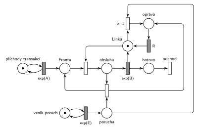

# 03–03 – Porucha s opravou, návrat do fronty

## Zadání

> Uvažujme systém typu M/M/1. U linky dochází k poruše v intervalech daných Exp(E). Porucha zabere linku na dobu R. Pokud je v okamžiku vzniku poruchy nějaká transakce v obsluze, pak je její obsluha zrušena a transakce se vrací do fronty. Nakreslete model systému s použitím Petriho sítí.

Podobné úlohy:

- [03–02 – Porucha vrací transakci do fronty](<../03–02 - Porucha vrací transakci do fronty/03–02 - Porucha vrací transakci do fronty.md>): totéž bez doby poruchy
- [03–04 – Porucha s opravou, transakce odchází](<../03–04 - Porucha s opravou, transakce odchází/03–04 - Porucha s opravou, transakce odchází.md>) a [03–05 – Kritická havárie](<../03–05 - Kritická havárie/03–05 - Kritická havárie.md>): stejná síť, jen přerušená transakce odchází
- [03–07 – Každá 10. transakce vyvolá poruchu](<../03–07 - Každá 10. transakce vyvolá poruchu/03–07 - Každá 10. transakce vyvolá poruchu.md>): stejné zabrání linky na dobu poruchy, spouští ho čítač

## Interpretace

Zobrazit interpretaci (nápověda)

- **„Porucha zabere linku na dobu R“:** porucha se chová jako transakce s vyšší prioritou obsluhy (v SIMLIBu `Seize(linka, 1)`): vezme si značku *Linky* a vrátí ji po čase `R`.
- **Dva kroky:** je-li linka obsazená, přechod `p=1` dole nejdřív obsluhu zruší: transakci vrátí do *Fronty* a značku *Lince*. Porucha přitom v místě *porucha* zůstává (hrana tam a zpět). Hned potom ji přechod `p=1` nahoře spojí s volnou *Linkou* a začne doba `R`. Když linka nic neobsluhuje, provede se rovnou ten horní přechod. Oba kroky proběhnou ve stejném okamžiku, protože jde o okamžité přechody.
- **Priorita `p=1` na zabrání linky** je nutná: po zrušení obsluhy je *Linka* volná a ve *Frontě* čeká transakce, takže je proveditelné i obyčejné obsazení. Porucha ho musí předběhnout.
- **Porucha během opravy:** linka je zabraná, porucha tedy počká v místě *porucha* a linku zabere hned po skončení opravy (další doba `R`). Stejně by se chovala porucha v SIMLIBu, která čeká ve frontě k zařízení. Jiné rozumné čtení je, že porucha během opravy zanikne (rozbitá linka se znovu nerozbije). Pak by stačilo přidat přechod *porucha bez účinku* s `p=0` jako v 03–02: provede se jen tehdy, když porucha nemůže linku přerušit ani zabrat, tedy právě během opravy.
- Kam do fronty se transakce vrací (na začátek, nebo na konec), Petriho síť nerozliší. Obsluhu začne znovu od začátku.
- `E` a `R` jsou parametry ze zadání. Doba poruchy `R` je konstanta (zadání neříká, že je náhodná).

## Petriho síť

Zobrazit Petriho síť

| Požadavek | Prvek sítě |
|---|---|
| M/M/1 | *generátor* ⇄ `exp(A)` → *Fronta* → obsazení *Linky* → `exp(B)` (vrací *Linku*) → *odchod* |
| poruchy v intervalech Exp(E) | *generátor poruch* ⇄ `Exp(E)` → *porucha* |
| obsluha je zrušena, transakce se vrací do fronty | `p=1` dole: *porucha* (zůstává) + obsluhovaná transakce → *Fronta* + *Linka* |
| porucha zabere linku na dobu R | `p=1` nahoře: *porucha* + *Linka* → *oprava* → `R` → *Linka* |
| transakce opouští systém | *odchod* |

Kontrola simulací: *Linka* + obsluhovaná transakce + *oprava* = 1. Každá porucha linku zabere (počet provedení `R` = počet poruch), asi 60 % poruch přitom zruší obsluhu. Poruchy čekají na linku jen výjimečně (nejvýš dvě v místě *porucha*).

## Časté chyby

Zobrazit časté chyby

- Porucha jen přeruší obsluhu, ale linku nezabere: chybí doba `R` (to je úloha 03–02).
- Porucha zabere jen volnou linku a obsazenou ignoruje, nebo naopak volnou linku nezabere a porucha zanikne.
- Zabrání linky bez priority: po zrušení obsluhy si linku znovu vezme transakce z *Fronty* a oprava se odloží.
- Linka se po opravě nevrátí (chybí hrana z `R` do *Linky*).
- Přerušená transakce poslaná na odchod místo do *Fronty*.

## Původ a zdroje

Zobrazit původ a zdroje

**Původ:** zkouška 2024/25, 1. termín, skupina A, otázka 3, 10 bodů.

**Zdroje:**

- `Fitcheats/Zkoušky z minulých let/2024-25 - 1. termín A+C.pdf`, str. 2 (fotka zadání, rámeček na odpověď je prázdný)

**Existující řešení:**

- K tomuto zadání žádné řešení není. Nejbližší je **fifinas, str. 2** (úloha 03–04): porucha zabere volnou linku přechodem s `p=1` a obsazenou linku přechodem, který vezme obsluhovanou transakci. Oba vedou do místa před časovaným přechodem `C`, který linku vrátí. Rozdíl je jen v tom, že tam přerušená transakce mizí, kdežto tady se vrací do *Fronty*.

