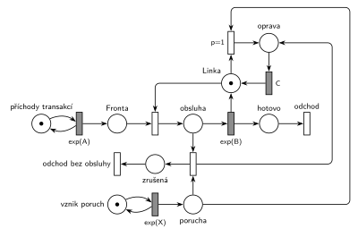

# 03–04 – Porucha s opravou, transakce odchází

## Zadání

⚠️ Původní zadání se nedochovalo, jen studentské přepisy (slovensky). Podrobný přepis neznámé skupiny:

> Petriho sieť MM1, kde v intervaloch Exp(X) dochádza k poruchám obslužnej linky. Oprava poruchy zaberie C jednotiek času. Ak sa chyba prejaví počas obsluhy transakcie, potom táto trans. okamžite bez náhrady opúšta systém. S využitím notácie knižnice SIMLIB napíš pseudokód pre procesy transakcií a obsluhy chyby. Modely MUSIA byť izomorfné.

Skupina A (zřejmě totéž): „M/M/1, porucha s Exp(X), trvanie poruchy C jednotiek + SIMLIB (proces, porucha)“.

Podobné úlohy:

- [03–05 – Kritická havárie](<../03–05 - Kritická havárie/03–05 - Kritická havárie.md>): stejná úloha s čísly (2025/26)
- [03–03 – Porucha s opravou, návrat do fronty](<../03–03 - Porucha s opravou, návrat do fronty/03–03 - Porucha s opravou, návrat do fronty.md>): přerušená transakce se vrací do fronty
- [03–01 – Porucha zruší obsluhu](<../03–01 - Porucha zruší obsluhu/03–01 - Porucha zruší obsluhu.md>): totéž bez doby opravy

## Interpretace

Zobrazit interpretaci (nápověda)

 

- **Oprava zabere linku na dobu C** (i když linka zrovna nic neobsluhuje): porucha si vezme značku *Linky* a vrátí ji po čase `C`, jako transakce s vyšší prioritou obsluhy.
- **Přerušená transakce „bez náhrady opúšta systém“:** má vlastní výstupní přechod *odchod bez obsluhy*.
- **Dva kroky:** přechod `p=1` dole zruší obsluhu, vrátí *Linku* a poruchu nechá v místě *porucha* (hrana tam a zpět). Přechod `p=1` nahoře pak poruchu spojí s volnou *Linkou* a začne oprava. Priorita nahoře je nutná, aby linku po zrušení nezabrala čekající transakce z *Fronty*.
- **Porucha během opravy** počká a linku zabere hned po skončení opravy (další oprava `C`), stejně jako proces poruchy v SIMLIBu čekající ve frontě k zařízení. Kdo chce, aby zanikla, přidá přechod *porucha bez účinku* s `p=0` jako v 03–02.
- SIMLIB část otázky tu není řešená. Požadavek na izomorfní modely znamená, že každému přechodu sítě má odpovídat krok v procesu transakce nebo poruchy.

## Petriho síť

Zobrazit Petriho síť

 

| Požadavek | Prvek sítě |
|---|---|
| M/M/1 | *generátor* ⇄ `exp(A)` → *Fronta* → obsazení *Linky* → `exp(B)` (vrací *Linku*) → *odchod* |
| poruchy v intervalech Exp(X) | *generátor poruch* ⇄ `Exp(X)` → *porucha* |
| porucha během obsluhy: transakce bez náhrady odchází | `p=1` dole: *porucha* (zůstává) + obsluhovaná transakce → *Linka* + *zrušená* → *odchod bez obsluhy* |
| oprava zabere linku na dobu C | `p=1` nahoře: *porucha* + *Linka* → *oprava* → `C` → *Linka* |

Kontrola simulací: *Linka* + obsluhovaná transakce + *oprava* = 1, každá porucha vede k jedné opravě a asi 57 % poruch zruší obsluhu.

## Časté chyby

Zobrazit časté chyby

 

- Porucha zabere jen obsazenou linku a při volné lince zanikne. Oprava ale trvá `C` vždy.
- Zabrání linky bez priority: po zrušení obsluhy si linku vezme transakce z *Fronty*.
- Přerušená transakce se vrací do fronty: to je úloha 03–03.
- Přerušená transakce zmizí bez výstupního přechodu.

## Původ a zdroje

Zobrazit původ a zdroje

 

**Původ:** zkouška 2021/22, 1. termín, nejspíš skupina A, otázka 1, 15 bodů (podle přepisu neznámé skupiny).

**Zdroje:**

- `Fitcheats/Zkoušky z minulých let/2021-22 - 1. termín.txt`: skupina A, otázka 1 (krátký přepis) a „Neznáma skupina (pravdepodobne jedna z vyššie spísaných)“, otázka 1 (podrobný přepis)
- `Fitcheats/Příprava na zkoušku/fifinas - Tabule ze streamu.pdf`, str. 2 („A) M/M/1, porucha s Exp(x) na C jednotek“: síť a SIMLIB ze streamu)

**Existující řešení:**

- **fifinas, str. 2:** volnou linku zabere porucha přechodem s `p=1` (*porucha* + *Linka*), obsazenou linku druhým přechodem (*porucha* + obsluhovaná transakce, červeně zakroužkovaný). Oba vedou do místa před časovaným přechodem `C`, který vrací *Linku*. Přerušená transakce zmizí. To je stejná logika jako tady, jen v jednom kroku. Chybí výstupní přechody: obsloužená i přerušená transakce mizí bez viditelného odchodu (dnes se odchod vyžaduje). SIMLIB na tabuli: `Seize(linka, 2); Wait(C); Release(linka);`.

