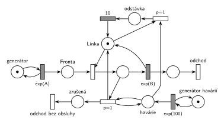

# 03–05 – Kritická havárie

## Zadání

> Zadaný systém modelujte prostředky Petriho sítě s vyznačením atributů na přechodech a místech. Vyznačte přechodem, kde transakce opouští systém.
>
> Uvažujme systém typu M/M/1. V intervalech exponenciálně se středem 100 časových jednotek se na lince projeví kritická havárie, která linku na přesně 10 časových jednotek zcela odstaví. Případná rozpracovaná obsluha je bez náhrady ukončena.

Podobné úlohy:

- [03–04 – Porucha s opravou, transakce odchází](<../03–04 - Porucha s opravou, transakce odchází/03–04 - Porucha s opravou, transakce odchází.md>): stejná úloha se symboly (2021/22)
- [03–03 – Porucha s opravou, návrat do fronty](<../03–03 - Porucha s opravou, návrat do fronty/03–03 - Porucha s opravou, návrat do fronty.md>): přerušená transakce se vrací do fronty
- [03–01 – Porucha zruší obsluhu](<../03–01 - Porucha zruší obsluhu/03–01 - Porucha zruší obsluhu.md>): bez odstávky

## Interpretace

<details>
<summary>Zobrazit interpretaci (nápověda)</summary>
<br>

- **M/M/1:** *příchody transakcí* ve smyčce s `exp(A)`, *Fronta*, obsazení *Linky*, obsluha `exp(B)`, která *Linku* vrací, a *odchod*. Časy příchodů a obsluhy zadání neuvádí, proto `exp(A)` a `exp(B)`.
- **Havárie** vznikají v intervalech `exp(100)`: místo *vznik havárií* ve smyčce s časovaným přechodem, každé provedení vloží značku do místa *havárie*.
- **„Linku na 10 č.j. zcela odstaví“:** havárie si vezme *Linku* do místa *odstávka* a časovaný přechod `10` ji vrátí, ať linka zrovna obsluhuje, nebo ne.
- **Volná linka:** přechod `p=1` nahoře spojí *havárii* s *Linkou* a začne odstávka. Priorita zajistí, že havárie, která čekala během předchozí odstávky, dostane linku dřív než transakce čekající ve *Frontě*.
- **Obsazená linka:** přechod dole vezme *havárii* a obsluhovanou transakci (místo *obsluha*), linku předá rovnou do *odstávky* (*Linka* + *obsluha* + *odstávka* = 1) a transakci pošle do místa *zrušená*. Odpočet `exp(B)` přitom zanikne (slajd 139).
- **„Rozpracovaná obsluha je bez náhrady ukončena“:** přerušená transakce se neobslouží a odchází ze systému. Zadání chce vyznačit odchod přechodem, a odchody jsou tu dva: *odchod* po obsluze a *odchod bez obsluhy*.
- Stejně správná je varianta ve dvou krocích: ukončení obsluhy vrátí značku *Lince* a havárii nechá v místě *havárie* (hrana tam a zpět), hned potom ji přechod `p=1` spojí s volnou *Linkou*. Tady je kreslená v jednom kroku, protože síť je jednodušší.
- **Havárie během odstávky** počká a linku odstaví znovu hned po skončení odstávky. Při exp(100) a odstávce 10 je to vzácné. Pokud by měla zaniknout, přidá se přechod *porucha bez účinku* s `p=0` jako v 03–02.
- „Atributy na místech“ jsou názvy míst a počáteční značky.

</details>

## Petriho síť

<details>
<summary>Zobrazit Petriho síť</summary>
<br>



</details>

## Časté chyby

<details>
<summary>Zobrazit časté chyby</summary>
<br>

- Havárie jen ukončí obsluhu, ale linku neodstaví (chybí doba 10).
- Odstávka jen při obsazené lince: volnou linku havárie neodstaví a hned může začít další obsluha.
- Ukončená transakce se vrací do fronty: to by byla náhrada (úloha 03–03).
- Chybí výstupní přechod pro ukončenou transakci (zadání ho výslovně chce).
- Linka se po odstávce nevrátí.
- V SIMLIBu jen `Seize(Linka, 1)`: přerušená transakce zůstane ve frontě přerušených a po odstávce obsluhu dokončí, tedy „s náhradou“.

</details>

## SIMLIB

<details>
<summary>Zobrazit SIMLIB kód</summary>
<br>

Model je izomorfní k Petriho síti výše: každé místo, přechod a značka mají svůj protějšek v kódu.

```cpp
// 03–05 Kritická havárie – model v SIMLIB/C++
#include "simlib.h"

const double A = 10, B = 6;              // symboly ze sítě (zadání je nemá)

Facility Linka("Linka");                 // místo Linka (zařízení s kapacitou 1)
Histogram Doba("Doba obsloužené transakce v systému", 0, 10, 20);
long havarie = 0, zruseno = 0;

class Transakce;
Transakce *obsluhovana = nullptr;        // místo „obsluha“ (nullptr = bez značky)

class Transakce : public Process {       // transakce = značka, která prochází sítí
 public:
  bool zrusena = false;
  void Behavior() {
    double prichod = Time;
    Seize(Linka);                        // obsazení: Fronta + Linka → obsluha
    obsluhovana = this;
    Wait(Exponential(B));                // časovaný přechod exp(B), havárie ho může přerušit
    if (zrusena)                         // místo „zrušená“ (Linku už má havárie)
      return;                            // přechod „odchod bez obsluhy“
    obsluhovana = nullptr;
    Release(Linka);                      // exp(B) vrací Linku
    Doba(Time - prichod);
  }                                      // konec Behavior = přechod „odchod“
};

class Havarie : public Process {         // havárie = značka v místě „havárie“
  void Behavior() {
    havarie++;
    Transakce *t = obsluhovana;          // probíhající obsluha, nebo nullptr
    Seize(Linka, 1);                     // priorita obsluhy 1: přerušení obsazené Linky,
                                         // u volné Linky zabrání p=1 (předběhne Frontu)
    if (t) {                             // přechod přerušení: transakce odchází
      t->Out();                          // SIMLIB by ji nechal ve frontě přerušených
      t->zrusena = true;                 // a po odstávce by obsluhu jen dokončil
      t->Activate();
      obsluhovana = nullptr;
      zruseno++;
    }
    Wait(10);                            // místo „odstávka“ + časovaný přechod 10 ...
    Release(Linka);                      // ... který vrací Linku
  }
};

class GeneratorHavarii : public Event {  // „vznik havárií“ ve smyčce s exp(100)
  void Behavior() {
    (new Havarie)->Activate();
    Activate(Time + Exponential(100));
  }
};

class Generator : public Event {         // „příchody transakcí“ ve smyčce s exp(A)
  void Behavior() {
    (new Transakce)->Activate();         // nová značka v místě „Fronta“
    Activate(Time + Exponential(A));
  }
};

int main() {
  Init(0, 1000000);                      // modelový čas v časových jednotkách sítě
  (new Generator)->Activate();
  (new GeneratorHavarii)->Activate(Exponential(100));
  Run();
  Linka.Output();
  Doba.Output();
  Print("Havárie: %ld, z toho ukončily obsluhu: %ld\n", havarie, zruseno);
}
```

| Petriho síť | SIMLIB |
|---|---|
| *příchody transakcí* ⇄ `exp(A)` | událost `Generator`, která se znovu plánuje za `Exponential(A)` |
| značka (transakce) | proces `Transakce` |
| *Fronta* + obsazení *Linky* | `Seize(Linka)` (fronta je vnitřní fronta zařízení) |
| místo *Linka* (1 značka) | `Facility Linka` |
| místo *obsluha* | ukazatel `obsluhovana` (`nullptr` = místo je prázdné) |
| `exp(B)` se sloučeným uvolněním *Linky* | `Wait(Exponential(B)); Release(Linka);` |
| *vznik havárií* ⇄ `exp(100)` | událost `GeneratorHavarii`, která se znovu plánuje za `Exponential(100)` |
| značka v místě *havárie* | proces `Havarie` |
| odstavení volné *Linky* (`p=1`) | `Seize(Linka, 1)`: priorita obsluhy 1 řadí havárii ve frontě zařízení před transakce |
| ukončení obsluhy (havárie + *obsluha* → *odstávka* + *zrušená*) | `Seize(Linka, 1)` u obsazené linky: SIMLIB vezme linku obsluhované transakci; `t->Out()` ji vyjme z fronty přerušených a `Activate()` s příznakem `zrusena` ji probudí |
| *zrušená* → *odchod bez obsluhy* | `if (zrusena) return;` (bez `Release`, linku má havárie) |
| místo *odstávka* + časovaný přechod `10` | `Wait(10); Release(Linka);` v procesu `Havarie` |
| přechod *odchod* | konec metody `Behavior()` transakce |

**Kontrola simulací.** Petriho síť: *Linka* + *obsluha* + *odstávka* = 1, všechny přechody se provádějí a každá havárie vede k jedné odstávce (`make check`). SIMLIB model: v jednom běhu (10⁶ časových jednotek, A = 10, B = 6) ukončilo obsluhu 5 524 z 9 854 havárií (56 %) a linka byla obsazená 66,2 % času (transakce i odstávky). Teoreticky obsluha končí dokončením nebo havárií, dřív z obou, takže trvá průměrně 1 / (1/6 + 1/100) = 5,66; transakce vytíží linku na 0,1 × 5,66 = 56,6 % (se stejnou pravděpodobností havárie zastihne obsluhu) a odstávky na 10/100 = 10 %, celkem 66,6 % (`make simlib`).

</details>

## Původ a zdroje

<details>
<summary>Zobrazit původ a zdroje</summary>
<br>

**Původ:** zkouška 2025/26, 1. termín (13. 1. 2026), skupina C, otázka 1, 10 bodů.

**Původní znění:**

> Zadaný systém modelujte prostředky Petriho sítě s vyznačením atributů na přechodech a místech. Vyznačte přechodem, kde transakce opouští systém.
>
> Uvažujme systém typu M/M/1. V intervalech exp(100) č.j. se na lince projeví kritická havárie, která linku na 10 č.j. zcela odstaví. Případná rozpracovaná obsluha je bez náhrady ukončena.

**Zdroje:**

- `Fitcheats/Zkoušky z minulých let/2025-26 - 1. termín C.pdf`, str. 1 (fotka zadání)

**Existující řešení:**

- K tomuto zadání žádné řešení není. Stejnou úlohu se symboly řeší fifinas (str. 2), viz [03–04 – Porucha s opravou, transakce odchází](<../03–04 - Porucha s opravou, transakce odchází/03–04 - Porucha s opravou, transakce odchází.md>).

</details>
