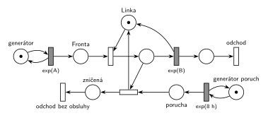

# 03–06 – Porucha zničí obsluhu nebo počká

## Zadání

⚠️ Původní zadání se nedochovalo, jen studentský přepis (slovensky):

> Petri MM1
> V intervaloch exp(8 hodín) sa objaví porucha ktorá buď:
> - zničí práve prebihajúcu obsluhu
> - alebo počká na príchod následujúcej obsluhy a tú zničí
>
> \+ SIMLIB kód
> Modely MUSIA byť izomorfné.

Podobné úlohy:

- [03–01 – Porucha zruší obsluhu](<../03–01 - Porucha zruší obsluhu/03–01 - Porucha zruší obsluhu.md>): porucha bez obsluhy zanikne
- [03–08 – Porucha prodlouží další obsluhu](<../03–08 - Porucha prodlouží další obsluhu/03–08 - Porucha prodlouží další obsluhu.md>): porucha čeká na další obsluhu a prodlouží ji
- [09–11 – Kopírovací centrum s poruchami](<../09–11 - Kopírovací centrum s poruchami/09–11 - Kopírovací centrum s poruchami.md>): porucha ničí rozpracované obsluhy

## Interpretace

Zobrazit interpretaci (nápověda)

- **Stačí jediný přechod:** *porucha* + obsluhovaná transakce → *Linka* + *zničená*. Když linka obsluhuje, provede se hned. Když neobsluhuje, porucha zůstane v místě *porucha* a přechod se provede ve chvíli, kdy další transakce obsadí linku. Obsluha je tedy zničena hned na začátku.
- **Oproti 03–01 tu chybí přechod *porucha bez účinku*.** Právě ten by poruchu při volné lince zahodil. Bez něj porucha „počká“.
- **Priorita není potřeba:** přechod nemá žádného okamžitého soupeře a před časovaným `exp(B)` má okamžitý přechod přednost vždy (slajd 139).
- **„Zničí obsluhu“:** transakce se neobslouží a odchází ze systému (*odchod bez obsluhy*). Porucha nemá dobu trvání, linka je hned volná.
- **Více čekajících poruch** (druhá přijde dřív, než začne další obsluha) zničí každá jednu další obsluhu. Při exp(8 h) je to vzácné. Kdyby měly splývat v jednu, použije se sloučení jako v 03–08.
- Časy příchodů a obsluhy zadání neuvádí, proto `exp(A)` a `exp(B)` (v simulaci v minutách).
- SIMLIB část otázky tu není řešená.

## Petriho síť

Zobrazit Petriho síť

| Požadavek | Prvek sítě |
|---|---|
| M/M/1 | *generátor* ⇄ `exp(A)` → *Fronta* → obsazení *Linky* → `exp(B)` (vrací *Linku*) → *odchod* |
| porucha v intervalech exp(8 h) | *generátor poruch* ⇄ `exp(8 h)` → *porucha* |
| zničí probíhající obsluhu | *porucha* + obsluhovaná transakce → *Linka* + *zničená* → *odchod bez obsluhy* |
| jinak počká na další obsluhu | žádný jiný přechod z místa *porucha*: porucha čeká, až se objeví obsluhovaná transakce |

Kontrola simulací: *Linka* + obsluhovaná transakce = 1, každá porucha zničí právě jednu obsluhu (počet zničení = počet poruch) a v místě *porucha* čekají nanejvýš tři poruchy najednou.

## Časté chyby

Zobrazit časté chyby

- Přechod *porucha bez účinku* převzatý z 03–01: porucha při volné lince zanikne a nepočká.
- Čekající porucha modelovaná vlastním časovaným přechodem nebo testem fronty. Stačí, že porucha zůstane v místě, dokud nemá s čím reagovat.
- Zničení bez vrácení *Linky*.
- Zničená transakce zmizí bez výstupního přechodu.

## Původ a zdroje

**Původ:** zkouška 2021/22, 2. termín, otázka 1 (body neuvedené).

**Zdroje:**

- `Fitcheats/Zkoušky z minulých let/2021-22 - 2. termín.txt`, otázka 1 (studentský přepis zadání)

**Existující řešení:**

Zobrazit existující řešení

- K této úloze žádné řešení není.

