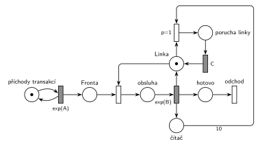

# 03–07 – Každá 10. transakce vyvolá poruchu

## Zadání

⚠️ Původní zadání se nedochovalo, jen studentský přepis (slovensky):

> M/M/1 Každá 10. transakcia ktorá prejde systémom vyvola poruchu na linke, ktorá trvá čas C. + Simlib

Podobné úlohy:

- [04–06 – Údržba po každé 10. obsluze](<../04–06 - Údržba po každé 10. obsluze/04–06 - Údržba po každé 10. obsluze.md>): stejná konstrukce, místo poruchy údržba
- [03–03 – Porucha s opravou, návrat do fronty](<../03–03 - Porucha s opravou, návrat do fronty/03–03 - Porucha s opravou, návrat do fronty.md>): stejné zabrání linky na dobu poruchy, spouští ho generátor
- [06–01 – MD1 – prodlužování po 10 obsluhách](<../06–01 - MD1 – prodlužování po 10 obsluhách/06–01 - MD1 – prodlužování po 10 obsluhách.md>): čítač 10 obsluh

## Interpretace

Zobrazit interpretaci (nápověda)

- **„Prejde systémom“** = dokončí obsluhu. Každé dokončení přidá značku do *čítače*. Přechod s hranou váhy 10 se provede u desáté transakce a zároveň čítač vynuluje (odebere všech 10 značek).
- **Porucha zabere linku na dobu C:** přechod *čítač* (10) + *Linka* → *porucha linky* → `C` → *Linka*. Porucha vzniká ve chvíli, kdy desátá transakce linku uvolní, takže nic nepřerušuje.
- **Priorita `p=1`:** po dokončení 10. obsluhy je *Linka* volná a ve *Frontě* může čekat další transakce. Bez priority by mohla linku obsadit dřív než porucha a porucha by se odložila až za její obsluhu.
- Obsluhu po čítači nijak neupravujeme: uvolnění zůstává sloučené s `exp(B)` jako v ostatních sítích, porucha si linku vezme hned potom.
- Doba poruchy `C` je konstanta, časy příchodů a obsluhy zadání neuvádí (`exp(A)`, `exp(B)`).
- SIMLIB část otázky tu není řešená.

## Řešení

Zobrazit řešení

| Požadavek | Prvek sítě |
|---|---|
| M/M/1 | *generátor* ⇄ `exp(A)` → *Fronta* → obsazení *Linky* → `exp(B)` (vrací *Linku*) → *odchod* |
| počítání transakcí, které prošly systémem | `exp(B)` → *čítač* |
| 10. transakce vyvolá poruchu | `p=1`: *čítač* (váha 10) + *Linka* → *porucha linky* |
| porucha trvá C | *porucha linky* → `C` → *Linka* |

Kontrola simulací: *Linka* + obsluhovaná transakce + *porucha linky* = 1, *čítač* nepřesáhne 10 a poruch je přesně desetina dokončených obsluh.

## Časté chyby

Zobrazit časté chyby

- Čítač jen otestovaný (hrana s váhou 10 tam i zpět), takže se nevynuluje: porucha pak nastane po každé další transakci.
- Porucha bez priority: linku po desáté obsluze obsadí další transakce.
- Porucha, která linku nezabere (jen čeká `C`): obsluha pokračuje, jako by se nic nestalo.
- Počítání příchodů místo dokončených obsluh.

## Původ a zdroje

**Původ:** zkouška 2021/22, 1. termín, skupina B, otázka 1 (body neuvedené).

**Zdroje:**

- `Fitcheats/Zkoušky z minulých let/2021-22 - 1. termín.txt`, skupina B, otázka 1 (studentský přepis zadání)
- `Fitcheats/Příprava na zkoušku/fifinas - Tabule ze streamu.pdf`, str. 3 („B) M/M/1 každá 10. vyvolá poruchu ⇒ C“: síť a SIMLIB ze streamu)

**Existující řešení:**

Zobrazit existující řešení

- **fifinas, str. 3:** `Exp(b)` posílá značku do čítače *Cnt* a do místa „uvolnění“. Přechod s hranou váhy 10 z *Cnt* vezme i značku z uvolnění a přes místo a čas `C` vrátí *Linku*. Jinak značka z uvolnění jde rovnou do *Linky*. Tedy totéž s uvolněním odděleným od obsluhy: porucha „zdrží“ desátou transakci na lince, jak to dělá i SIMLIB kód na tabuli (`if (done >= 10) { Wait(C); done = 0; }` před `Release`). Popisek priority je na tabuli u obou přechodů nejednoznačný. Musí ji mít přechod s váhou 10, jinak by se uvolnění provedlo vždy bez poruchy. Chybí výstupní přechod.

