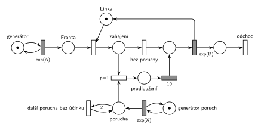

# 03–08 – Porucha prodlouží další obsluhu

## Zadání

> Nakreslete Petriho síť pro systém typu M/M/1. V intervalech daných exp(X) se na lince vyskytne porucha, která způsobí, že první následující transakce bude mít dobu obsluhy o 10 časových jednotek delší.

Podobné úlohy:

- [03–09 – Porucha prodlouží obsluhu o 2](<../03–09 - Porucha prodlouží obsluhu o 2/03–09 - Porucha prodlouží obsluhu o 2.md>): prodlužuje se právě probíhající obsluha
- [03–06 – Porucha zničí obsluhu nebo počká](<../03–06 - Porucha zničí obsluhu nebo počká/03–06 - Porucha zničí obsluhu nebo počká.md>): porucha také čeká na další obsluhu
- [06–01 – MD1 – prodlužování po 10 obsluhách](<../06–01 - MD1 – prodlužování po 10 obsluhách/06–01 - MD1 – prodlužování po 10 obsluhách.md>)

## Interpretace

Zobrazit interpretaci (nápověda)

- **„První následující transakce“** = první transakce, která po vzniku poruchy *začne* obsluhu. Probíhající obsluhu porucha nemění. Proto se o prodloužení rozhoduje v okamžiku obsazení linky (místo *zahájení*): `p=1` vybere prodlouženou cestu, pokud čeká porucha, jinak `p=0` (*bez poruchy*).
- **Prodloužení o 10** = konstantní časovaný přechod `10` před běžnou obsluhou `exp(B)`. Transakce celou dobu drží *Linku*, takže obsluha trvá `10 + exp(B)`.
- **Poruchy se nesmí hromadit:** dvě poruchy před začátkem obsluhy prodlouží stejnou (první následující) transakci, ne dvě po sobě jdoucí. Přechod *další porucha bez účinku* proto dvě čekající poruchy sloučí v jednu (hrana s váhou 2 dovnitř, 1 ven). V místě *porucha* je tak nejvýš jedna značka. Totéž jde udělat doplňkovým místem „bez poruchy“.
- Prodloužení se neopakuje: porucha během prodloužené obsluhy čeká na další transakci.
- Časy příchodů a obsluhy zadání neuvádí, proto `exp(A)` a `exp(B)`.

## Petriho síť

Zobrazit Petriho síť

| Požadavek | Prvek sítě |
|---|---|
| M/M/1 | *generátor* ⇄ `exp(A)` → *Fronta* → obsazení *Linky* → *zahájení* → *bez poruchy* → `exp(B)` (vrací *Linku*) → *odchod* |
| poruchy v intervalech exp(X) | *generátor poruch* ⇄ `exp(X)` → *porucha* |
| první následující transakce má obsluhu o 10 delší | `p=1`: *zahájení* + *porucha* → *prodloužení* → `10` → `exp(B)` |
| poruchy se nehromadí | *porucha* (váha 2) → *další porucha bez účinku* → *porucha* |

Kontrola simulací: *Linka* + transakce na lince (*zahájení*, *prodloužení*, obsluha) = 1, v místě *porucha* je nejvýš jedna značka. Každá porucha buď prodlouží jednu obsluhu, nebo splyne s už čekající.

## Časté chyby

Zobrazit časté chyby

- Hromadění poruch: každá porucha prodlouží jinou transakci.
- Prodloužení probíhající obsluhy místo následující (to je úloha 03–09).
- Prodloužení modelované jako `exp(B + 10)` nebo jako `exp(10)`: zadání říká o 10 časových jednotek delší, tedy konstantu přičtenou k náhodné době obsluhy.
- Rozhodnutí o prodloužení až po skončení obsluhy: porucha vzniklá během obsluhy by pak prodloužila tu probíhající.
- Stejné písmeno pro střední dobu příchodů a interval poruch.

## Původ a zdroje

Zobrazit původ a zdroje

**Původ:** zkouška 2017/18, 3. termín (2. 2. 2018), skupina 8A, otázka 3, 10 bodů.

**Zdroje:**

- `Fitcheats/Zkoušky z minulých let/2017-18 - 3. termín A.pdf`, str. 1 (sken zadání)
- `Fitcheats/Příprava na zkoušku/FIT - Příprava 2018-19.pdf`, str. 48 („2. opravný termín 2017/2018 - skupina A“, Př. 3: studentské řešení s komentáři)

**Existující řešení:**

- **Příprava 2018-19, str. 48:** stejná struktura jako tady: po obsazení linky místo, z něj přechod `p=1` (vezme i poruchu) přes čas `10` a přechod bez priority přímo k `exp(y)`. Komentáře se neshodnou. Zelený: „Za mě je to dobře, akorát bych si dával pozor na popisky těch časovaných přechodů. Exp(x) je dle zadání jen pro generování poruch…“ (síť používá `exp(x)` pro příchody i `Exp(X)` pro poruchy). Červený: „Za mě je to špatně, protože těch poruch se tam může nakumulovat víc, což neodpovídá zadání.“ Červený má pravdu: bez sloučení prodlouží dvě poruchy dvě transakce. Jinak je síť v pořádku, včetně výstupního přechodu.

