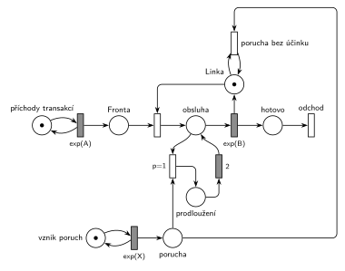

# 03–09 – Porucha prodlouží obsluhu o 2

## Zadání

⚠️ Zadání je dochované jen jako ruční přepis:

> 2.(10b) Modelujte Petriho sítí systém M/M/1 s následujícím specifikem: v intervalech daných exponenciálním rozložením se středem X časových jednotek se v systému projeví porucha, která prodlouží případnou právě probíhající obsluhu o 2 čas. jednotky.
>
> 3.(10b) Pseudokód podle 2. bodu zadání.

Podobné úlohy:

- [03–10 – Porucha prodlouží probíhající obsluhu o 5](<../03–10 - Porucha prodlouží probíhající obsluhu o 5/03–10 - Porucha prodlouží probíhající obsluhu o 5.md>): stejná úloha s jinými čísly
- [03–08 – Porucha prodlouží další obsluhu](<../03–08 - Porucha prodlouží další obsluhu/03–08 - Porucha prodlouží další obsluhu.md>): prodlužuje se následující obsluha
- [03–02 – Porucha vrací transakci do fronty](<../03–02 - Porucha vrací transakci do fronty/03–02 - Porucha vrací transakci do fronty.md>): stejné přerušení, transakce jde do fronty

## Interpretace

Zobrazit interpretaci (nápověda)

- **Jak prodloužit běžící časovaný přechod:** v Petriho síti nejde k běžícímu odpočtu `exp(B)` „přičíst“ 2. Jde ho ale přerušit: přechod `p=1` si vezme značku obsluhované transakce (slajd 139, stejně jako v 03–02) a pošle ji do místa *prodloužení*. Po 2 časových jednotkách se transakce vrátí do obsluhy a `exp(B)` začne odpočítávat znovu.
- **Proč je to správně:** exponenciální rozdělení je bez paměti. Zbývající doba obsluhy přerušené v libovolném okamžiku má opět rozdělení `exp(B)`, nezávisle na tom, kolik už uběhlo. Nový odpočet `exp(B)` je tedy statisticky totéž co pokračování starého a celková obsluha = dosavadní doba + 2 + zbytek. U konstantní nebo rovnoměrné doby obsluhy (M/D/1) by tento trik nefungoval, tam je potřeba konstrukce popsaná v [03–10](<../03–10 - Porucha prodlouží probíhající obsluhu o 5/03–10 - Porucha prodlouží probíhající obsluhu o 5.md>).
- **„Případnou“ obsluhu:** porucha při volné lince nemá účinek a zanikne. Přechod *porucha bez účinku* ale nesmí být jen obyčejný přechod `p=0` jako v 03–02: zahodil by i poruchu, která přijde během prodloužení (obsluha přitom pořád probíhá). Proto testuje, že je *Linka* volná (hrana z *Linky* a zpět). Porucha během prodloužení tak počká a hned po něm obsluhu přeruší znovu: prodloužení se sečtou.
- Přerušení s `p=1` a zánik s testem *Linky* nikdy nejsou proveditelné zároveň, priorita je tu jen pro přehlednost a shodu s 03–02.
- Časy příchodů a obsluhy zadání neuvádí, proto `exp(A)` a `exp(B)`.
- Pseudokód (otázka 3) tu není řešený.

## Petriho síť

Zobrazit Petriho síť

| Požadavek | Prvek sítě |
|---|---|
| M/M/1 | *generátor* ⇄ `exp(A)` → *Fronta* → obsazení *Linky* → `exp(B)` (vrací *Linku*) → *odchod* |
| poruchy v intervalech exp(X) | *generátor poruch* ⇄ `exp(X)` → *porucha* |
| prodlouží probíhající obsluhu o 2 | `p=1`: *porucha* + obsluhovaná transakce → *prodloužení* → `2` → zpět do obsluhy (`exp(B)` znovu, bez paměti) |
| bez probíhající obsluhy porucha nic nedělá | *porucha* + volná *Linka* → *porucha bez účinku* → *Linka* |

Kontrola simulací: *Linka* + obsluhovaná transakce + *prodloužení* = 1, každá porucha buď prodlouží obsluhu, nebo zanikne při volné lince. V místě *porucha* čekají nejvýš dvě poruchy (druhá přišla během prodloužení).

## Časté chyby

Zobrazit časté chyby

- Časovaný přechod `2` zapojený za `exp(B)` „pro jistotu“ u každé obsluhy: prodlouží se i obsluhy bez poruchy.
- Porucha, která prodlouží až další obsluhu (to je úloha 03–08).
- Přerušená transakce, která po prodloužení nepokračuje v obsluze, ale jde do fronty nebo odchází.
- Chybějící zánik poruchy při volné lince: poruchy se hromadí a prodlouží pozdější obsluhy.
- Zánik poruchy jako obyčejný přechod `p=0`: porucha během prodloužení se ztratí.

## Původ a zdroje

Zobrazit původ a zdroje

**Původ:** zkouška 2020/21, 1. opravný termín (11:00), otázka 2, 10 bodů. Soubor se zadáním se jmenuje „1. termín“, ale otázky jsou totožné s termínem „2021 - 1. opravný 11:00“ v Řešených výpočetních příkladech.

**Zdroje:**

- `Fitcheats/Zkoušky z minulých let/2020-21 - 1. termín.pdf`, str. 1 (ručně přepsané celé zadání)
- `Fitcheats/Příprava na zkoušku/FIT - Řešené výpočetní příklady 2017-21.pdf`, str. 37 („2021 - 1. opravný 11:00“, jen text zadání a odkaz na pseudokód)

**Existující řešení:**

- K této úloze žádná nakreslená síť není. Řešené výpočetní příklady (str. 37) mají jen odkaz na pseudokód.

