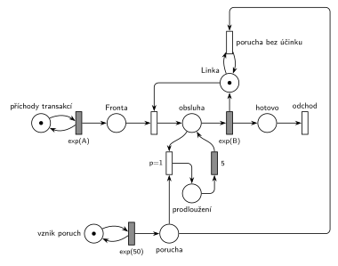

# 03–10 – Porucha prodlouží probíhající obsluhu o 5

## Zadání

⚠️ Původní zadání se nedochovalo, jen studentský přepis (slovensky):

> 2. (10b) Petriho sieť pre M/M/1 kde vzniká porucha každých Exp(50), ktorá predĺži momentálny proces o 5 j.č. Ak pri vytvorení poruchy momentálne neprebieha žiadny proces tak sa nepredlžuje nič.
>
> 3. (10b) Pseudokód na základe SIMLIBu, pre zadanie z 2. úlohy

Podobné úlohy:

- [03–09 – Porucha prodlouží obsluhu o 2](<../03–09 - Porucha prodlouží obsluhu o 2/03–09 - Porucha prodlouží obsluhu o 2.md>): stejná úloha (2020/21, 1. opravný termín) s čísly X a 2
- [03–08 – Porucha prodlouží další obsluhu](<../03–08 - Porucha prodlouží další obsluhu/03–08 - Porucha prodlouží další obsluhu.md>): prodlužuje se následující obsluha

## Interpretace

Zobrazit interpretaci (nápověda)

- **„Momentálny proces“** = právě probíhající obsluha. Síť je stejná jako v [03–09](<../03–09 - Porucha prodlouží obsluhu o 2/03–09 - Porucha prodlouží obsluhu o 2.md>), jen s `Exp(50)` a prodloužením `5`.
- **Prodloužení běžící obsluhy:** přechod `p=1` obsluhu přeruší (vezme značku transakce), transakce počká 5 časových jednotek v místě *prodloužení* a pak se vrátí do obsluhy, kde `exp(B)` začne znovu. Díky bezpaměťovosti exponenciálního rozdělení má zbytek obsluhy pořád rozdělení `exp(B)`, takže celková obsluha = dosavadní doba + 5 + zbytek.
- **„Ak … neprebieha žiadny proces, tak sa nepredlžuje nič“:** *porucha bez účinku* zanikne jen při volné *Lince* (hrana z *Linky* a zpět). Porucha během prodloužení počká a obsluhu prodlouží znovu.
- **Obecnější konstrukce (i pro konstantní obsluhu, M/D/1),** kde se bezpaměťovost nevyužívá: porucha při obsazené lince přidá značku do místa *dluh*. Po skončení obsluhy přejde transakce do místa *hotovo*, odkud přechod `p=1` (*hotovo* + *dluh*) vede přes čas `5` zpět do *hotovo* a přechod `p=0` uvolní *Linku* a pošle transakci k odchodu. Prodloužení se tak přičtou na konci, celková doba je stejná. Uvolnění linky už ale nejde sloučit s časovaným přechodem obsluhy.
- Časy příchodů a obsluhy zadání neuvádí, proto `exp(A)` a `exp(B)`.
- SIMLIB část (otázka 3) tu není řešená.

## Petriho síť

Zobrazit Petriho síť

| Požadavek | Prvek sítě |
|---|---|
| M/M/1 | *generátor* ⇄ `exp(A)` → *Fronta* → obsazení *Linky* → `exp(B)` (vrací *Linku*) → *odchod* |
| porucha každých Exp(50) | *generátor poruch* ⇄ `Exp(50)` → *porucha* |
| prodlouží probíhající obsluhu o 5 | `p=1`: *porucha* + obsluhovaná transakce → *prodloužení* → `5` → zpět do obsluhy |
| bez probíhající obsluhy se nic neprodlužuje | *porucha* + volná *Linka* → *porucha bez účinku* → *Linka* |

Kontrola simulací: *Linka* + obsluhovaná transakce + *prodloužení* = 1, asi dvě třetiny poruch prodlouží obsluhu, zbytek zanikne při volné lince.

## Časté chyby

Zobrazit časté chyby

- Prodloužení až následující obsluhy (úloha 03–08).
- Přerušení obsluhy bez návratu do ní: transakce po prodloužení odejde nebo jde do fronty.
- Zánik poruchy jako obyčejný přechod `p=0`: porucha během prodloužení se ztratí.
- Tento postup (restart `exp(B)`) použitý pro konstantní dobu obsluhy: odpočet by začal znovu od začátku a obsluha by se prodloužila víc než o 5.

## Původ a zdroje

**Původ:** zkouška 2020/21, náhradní termín (COVID), otázka 2, 10 bodů.

**Zdroje:**

- `Fitcheats/Příprava na zkoušku/FIT - Řešené výpočetní příklady 2017-21.pdf`, str. 38 („2021 - náhradný COVID termín“, jen text zadání, bez řešení)

**Existující řešení:**

Zobrazit existující řešení

- K této úloze žádné řešení není.

