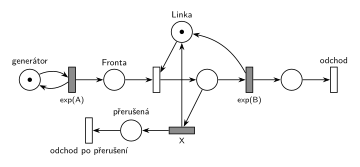

# 03–11 – Přerušení příliš dlouhé obsluhy

## Zadání

> Pro následující systém nakreslete jeho model v Petriho síti. Systém typu M/M/1. Pokud právě probíhající obsluha přesáhne délku X č.j., pak je přerušena a její transakce opouští systém.

Podobné úlohy:

- [03–01 – Porucha zruší obsluhu](<../03–01 - Porucha zruší obsluhu/03–01 - Porucha zruší obsluhu.md>): stejný tvar, obsluhu ukončí porucha místo časového limitu
- [02–01 – Netrpělivé požadavky](<../02–01 - Netrpělivé požadavky/02–01 - Netrpělivé požadavky.md>): časový limit na čekání ve frontě
- [04–05 – Údržba po dlouhé obsluze](<../04–05 - Údržba po dlouhé obsluze/04–05 - Údržba po dlouhé obsluze.md>)

## Interpretace

Zobrazit interpretaci (nápověda)

- **Časový limit = druhý časovaný přechod na stejném místě.** Z místa obsluhy vedou dva časované přechody: `exp(B)` (konec obsluhy) a `X` (limit). Oba začnou odpočítávat ve chvíli, kdy transakce obsadí linku. Který doběhne dřív, ten si značku vezme a druhý odpočet zanikne (slajdy 137 a 139).
- Obsluha tedy skončí normálně, je-li `exp(B) < X`. Jinak ji po `X` č.j. přeruší limit: vrátí *Linku* a transakce odchází přes *přerušená* → *odchod po přerušení*.
- `X` je konstanta (délka ze zadání), ne `exp(X)`.
- Žádná priorita ani porucha tu není potřeba. Na rozdíl od netrpělivosti ve frontě ([02–01](<../02–01 - Netrpělivé požadavky/02–01 - Netrpělivé požadavky.md>)) je limit na místě obsluhy, kde je vždy nejvýš jedna značka.

## Řešení

Zobrazit řešení

| Požadavek | Prvek sítě |
|---|---|
| M/M/1 | *generátor* ⇄ `exp(A)` → *Fronta* → obsazení *Linky* → `exp(B)` (vrací *Linku*) → *odchod* |
| obsluha přesáhne X → přerušena | časovaný přechod `X` z místa obsluhy, soupeří s `exp(B)` a vrací *Linku* |
| transakce opouští systém | *přerušená* → *odchod po přerušení* |

Kontrola simulací: *Linka* + obsluhovaná transakce = 1, provádějí se oba odchody.

## Časté chyby

Zobrazit časté chyby

- Limit jako okamžitý přechod nebo `exp(X)`: zadání dává pevnou délku `X`.
- Limit bez vrácení *Linky*: po prvním přerušení se systém zastaví.
- Limit napojený na *Frontu* místo na obsluhu: to je netrpělivost ve frontě (02–01).
- Přerušená transakce, která se vrací do fronty: zadání chce, aby opustila systém.

## Původ a zdroje

**Původ:** zkouška 2019/20, 2. termín (29. 1. 2020; v Řešených výpočetních příkladech „2020 - 1. opravný“), skupina Z, otázka 3, 10 bodů.

**Zdroje:**

- `Fitcheats/Zkoušky z minulých let/2019-20 - 2. termín Z.pdf`, str. 3 (fotka zadání)
- `Fitcheats/Příprava na zkoušku/FIT - Řešené výpočetní příklady 2017-21.pdf`, str. 27 („2020 - 1. opravný“, otázka 3: studentské řešení)
- `Fitcheats/Příprava na zkoušku/cranycrane - Kódy (generátory, Monte Carlo, Euler, RK, Petri + SIMLIB)/petri/2.png` a `2.cpp`

**Existující řešení:**

Zobrazit existující řešení

- **Řešené výpočetní příklady, str. 27:** stejná síť: z místa obsluhy časovaný přechod `exp(x)` a časovaný přechod `X`, ten vrací linku dlouhou hranou kolem celé sítě a transakce jím odchází. V diskuzi „Ano: +2“. Jen značení je matoucí: obsluha je `exp(x)` a limit `X`, příchody `exp(y)`.
- **cranycrane, 2.png:** totéž, limit `X` vrací linku (zeleně) a vede přes místo k odchodu. Přechody jsou nakreslené jen jako čárky, takže časovaný a okamžitý nejdou rozlišit. V `2.cpp` je obsluha `Wait(min(Exponential(B), X))` (zapsané přes `if`), ale generátor nikdy nevytvoří transakci (chybí `(new Rob_neco)->Activate()`), takže program nic nesimuluje.

