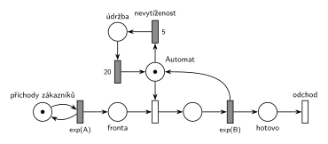

# Automat na kávu – údržba po nečinnosti

## Zadání

> 1. (10 bodů) Nakreslete Petriho síť pro systém typu M/M/1 s obslužnou linkou "automat na kafe". Automat se po každých přesně 5 časových jednotkách nevytíženosti přepne do režimu údržby (není k dispozici) na dobu přesně 20 časových jednotek.

Zkouška 2018/19 podle vzpomínky: „… automat na kávu, který při vydávání kávy zabere obslužnou linku a pokud u oblužné linky není fronta po dobu 5 časových jednotek, tj. automat se nějakou dobu nepoužívá, tak přejde do nečinného režimu na dobu 20 časových jednotek.“

Podobné úlohy:

- [Automat na kávu – uspání](<../03 - Automat na kávu – uspání/03 - Automat na kávu – uspání.md>): po nečinnosti automat usne a probudí ho až zákazník
- [Spánek po nečinnosti](<../08 - Spánek po nečinnosti/08 - Spánek po nečinnosti.md>)
- [Údržba při prázdné frontě](<../04 - Údržba při prázdné frontě/04 - Údržba při prázdné frontě.md>): údržba hned po obsluze, ne po nečinnosti
- [Automat na kávu – údržba po 50 obsluhách](<../02 - Automat na kávu – údržba po 50 obsluhách/02 - Automat na kávu – údržba po 50 obsluhách.md>)
- [Trafika](<../../09 - Obsluha zákazníků/09 - Trafika/09 - Trafika.md>): stejný časovač nečinnosti na místě prodavače

## Nápověda

<details>
<summary>Zobrazit nápovědu</summary>
<br>

- **M/M/1:** *příchody zákazníků* ⇄ `exp(A)` → *fronta* → obsazení *Automatu* → `exp(B)`, které značku automatu vrací → *odchod*. Střední doby příchodů a obsluhy zadání neuvádí, proto `exp(A)` a `exp(B)`.
- **Nevytíženost** = automat nic nevydává a nikdo nečeká. Přesně tehdy je značka v místě *Automat*: obsazení je okamžitý přechod, takže při neprázdné frontě si značku vezme hned. Vzpomínka z roku 2018/19 („není fronta po dobu 5“) dodává „automat se nějakou dobu nepoužívá“, jde tedy o tutéž podmínku.
- **Časovač 5:** časovaný přechod `5` (*nevytíženost*) má jediný vstup, místo *Automat*. Odpočet běží jen po dobu, kdy automat stojí. Když přijde zákazník, obsazení si značku vezme a odpočet zanikne (slajd 139). Po každé obsluze začíná znovu od nuly.
- **Údržba (není k dispozici)** je stav značky automatu: `5` ji přesune do místa *údržba* → `20` → zpět do *Automatu*. Zákazníci, kteří mezitím přijdou, čekají ve *frontě*.
- **„Po každých 5“:** když po údržbě stále nikdo nepřišel, odpočet běží znovu a za dalších 5 přijde další údržba. Síť to dělá sama, nic dalšího není potřeba.
- Doby 5 a 20 jsou pevné, ne exponenciální.
- Zákazník po obsluze **opouští systém** přechodem *odchod*.

</details>

## Petriho síť

<details>
<summary>Zobrazit Petriho síť</summary>
<br>



</details>

## Časté chyby

<details>
<summary>Zobrazit časté chyby</summary>
<br>

- Časovač napojený na *frontu* nebo na generátor místo na volný automat. Pak neměří nevytíženost automatu.
- Časovač s vlastní značkou (samostatný generátor „každých 5“), který automat nijak nezastaví ani se neresetuje při obsluze. Údržba pak přichází pravidelně bez ohledu na provoz.
- Údržba, která si vezme automat i během obsluhy (přerušení). Zadání mluví o nevytíženosti, obsluha se nepřerušuje.
- Návrat z údržby do jiného místa než *Automat* (ztráta značky linky).

</details>

## SIMLIB

<details>
<summary>Zobrazit SIMLIB kód</summary>
<br>

Model je izomorfní k Petriho síti výše: každé místo, přechod a značka mají svůj protějšek v kódu.

```cpp
// Automat na kávu – údržba po nečinnosti – model v SIMLIB/C++
#include "simlib.h"

const double A = 10;                   // střední interval příchodů (zadání ho neuvádí)
const double B = 6;                    // střední doba obsluhy (zadání ji neuvádí)

Facility Automat("Automat");           // místo „Automat“ (1 značka) + fronta
Histogram Doba("Doba zákazníka v systému [č. j.]", 0, 5, 20);
int udrzeb = 0;                        // počet provedených údržeb

class Necinnost;
Necinnost *odpocet = nullptr;          // běžící odpočet přechodu 5, nebo žádný

class Necinnost : public Process {     // značka automatu na cestě 5 → údržba → 20
  void Behavior() {
    Wait(5);                           // časovaný přechod 5 (nevytíženost) doběhl ...
    odpocet = nullptr;
    Seize(Automat);                    // ... a vzal značku automatu: místo „údržba“
    udrzeb++;
    Wait(20);                          // časovaný přechod 20 ...
    Release(Automat);                  // ... vrací značku do místa Automat
    Volno();
  }
 public:
  static void Volno() {                // značka je zpět v místě Automat
    if (!Automat.Busy()) {             // fronta je prázdná, nikdo ji hned neobsadil
      odpocet = new Necinnost;         // začíná odpočet 5
      odpocet->Activate();
    }
  }
};

class Zakaznik : public Process {      // transakce = značka, která prochází sítí
  void Behavior() {
    double prichod = Time;
    if (odpocet) {                     // obsazení vezme značku automatu:
      odpocet->Cancel();               // odpočet 5 zanikne (slajd 139)
      odpocet = nullptr;
    }
    Seize(Automat);                    // fronta + obsazení
    Wait(Exponential(B));              // časovaný přechod exp(B) ...
    Release(Automat);                  // ... který vrací značku automatu
    Necinnost::Volno();
    Doba(Time - prichod);
  }                                    // konec Behavior = přechod „odchod“
};

class Generator : public Event {       // místo „příchody zákazníků“ ve smyčce s exp(A)
  void Behavior() {
    (new Zakaznik)->Activate();        // nová značka v místě „fronta“
    Activate(Time + Exponential(A));   // další příchod
  }
};

int main() {
  Init(0, 100000);                     // modelový čas v časových jednotkách
  (new Generator)->Activate();
  Necinnost::Volno();                  // na začátku je automat volný: běží odpočet 5
  Run();
  Automat.Output();                    // vytížení = obsluha + údržba
  Doba.Output();
  Print("Počet údržeb: %d\n", udrzeb);
}
```

| Petriho síť | SIMLIB |
|---|---|
| *příchody zákazníků* ⇄ `exp(A)` | událost `Generator`, která se znovu plánuje za `Exponential(A)` |
| značka (zákazník) | proces `Zakaznik` |
| *fronta* + obsazení automatu | `Seize(Automat)` (fronta je vnitřní fronta zařízení) |
| časovaný přechod `exp(B)` se sloučeným uvolněním | `Wait(Exponential(B)); Release(Automat);` |
| místo *Automat* (1 značka) | `Facility Automat`; značka v místě = `!Automat.Busy()` |
| odpočet `5` (*nevytíženost*) | proces `Necinnost`, `Wait(5)`, spuštěný v `Volno()` vždy, když značka zůstane v místě *Automat* |
| obsazení zruší odpočet | `odpocet->Cancel()` v procesu `Zakaznik` |
| *údržba* → `20` → *Automat* | `Seize(Automat); Wait(20); Release(Automat);` v procesu `Necinnost` |
| přechod *odchod* | konec metody `Behavior()` |

**Kontrola simulací.** Petriho síť: *Automat* + obsluha + *údržba* = 1, všechny přechody se provádějí, údržba se spouští jen při prázdné frontě a fronta zůstává krátká (`make check`). SIMLIB model: v jednom běhu (100 000 č. j.) prošlo systémem 10 059 zákazníků a proběhlo 1 486 údržeb. Automat byl obsazený 90 % času: obsluha 60 % (10 059 × 6 / 100 000, teoreticky B/A = 6/10 = 60 %) a údržba 30 % (1 486 × 20 / 100 000). Zákazník strávil v systému průměrně 23 č. j. (`make simlib`).

</details>

## Původ a zdroje

<details>
<summary>Zobrazit původ a zdroje</summary>
<br>

**Původ:** zkouška 2017/18, 2. termín (19. 1. 2018), skupina 8B, otázka 1, 10 bodů. Stejná úloha (podle vzpomínky studenta): zkouška 2018/19, 1. termín, otázka 1, 10 bodů.

**Původní znění:**

> 1. (10 bodů) Nakreslete Petriho síť pro systém typu M/M/1 s obslužnou linkou "automat na kafe". Automat se po každých 5 časových jednotkách nevytíženosti přepne do režimu údržby (není k dispozici) na dobu 20 časových jednotek.

**Zdroje:**

- `Fitcheats/Zkoušky z minulých let/2017-18 - 2. termín B.pdf`, str. 1 (sken zadání)
- `Fitcheats/Zkoušky z minulých let/2018-19 - 1. termín.txt` (první vzpomínka v souboru)
- `Fitcheats/Příprava na zkoušku/FIT - Příprava 2018-19.pdf`, str. 37–38 („1. opravný termín 2017/2018 - skupina B“: fotka studentského řešení, „Spravne - 3x“, a pokusy o SIMLIB) a str. 51 („řádný termín 2018/2019“, jen text)
- `Fitcheats/Příprava na zkoušku/xenix - Příprava.pdf`, str. 27 (táž fotka jako v Přípravě 2018-19)

**Existující řešení:**

- **Příprava 2018-19, str. 37 (a xenix, str. 27, táž fotka):** stejná síť: linka → přechod `5` → místo → přechod `20` → linka, odpočet ruší obsazení linky. Je kreslená bez rozlišení časovaných a okamžitých přechodů (všechny jsou prázdné obdélníky), časy u nich ale jsou. Řešení má tři souhlasy („Spravne - 3x“) a je správné. Následující SIMLIB pokusy (proces `Timeout` rušený při každém `Seize`) nejsou součástí otázky.

</details>

## Reference

- [Jak síť funguje](<../../../basics/Jak síť funguje.md>)
- [Notace a vzory](<../../../basics/Notace a vzory.md>)
- [Seznam úloh](<../../Seznam úloh.md>)
