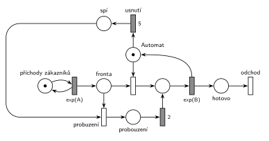

# Automat na kávu – uspání

## Zadání

> Zadán M/M/1, ve kterém obsluhuje kávový automat. Když neprobíhá obsluha a po dobu přesně 5 časových jednotek není nebo nepřichází požadavek k obsluze, automat se uspí. Při "probuzení" se délka obsluhy zákazníka prodlužuje o přesně 2 časové jednotky.
> - pozn.: o frontě nebyla zmínka, tudíž lze uvážit, že zákazníci stojí ve frontě dokud nejsou obslouženi

Podobné úlohy:

- [Spánek po nečinnosti](<../08 - Spánek po nečinnosti/08 - Spánek po nečinnosti.md>): probouzení trvá 5 min, zákazník při něm čeká ve frontě
- [Výpočetní služba se spánkem](<../../10 - Počítačové systémy/02 - Výpočetní služba se spánkem/02 - Výpočetní služba se spánkem.md>)
- [Automat na kávu – údržba po nečinnosti](<../01 - Automat na kávu – údržba po nečinnosti/01 - Automat na kávu – údržba po nečinnosti.md>): stejný časovač, místo spánku údržba

## Nápověda

<details>
<summary>Zobrazit nápovědu</summary>
<br>

- **M/M/1:** *příchody zákazníků* ⇄ `exp(A)` → *fronta* → obsazení *Automatu* → `exp(B)`, které značku automatu vrací → *odchod*. Střední doby příchodů a obsluhy zadání neuvádí, proto `exp(A)` a `exp(B)`.
- **„Neprobíhá obsluha a nikdo nečeká“** = značka je v místě *Automat* (obsazení je okamžitý přechod, při neprázdné frontě si značku vezme hned). Časovaný přechod `5` (*usnutí*) má jediný vstup, *Automat*, a přesouvá značku do místa *spí*. Když mezitím přijde zákazník, obsazení si značku vezme a odpočet zanikne (slajd 139).
- **Automat má čtyři stavy** a jeho značka je vždy v právě jednom z nich: volný (*Automat*), obsluhuje, *spí*, *probouzení*.
- **Probuzení = obsazení spícího automatu.** Druhý okamžitý přechod obsazení (*probuzení*) bere zákazníka z *fronty* a značku ze *spí*. Zákazník tak automat drží už během probouzení.
- **Prodloužení o 2:** po probuzení jde zákazník nejdřív přes přechod `2` a pak teprve do běžné obsluhy `exp(B)`. Jeho obsluha trvá 2 + exp(B), obsluhy ostatních zůstávají exp(B).
- Zákazníci, kteří přijdou během probouzení nebo obsluhy, čekají ve *frontě* (poznámka v zadání).
- Kdyby se probouzení chápalo jako čas, kdy zákazník ještě čeká ve frontě a automat se „startuje“ (jako v úloze [Spánek po nečinnosti](<../08 - Spánek po nečinnosti/08 - Spánek po nečinnosti.md>)), automat by byl obsazený stejně dlouho. Zadání ale mluví o délce obsluhy zákazníka, proto je tu zákazník v obsluze už během probouzení.
- Doby 5 a 2 jsou pevné.
- Zákazník po obsluze **opouští systém** přechodem *odchod*.

</details>

## Petriho síť

<details>
<summary>Zobrazit Petriho síť</summary>
<br>



</details>

## Časté chyby

<details>
<summary>Zobrazit časté chyby</summary>
<br>

- Časovač usnutí na *frontě* nebo na generátoru místo na volném automatu.
- Spící automat, který se probudí sám po nějaké době, nebo ho probudí až příchod v době, kdy už nikdo nečeká. Probudit ho musí zákazník, který čeká ve *frontě*.
- Prodloužení o 2 u všech obsluh (časovaný přechod `2` přímo v hlavní větvi) místo jen u obsluhy po probuzení.
- `exp(2)` místo pevné doby 2.
- Probuzení, po kterém se značka automatu nevrátí do *Automatu* (automat po první obsluze po probuzení zmizí nebo zůstane „spát“).

</details>

## SIMLIB

<details>
<summary>Zobrazit SIMLIB kód</summary>
<br>

Model je izomorfní k Petriho síti výše: každé místo, přechod a značka mají svůj protějšek v kódu.

```cpp
// Automat na kávu – uspání – model v SIMLIB/C++
#include "simlib.h"

const double A = 10;                   // střední interval příchodů (zadání ho neuvádí)
const double B = 6;                    // střední doba obsluhy (zadání ji neuvádí)

Facility Automat("Automat");           // značka automatu: volný / obsluhuje / probouzí se
bool spi = false;                      // značka automatu je v místě „spí“
Histogram Doba("Doba zákazníka v systému [č. j.]", 0, 5, 20);
int necinnosti = 0, usnuti = 0;        // počet období nečinnosti a usnutí

class Usnuti : public Event {          // časovaný přechod 5 (usnutí)
  void Behavior();
};
Usnuti *odpocet = nullptr;             // běžící odpočet přechodu 5, nebo žádný

void Usnuti::Behavior() {
  odpocet = nullptr;
  spi = true;                          // značka automatu přešla do místa „spí“
  usnuti++;
}

void Volno() {                         // značka se vrátila do místa Automat
  if (!Automat.Busy()) {               // fronta je prázdná, nikdo ji hned neobsadil
    necinnosti++;
    odpocet = new Usnuti;              // začíná odpočet 5
    odpocet->Activate(Time + 5);
  }
}

class Zakaznik : public Process {      // transakce = značka, která prochází sítí
  void Behavior() {
    double prichod = Time;
    if (odpocet) {                     // obsazení vezme značku automatu:
      odpocet->Cancel();               // odpočet 5 zanikne (slajd 139)
      odpocet = nullptr;
    }
    Seize(Automat);                    // fronta + obsazení, nebo probuzení
    if (spi) {                         // přechod „probuzení“ (bere značku ze „spí“)
      spi = false;
      Wait(2);                         // místo „probouzení“ + časovaný přechod 2
    }
    Wait(Exponential(B));              // časovaný přechod exp(B) ...
    Release(Automat);                  // ... který vrací značku automatu
    Volno();
    Doba(Time - prichod);
  }                                    // konec Behavior = přechod „odchod“
};

class Generator : public Event {       // místo „příchody zákazníků“ ve smyčce s exp(A)
  void Behavior() {
    (new Zakaznik)->Activate();        // nová značka v místě „fronta“
    Activate(Time + Exponential(A));   // další příchod
  }
};

int main() {
  Init(0, 100000);                     // modelový čas v časových jednotkách
  (new Generator)->Activate();
  Volno();                             // na začátku je automat volný: běží odpočet 5
  Run();
  Automat.Output();
  Doba.Output();
  Print("Období nečinnosti: %d, z toho usnutí: %d\n", necinnosti, usnuti);
}
```

| Petriho síť | SIMLIB |
|---|---|
| *příchody zákazníků* ⇄ `exp(A)` | událost `Generator`, která se znovu plánuje za `Exponential(A)` |
| značka (zákazník) | proces `Zakaznik` |
| *fronta* + obsazení automatu | `Seize(Automat)` (fronta je vnitřní fronta zařízení) |
| časovaný přechod `exp(B)` se sloučeným uvolněním | `Wait(Exponential(B)); Release(Automat);` |
| místo *Automat* (1 značka) | `Facility Automat`; značka v místě = `!Automat.Busy() && !spi` |
| odpočet `5` (*usnutí*) | událost `Usnuti` naplánovaná ve `Volno()`, kdykoli značka zůstane v místě *Automat* |
| obsazení zruší odpočet | `odpocet->Cancel()` v procesu `Zakaznik` |
| místo *spí* | `bool spi` (zařízení je přitom volné) |
| *probuzení* → *probouzení* → `2` → obsluha | `if (spi) { spi = false; Wait(2); }` po `Seize` |
| přechod *odchod* | konec metody `Behavior()` |

**Kontrola simulací.** Petriho síť: *Automat* + obsluha + *spí* + *probouzení* = 1, automat usíná i se probouzí, všechny přechody se provádějí, fronta zůstává krátká (`make check`). SIMLIB model: v jednom běhu (100 000 č. j.) prošlo systémem 10 038 zákazníků. Z 3 534 období nečinnosti skončilo usnutím 2 155, tj. 61 %; teoreticky e^(−5/10) ≈ 61 %, protože doba do dalšího příchodu je exponenciální se středem A = 10. Automat byl obsazený 65 % času: 60 % obsluha (B/A) a 4 % probouzení (2 155 × 2 / 100 000) (`make simlib`).

</details>

## Původ a zdroje

<details>
<summary>Zobrazit původ a zdroje</summary>
<br>

**Původ:** zkouška 2017/18, 2. termín, skupina D, otázka 1 (body neuvedeny, sesterské skupiny B a C mají 10 bodů).

**Původní znění** (jen ze vzpomínky studenta; Petriho síť v textu výslovně není, ale otázka 1 tohoto termínu je ve skupinách B a C vždy Petriho síť):

> Zadán M/M/1, ve kterém obsluhuje kávový automat. Když neprobíhá obsluha a po dobu 5 časových jednotek není nebo nepřichází požadavek k obsluze, automat se uspí. Při "probuzení" se délka obsluhy zákazníka prodlužuje o 2 časové jednotky.
> - pozn.: o frontě nebyla zmínka, tudíž lze uvážit, že zákazníci stojí ve frontě dokud nejsou obslouženi

**Zdroje:**

- `Fitcheats/Zkoušky z minulých let/2017-18 - 2. termín D.txt`, otázka [1] (vzpomínka studenta)

**Existující řešení:**

- Ve zdrojích není žádné řešení.

</details>

## Reference

- [Jak síť funguje](<../../../basics/Jak síť funguje.md>)
- [Notace a vzory](<../../../basics/Notace a vzory.md>)

<!-- -->

- [Studijní plán](<../../Studijní plán.md>)
- [Seznam úloh](<../../Seznam úloh.md>)
