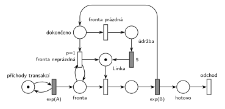

# Údržba při prázdné frontě

## Zadání

⚠️ Zadání je známé z textového přepisu studenta, ne z fotky. Znění je úplné a shoduje se s textem v Řešených výpočetních příkladech.

> 3. (10 bodů) Nakreslete model v podobě Petriho sítě pro systém typu M/M/1 se zadaným specifikem: Pokud je po dokončení obsluhy transakce fronta před linkou prázdná, pak systém zahájí údržbu o délce přesně 5 časových jednotek.

Podobné úlohy:

- [Automat na kávu – údržba po nečinnosti](<../01 - Automat na kávu – údržba po nečinnosti/01 - Automat na kávu – údržba po nečinnosti.md>): údržba až po 5 jednotkách nečinnosti
- [Údržba po dlouhé obsluze](<../05 - Údržba po dlouhé obsluze/05 - Údržba po dlouhé obsluze.md>): o údržbě se také rozhoduje po obsluze
- [Údržba po každé 10. obsluze](<../06 - Údržba po každé 10. obsluze/06 - Údržba po každé 10. obsluze.md>)

## Interpretace

<details>
<summary>Zobrazit interpretaci (nápověda)</summary>
<br>

- **M/M/1:** *příchody transakcí* ⇄ `exp(A)` → *fronta* → obsazení *Linky* → `exp(B)` → *odchod*. Střední doby příchodů a obsluhy zadání neuvádí, proto `exp(A)` a `exp(B)`.
- **Rozhoduje se v okamžiku dokončení obsluhy.** Proto `exp(B)` nevrací značku přímo *Lince*, ale do místa *dokončeno*. Odtud vedou dva okamžité přechody:
  - *fronta neprázdná* (`p=1`) je k *frontě* připojený testovacími hranami (tam a zpět): ověří, že někdo čeká, nikoho z fronty neodebere a vrátí značku *Lince*. Čekající ji pak hned obsadí.
  - *fronta prázdná* (`p=0`) se provede jen tehdy, když `p=1` provést nejde, tedy při prázdné *frontě*. Linka jde na 5 jednotek do *údržby* (`5` je pevná doba) a pak zpět do místa *Linka*.
- **Proč ne časovač na volné lince** (jako v úloze [Automat na kávu – údržba po nečinnosti](<../01 - Automat na kávu – údržba po nečinnosti/01 - Automat na kávu – údržba po nečinnosti.md>)): ten by údržbu spouštěl opakovaně, dokud nikdo nepřijde, a také na začátku simulace, kdy žádná obsluha neproběhla. Zadání chce jednu údržbu po každé obsluze, po které je fronta prázdná.
- Během údržby linka není k dispozici, příchozí čekají ve *frontě*. Po údržbě se nic dalšího nekontroluje: linka je volná, i když fronta zůstala prázdná.
- Inhibiční hrana z *fronty* na *fronta prázdná* by fungovala také, Hrubý ale místo ní používá prioritu.
- Transakce po obsluze **opouští systém** přechodem *odchod*, o údržbě rozhoduje už jen značka linky.

</details>

## Petriho síť

<details>
<summary>Zobrazit Petriho síť</summary>
<br>



</details>

## Časté chyby

<details>
<summary>Zobrazit časté chyby</summary>
<br>

- Časovač nečinnosti na volné lince místo rozhodnutí po obsluze (viz Interpretace).
- Test fronty obyčejnou hranou bez návratu: rozhodovací přechod pak odebere čekající transakci z *fronty*.
- Obě větve bez priority: při neprázdné frontě se náhodně vybere i údržba.
- `exp(B)`, které vrací *Linku* a zároveň posílá značku do rozhodování. Pak vzniká druhá značka linky.

</details>

## SIMLIB

<details>
<summary>Zobrazit SIMLIB kód</summary>
<br>

Model je izomorfní k Petriho síti výše: každé místo, přechod a značka mají svůj protějšek v kódu.

```cpp
// Údržba při prázdné frontě – model v SIMLIB/C++
#include "simlib.h"

const double A = 10;                   // střední interval příchodů (zadání ho neuvádí)
const double B = 6;                    // střední doba obsluhy (zadání ji neuvádí)

Facility Linka("Linka");               // místo „Linka“ (1 značka) + fronta
Histogram Doba("Doba transakce v systému [č. j.]", 0, 5, 20);
int obsluh = 0, udrzeb = 0;            // počet obsluh a údržeb

class Udrzba : public Process {        // místo „údržba“ + časovaný přechod 5
  void Behavior() {
    Seize(Linka);                      // značka linky v místě „údržba“
    udrzeb++;
    Wait(5);                           // časovaný přechod 5 ...
    Release(Linka);                    // ... vrací značku do místa Linka
  }
};

class Transakce : public Process {     // transakce = značka, která prochází sítí
  void Behavior() {
    double prichod = Time;
    Seize(Linka);                      // fronta + obsazení
    Wait(Exponential(B));              // časovaný přechod exp(B): značka linky → „dokončeno“
    obsluh++;
    bool prazdna = Linka.QueueLen() == 0;
    Release(Linka);                    // „fronta neprázdná“ (p=1): linku hned dostane první z fronty
    if (prazdna)                       // „fronta prázdná“ (p=0): linka jde do údržby
      (new Udrzba)->Activate();
    Doba(Time - prichod);
  }                                    // konec Behavior = přechod „odchod“
};

class Generator : public Event {       // místo „příchody transakcí“ ve smyčce s exp(A)
  void Behavior() {
    (new Transakce)->Activate();       // nová značka v místě „fronta“
    Activate(Time + Exponential(A));   // další příchod
  }
};

int main() {
  Init(0, 100000);                     // modelový čas v časových jednotkách
  (new Generator)->Activate();
  Run();
  Linka.Output();                      // vytížení = obsluha + údržba
  Doba.Output();
  Print("Obsluh: %d, údržeb: %d\n", obsluh, udrzeb);
}
```

| Petriho síť | SIMLIB |
|---|---|
| *příchody transakcí* ⇄ `exp(A)` | událost `Generator`, která se znovu plánuje za `Exponential(A)` |
| značka (transakce) | proces `Transakce` |
| *fronta* + obsazení linky | `Seize(Linka)` (fronta je vnitřní fronta zařízení) |
| místo *Linka* (1 značka) | `Facility Linka` |
| `exp(B)` → *dokončeno* | `Wait(Exponential(B));` a rozhodnutí hned za ním |
| *fronta neprázdná* (`p=1`, testovací hrany) | `Linka.QueueLen() > 0`, `Release(Linka)` předá linku prvnímu z fronty |
| *fronta prázdná* → *údržba* → `5` → *Linka* | `Release(Linka)` a proces `Udrzba`: `Seize(Linka); Wait(5); Release(Linka);` |
| přechod *odchod* | konec metody `Behavior()` |

**Kontrola simulací.** Petriho síť: *Linka* + obsluha + *dokončeno* + *údržba* = 1, obě větve se střídají podle stavu fronty, všechny přechody se provádějí, fronta zůstává krátká (`make check`). SIMLIB model: v jednom běhu (100 000 č. j.) proběhlo 10 008 obsluh a po 3 669 z nich (37 %) byla fronta prázdná a následovala údržba. Linka byla obsazená 78 % času: 60 % obsluha (teoreticky B/A = 6/10) a 18 % údržba (3 669 × 5 / 100 000) (`make simlib`).

</details>

## Původ a zdroje

<details>
<summary>Zobrazit původ a zdroje</summary>
<br>

**Původ:** zkouška 2019/20, 1. termín, skupina D, otázka 3, 10 bodů. Pravděpodobně stejná úloha: zkouška 2020/21, 1. termín (16:00), otázka 2, ze zadání se zachovalo jen „petriho siete M/M/1 s údržbou“.

**Původní znění:**

> 3. (10 bodů) Nakreslete model v podobě Petriho sítě pro systém typu M/M/1 se zadaným specifikem: Pokud je po dokončení obsluhy transakce fronta před linkou prázdná, pak systém zahájí údržbu o délce 5 časových jednotek.

**Zdroje:**

- `Fitcheats/Zkoušky z minulých let/2019-20 - 1. termín.txt`, „Skupina D“, otázka 3 (přepis zadání)
- `Fitcheats/Zkoušky z minulých let/2020-21 - 1. termín.txt`, termín 16:00, otázka 2
- `Fitcheats/Příprava na zkoušku/FIT - Řešené výpočetní příklady 2017-21.pdf`, str. 17 (skupina „1“, úloha 8: studentské řešení na tabuli s diskusí) a str. 34 („2021 - Řádný 16:00“, jen „M/M/1 s údržbou“)

**Existující řešení:**

- **Řešené výpočetní příklady, str. 17 (tabule):** stejná síť. `Exp(µ)` vede do místa, ze kterého přechod „P1“ s testovacími hranami na frontě vrací linku a přechod bez priority vede přes místo a přechod `5` zpět k lince. Výstup transakce je vidět. Diskuse pod obrázkem správně vysvětluje, proč je síť takto složitá: „…aby linka nešla do údržby niekoľkokrát po sebe, ak nechodia dlho žiadne transakcie“ (odpověď „YES“, Ano: +2).

</details>
