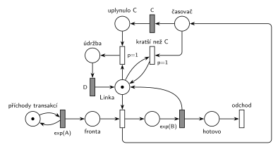

# Údržba po dlouhé obsluze

## Zadání

⚠️ Zadání je známé jen ze stručné vzpomínky studenta.

> M/M/1, kdyz obshuha trvala C časových jednotek a dyl, tak se pousti udrzba přesně D časových jednotek. + SIMLIB

Podle hlavičky souboru u tohoto termínu „Petriho siet a SIMLIB nemuseli byt izomorfne“.

Podobné úlohy:

- [Přerušení příliš dlouhé obsluhy](<../../03 - Poruchy/11 - Přerušení příliš dlouhé obsluhy/11 - Přerušení příliš dlouhé obsluhy.md>): dlouhá obsluha se přeruší, tady se dokončí
- [Údržba při prázdné frontě](<../04 - Údržba při prázdné frontě/04 - Údržba při prázdné frontě.md>): o údržbě se také rozhoduje po obsluze

## Nápověda

<details>
<summary>Zobrazit nápovědu</summary>
<br>

- **M/M/1:** *příchody transakcí* ⇄ `exp(A)` → *fronta* → obsazení *Linky* → `exp(B)`, které značku linky vrací → *odchod*. Střední doby příchodů a obsluhy zadání neuvádí, proto `exp(A)` a `exp(B)`.
- **Délku obsluhy síť přímo nezná.** Hodnota vylosovaná pro `exp(B)` se nikde neukládá. Proto se s obsazením linky spustí souběžný **časovač**: obsazení dává značku i do místa *časovač* a časovaný přechod `C` ji po C jednotkách přesune do *uplynulo C*.
- **Konec obsluhy** vrací značku *Lince* jako obvykle. V tu chvíli je značka buď ještě v *časovači* (obsluha byla kratší než C), nebo už v *uplynulo C*:
  - *kratší než C* (`p=1`) je k *Lince* připojený testovacími hranami a jen odebere značku *časovače*. Tím odpočet `C` zanikne (slajd 139).
  - druhý přechod (`p=1`) si vezme *Linku* i značku z *uplynulo C* a linka jde na dobu D do *údržby* → `D` → zpět do místa *Linka*.
- **Proč `p=1`:** oba přechody se musí provést dřív než obsazení linky další transakcí (`p=0`). Jinak by údržbu předběhla čekající transakce, nebo by v *časovači* zůstala stará značka a další obsluha by měla dva časovače.
- „C a déle“: obsluha přesně C má nulovou pravděpodobnost, na rovnosti nezáleží.
- Transakce po obsluze hned **opouští systém** přechodem *odchod*, údržbu dělá linka sama.
- C a D jsou konstanty.

</details>

## Petriho síť

<details>
<summary>Zobrazit Petriho síť</summary>
<br>



</details>

## Časté chyby

<details>
<summary>Zobrazit časté chyby</summary>
<br>

- Pokus porovnat „výsledek `exp(B)`“ s C přímo v síti. Síť umí jen časovat, potřebuje souběžný časovač.
- Časovač, který se po krátké obsluze nezruší. Zůstane běžet a spustí údržbu po některé z dalších obsluh.
- Časovač `C` napojený přímo na místo obsluhy bez návratu značky: po C jednotkách obsluhu ukončí (to je jiná úloha, [Přerušení příliš dlouhé obsluhy](<../../03 - Poruchy/11 - Přerušení příliš dlouhé obsluhy/11 - Přerušení příliš dlouhé obsluhy.md>)).
- Údržba bez priority vůči obsazení: čekající transakce může linku dostat dřív než údržba.

</details>

## SIMLIB

<details>
<summary>Zobrazit SIMLIB kód</summary>
<br>

Model je izomorfní k Petriho síti výše: každé místo, přechod a značka mají svůj protějšek v kódu.

```cpp
// Údržba po dlouhé obsluze – model v SIMLIB/C++
#include "simlib.h"

const double A = 10;                   // střední interval příchodů (zadání ho neuvádí)
const double B = 6;                    // střední doba obsluhy (zadání ji neuvádí)
const double C = 10;                   // hranice dlouhé obsluhy
const double D = 5;                    // doba údržby

Facility Linka("Linka");               // místo „Linka“ (1 značka) + fronta
Histogram Doba("Doba transakce v systému [č. j.]", 0, 5, 20);
int obsluh = 0, udrzeb = 0;            // počet obsluh a údržeb

class Casovac : public Event {         // časovaný přechod C
  void Behavior();
};
Casovac *casovac = nullptr;            // místo „časovač“ (běžící odpočet), nebo žádný
bool uplynulo = false;                 // místo „uplynulo C“

void Casovac::Behavior() {
  casovac = nullptr;
  uplynulo = true;                     // značka přešla z „časovač“ do „uplynulo C“
}

class Udrzba : public Process {        // přechod p=1 → údržba → D
  void Behavior() {
    Seize(Linka, 1);                   // p=1: linku dostane dřív než čekající transakce
    udrzeb++;                          //   (transakci, které ji Release právě předal, vytlačí)
    Wait(D);                           // časovaný přechod D ...
    Release(Linka);                    // ... vrací značku do místa Linka
  }
};

class Transakce : public Process {     // transakce = značka, která prochází sítí
  void Behavior() {
    double prichod = Time;
    Seize(Linka);                      // fronta + obsazení ...
    casovac = new Casovac;             // ... dává značku i do místa „časovač“
    casovac->Activate(Time + C);
    Wait(Exponential(B));              // časovaný přechod exp(B)
    obsluh++;
    if (casovac) {                     // „kratší než C“ (p=1): odebere značku časovače,
      casovac->Cancel();               //   odpočet C zanikne
      casovac = nullptr;
    } else {                           // obsluha trvala aspoň C: přechod p=1
      uplynulo = false;                //   bere „uplynulo C“ a linku do údržby
      (new Udrzba)->Activate();        //   (naplánovaná před Release, poběží dřív
    }                                  //   než transakce, které Release předá linku)
    Release(Linka);                    // exp(B) vrací značku linky
    Doba(Time - prichod);
  }                                    // konec Behavior = přechod „odchod“
};

class Generator : public Event {       // místo „příchody transakcí“ ve smyčce s exp(A)
  void Behavior() {
    (new Transakce)->Activate();       // nová značka v místě „fronta“
    Activate(Time + Exponential(A));   // další příchod
  }
};

int main() {
  Init(0, 100000);                     // modelový čas v časových jednotkách
  (new Generator)->Activate();
  Run();
  Linka.Output();                      // vytížení = obsluha + údržba
  Doba.Output();
  Print("Obsluh: %d, údržeb: %d\n", obsluh, udrzeb);
}
```

| Petriho síť | SIMLIB |
|---|---|
| *příchody transakcí* ⇄ `exp(A)` | událost `Generator`, která se znovu plánuje za `Exponential(A)` |
| značka (transakce) | proces `Transakce` |
| *fronta* + obsazení linky | `Seize(Linka)` (fronta je vnitřní fronta zařízení) |
| časovaný přechod `exp(B)` se sloučeným uvolněním | `Wait(Exponential(B)); Release(Linka);` |
| místo *Linka* (1 značka) | `Facility Linka` |
| obsazení → *časovač* → `C` → *uplynulo C* | událost `Casovac` naplánovaná za `C` hned po `Seize`, nastaví `uplynulo` |
| *kratší než C* (`p=1`, testovací hrany na *Lince*) | `casovac->Cancel()` na konci obsluhy, když odpočet ještě běží |
| `p=1`: *uplynulo C* + *Linka* → *údržba* → `D` | proces `Udrzba`: `Seize(Linka, 1); Wait(D); Release(Linka);` |
| přechod *odchod* | konec metody `Behavior()` |

**Kontrola simulací.** Petriho síť: *Linka* + obsluha + *údržba* = 1 a *časovač* + *uplynulo C* = obsluha (časovač běží právě během obsluhy), obě větve se provádějí, všechny přechody se provádějí, fronta zůstává krátká (`make check`). SIMLIB model: v jednom běhu (100 000 č. j.) proběhlo 9 905 obsluh a po 1 836 z nich (18,5 %) údržba; teoreticky trvá obsluha aspoň C s pravděpodobností e^(−C/B) = e^(−10/6) ≈ 18,9 %. Linka byla obsazená 68 % času, teoreticky 60 % obsluha (B/A) + 9,4 % údržba (18,9 % × 5 / 10) (`make simlib`).

</details>

## Původ a zdroje

<details>
<summary>Zobrazit původ a zdroje</summary>
<br>

**Původ:** zkouška 2021/22, 1. termín, skupina D, otázka 1 (body neuvedeny).

**Původní znění:**

> M/M/1, kdyz obshuha trvala konstatni dobu C a dyl, tak se pousti udrzba s konstatni dobu D. + SIMLIB

**Zdroje:**

- `Fitcheats/Zkoušky z minulých let/2021-22 - 1. termín.txt`, „D skupina“, otázka 1 (vzpomínka studenta)
- `Fitcheats/Příprava na zkoušku/fifinas - Tabule ze streamu.pdf`, str. 5 („D) M/M/1, pokud obsluha ≥ C, pak údržba D“: síť a SIMLIB kód z tabule)

**Existující řešení:**

- **fifinas, str. 5:** stejný nápad se souběžným časovačem („Timer C“). Obsazení dává značku do obsluhy i do časovače, `Exp(b)` vede do místa za obsluhou. Toto místo + uplynulý časovač → `D` → linka, zeleně toto místo + neuplynulý časovač → linka. Linka se tu nevrací z `Exp(b)`, ale až z rozhodovacích přechodů, které spojí značku transakce se značkou časovače do jedné značky linky. **Chybí výstupní přechod**, transakce v síti nikde neodchází. Priority nejsou potřeba, obě větve jsou vzájemně výlučné. SIMLIB kód na téže straně (po obsluze `if (wait >= C) Wait(D);`, až pak `Release`) odpovídá variantě, kdy transakce drží linku i během údržby; na chování linky to nic nemění, liší se jen doba transakce v systému.

</details>

## Reference

- [Jak síť funguje](<../../../basics/Jak síť funguje.md>)
- [Notace a vzory](<../../../basics/Notace a vzory.md>)
- [Seznam úloh](<../../Seznam úloh.md>)
