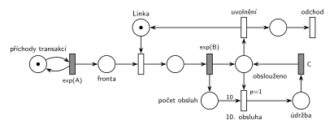

# 04-06 Údržba po každé 10. obsluze

## Zadání

> Nakreslete Petriho síť pro systém M/M/1, kde transakce po každé desáté dokončené obsluze navíc zařadí blok údržby linky trvající přesně C časových jednotek.

Podobné úlohy:

- [Automat na kávu – údržba po 50 obsluhách](<../02 - Automat na kávu – údržba po 50 obsluhách/02 - Automat na kávu – údržba po 50 obsluhách.md>): stejná síť, údržba po 50 obsluhách
- [Každá 10. transakce vyvolá poruchu](<../../03 - Poruchy/07 - Každá 10. transakce vyvolá poruchu/07 - Každá 10. transakce vyvolá poruchu.md>)
- [Údržbář na obchůzce](<../07 - Údržbář na obchůzce/07 - Údržbář na obchůzce.md>): stejný termín, skupina C
- [Server s údržbou po 1000 požadavcích](<../../10 - Počítačové systémy/01 - Server s údržbou po 1000 požadavcích/01 - Server s údržbou po 1000 požadavcích.md>)

## Nápověda

<details>
<summary>Zobrazit nápovědu</summary>
<br>

- **M/M/1:** *příchody transakcí* ⇄ `exp(A)` → *fronta* → obsazení *Linky* → `exp(B)`, které značku linky vrací → *obslouženo* → *odchod*. Střední doby příchodů a obsluhy zadání neuvádí, proto `exp(A)` a `exp(B)`.
- **Čítač:** `exp(B)` má tři výstupy a při provedení dá značku do všech najednou: vrací *Linku*, posílá transakci do *obslouženo* a přidá značku do *počtu obsluh*. Přechod *do údržby* má z čítače hranu s váhou 10, takže se provede po každé desáté obsluze a čítač zároveň vynuluje.
- **Údržba si vezme volnou linku:** po desáté obsluze je *Linka* volná a *do údržby* si její značku hned odebere a přesune do místa *údržba*. Pokud čeká transakce, je v tu chvíli proveditelné i obsazení. Priorita `p=1` zajistí, že vyhraje údržba, takže přijde opravdu po každé desáté obsluze, ne až po některé další.
- **Údržba trvá přesně C** (pevná doba): *údržba* → `C` → zpět do *Linky*. Transakce, které mezitím přijdou, čekají ve *frontě*.
- Transakce po obsluze **opouští systém** přechodem *odchod*, desátá také: údržba začne ve stejném okamžiku, kdy linku uvolní.
- **Druhá přípustná varianta:** desátá transakce linku po obsluze neuvolní a drží ji ještě C jednotek na údržbu („zařadí“ čteno jako „provede“). Síť pak potřebuje místo *obslouženo* ještě před uvolněním linky, za ním dva okamžité přechody (údržba s `p=1` a uvolnění) a návrat z `C` zpět do *obslouženo*, tedy o místo a přechod víc. Linka je mimo provoz stejně dlouho, liší se jen doba desáté transakce v systému. Izomorfní SIMLIB je u ní naopak jednodušší: `Wait(C)` ještě před `Release`.

</details>

## Petriho síť

<details>
<summary>Zobrazit Petriho síť</summary>
<br>



</details>

## Časté chyby

<details>
<summary>Zobrazit časté chyby</summary>
<br>

- Hrana z čítače bez váhy 10 (údržba po každé obsluze), nebo váha jen na testovací hraně, která čítač nevynuluje (údržba po každé obsluze od desáté dál).
- Čítání příchodů místo dokončených obsluh.
- Údržba bez priority: při čekající transakci může linku dostat ona a údržba se posune o jednu nebo více obsluh.
- Údržba, která si nevezme značku *Linky*. Pak linka během údržby dál obsluhuje.
- Hrana z přechodu *do údržby* rovnou do přechodu `C`. Hrana vždy spojuje místo a přechod, mezi nimi musí být místo *údržba*.

</details>

## SIMLIB

<details>
<summary>Zobrazit SIMLIB kód</summary>
<br>

Model je izomorfní k Petriho síti výše: každé místo, přechod a značka mají svůj protějšek v kódu.

```cpp
// Údržba po každé 10. obsluze – model v SIMLIB/C++
#include "simlib.h"

const double A = 10;                   // střední interval příchodů (zadání ho neuvádí)
const double B = 6;                    // střední doba obsluhy (zadání ji neuvádí)
const double C = 20;                   // doba údržby

Facility Linka("Linka");               // místo „Linka“ (1 značka) + fronta
Histogram Doba("Doba transakce v systému [č. j.]", 0, 5, 20);
int pocet = 0;                         // místo „počet obsluh“ (čítač)
int obsluh = 0, udrzeb = 0;            // počet obsluh a údržeb

class Udrzba : public Process {        // přechod „do údržby“ → údržba → C
  void Behavior() {
    Seize(Linka, 1);                   // p=1: linku dostane dřív než čekající transakce
    udrzeb++;                          //   (transakci, které ji Release právě předal, vytlačí)
    Wait(C);                           // časovaný přechod C ...
    Release(Linka);                    // ... vrací značku do místa Linka
  }
};

class Transakce : public Process {     // transakce = značka, která prochází sítí
  void Behavior() {
    double prichod = Time;
    Seize(Linka);                      // fronta + obsazení
    Wait(Exponential(B));              // časovaný přechod exp(B) přidá značku do čítače
    obsluh++;
    if (++pocet == 10) {               // hrana s váhou 10: přechod „do údržby“
      pocet = 0;                       //   čítač vynuluje; údržba je naplánovaná před
      (new Udrzba)->Activate();        //   Release, poběží dřív než transakce,
    }                                  //   které Release předá linku
    Release(Linka);                    // exp(B) vrací značku linky
    Doba(Time - prichod);
  }                                    // obslouženo → konec Behavior = přechod „odchod“
};

class Generator : public Event {       // místo „příchody transakcí“ ve smyčce s exp(A)
  void Behavior() {
    (new Transakce)->Activate();       // nová značka v místě „fronta“
    Activate(Time + Exponential(A));   // další příchod
  }
};

int main() {
  Init(0, 100000);                     // modelový čas v časových jednotkách
  (new Generator)->Activate();
  Run();
  Linka.Output();                      // vytížení = obsluha + údržba
  Doba.Output();
  Print("Obsluh: %d, údržeb: %d\n", obsluh, udrzeb);
}
```

| Petriho síť | SIMLIB |
|---|---|
| *příchody transakcí* ⇄ `exp(A)` | událost `Generator`, která se znovu plánuje za `Exponential(A)` |
| značka (transakce) | proces `Transakce` |
| *fronta* + obsazení linky | `Seize(Linka)` (fronta je vnitřní fronta zařízení) |
| místo *Linka* (1 značka) | `Facility Linka` |
| časovaný přechod `exp(B)` se sloučeným uvolněním | `Wait(Exponential(B)); Release(Linka);` |
| místo *počet obsluh*, hrana s váhou 10 | `int pocet`, `if (++pocet == 10) pocet = 0;` |
| *do údržby* (`p=1`) | proces `Udrzba`, `Seize(Linka, 1)` (priorita obsluhy) |
| *údržba* → `C` → *Linka* | `Wait(C); Release(Linka);` |
| *obslouženo* → přechod *odchod* | konec metody `Behavior()` |

**Kontrola simulací.** Petriho síť: *Linka* + obsluha + *údržba* = 1, v čítači je nejvýš 10 značek, údržba proběhla přesně po každé desáté obsluze (9 523 údržeb na 95 238 obsluh), fronta zůstává omezená (`make check`). SIMLIB model: v jednom běhu (100 000 č. j.) proběhlo 10 048 obsluh a 1 004 údržeb. Linka byla obsazená 81 % času; teoreticky 60 % obsluha (B/A = 6/10) + 20 % údržba (C = 20 jednotek na 10 × 10 = 100 jednotek provozu) = 80 %. V 694 případech už linku po uvolnění dostala čekající transakce a údržba ji vytlačila dřív, než její obsluha začala; ta pak čekala přesně C = 20 (fronta přerušených obsluh `Q2`), stejně jako by v síti čekala ve *frontě* (`make simlib`).

</details>

## Původ a zdroje

<details>
<summary>Zobrazit původ a zdroje</summary>
<br>

**Původ:** zkouška 2022/23, 1. termín (11. 1. 2023), skupina D, otázka 1, 15 bodů.

**Původní znění:**

> 1. (15 bodů) Nakreslete Petriho síť pro systém M/M/1, kde transakce po každé desáté dokončené obsluze navíc zařadí blok údržby linky trvající C časových jednotek. S využitím notace knihovny SIMLIB napište pseudokód všech nezbytných částí simulačního modelu. Dbejte na izomorfní vztah mezi oběma modely.

**Zdroje:**

- `Fitcheats/Zkoušky z minulých let/2022-23 - 1. termín D.pdf`, str. 1 (malá rozmazaná fotka zadání) a str. 4 (ručně psaný přepis celé písemky)

**Existující řešení:**

- Ve zdrojích není žádné řešení této otázky.

</details>

## Reference

- [Jak síť funguje](<../../../basics/Jak síť funguje.md>)
- [Notace a vzory](<../../../basics/Notace a vzory.md>)

<!-- -->

- [Studijní plán](<../../Studijní plán.md>)
- [Seznam úloh](<../../Seznam úloh.md>)
