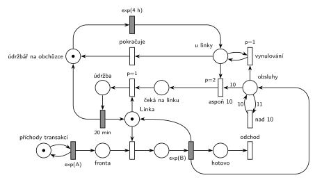

# Údržbář na obchůzce

## Zadání

> Uvažujme systém M/M/1. V systému pracuje jeden údržbář, který se v intervalech exponenciálně se středem 4 hodiny vrací k této obslužné lince. Pokud v okamžiku jeho příchodu bylo dokončeno alespoň 10 obsluh od jeho poslední návštěvy u linky, pak počká na dokončení případné právě prováděné obsluhy a zahájí na lince údržbu trvající přesně 20 minut. Jinak pokračuje ve své obchůzce.

Podobné úlohy:

- [Údržba po každé 10. obsluze](<../06 - Údržba po každé 10. obsluze/06 - Údržba po každé 10. obsluze.md>): stejný termín, skupina D
- [Automat na kávu – údržba po 50 obsluhách](<../02 - Automat na kávu – údržba po 50 obsluhách/02 - Automat na kávu – údržba po 50 obsluhách.md>)

## Nápověda

<details>
<summary>Zobrazit nápovědu</summary>
<br>

- **M/M/1:** *příchody transakcí* ⇄ `exp(A)` → *fronta* → obsazení *Linky* → `exp(B)`, které značku linky vrací → *odchod*. Časy jsou v minutách, střední doby příchodů a obsluhy zadání neuvádí, proto `exp(A)` a `exp(B)`.
- **Čítač obsluh:** `exp(B)` dává značku do místa *obsluhy*. Víc než 10 si pamatovat netřeba („alespoň 10“), proto přechod *nad 10* (hrana s váhou 11 tam, 10 zpět) každou jedenáctou značku hned zahodí. V čítači je tak vždy 0 až 10 značek.
- **Údržbář** je jedna značka, která obíhá: *údržbář na obchůzce* → `exp(4 h)` (= exp(240 min)) → *u linky* → (údržba, nebo nic) → zpět *na obchůzku*.
- **Rozhodnutí u linky** (tři okamžité přechody, vyšší priorita má přednost):
  - *aspoň 10* (`p=2`) odebere 10 značek, tedy celý čítač, a údržbář jde *čekat na linku*;
  - *vynulování* (`p=1`, testovací hrany na *u linky*) odebírá zbytek čítače po jedné, když je obsluh méně než 10;
  - *pokračuje* (`p=0`) vrátí údržbáře na obchůzku, až je čítač prázdný.

  Čítač se tedy nuluje při každé návštěvě, i když údržba neproběhne: „od jeho poslední návštěvy“ počítá i návštěvu bez údržby.
- **Počká na dokončení probíhající obsluhy:** údržbář si linku bere obyčejným obsazením, takže probíhající obsluhu nepřeruší. Obsazení údržbářem má `p=1`, proto po skončení obsluhy dostane linku on, ne další transakce z fronty.
- **Údržba 20 min** (pevná doba): *údržba* → `20 min` vrací značku *Lince* i údržbáře *na obchůzku*.
- Obsluhy dokončené v době, kdy údržbář čeká na linku, se počítají už do další návštěvy.
- Transakce po obsluze **opouští systém** přechodem *odchod*.

</details>

## Petriho síť

<details>
<summary>Zobrazit Petriho síť</summary>
<br>



</details>

## Časté chyby

<details>
<summary>Zobrazit časté chyby</summary>
<br>

- Údržba, která probíhající obsluhu přeruší. Zadání chce počkat na její dokončení.
- Údržbář bez priority při obsazení linky: po skončení obsluhy dostane linku další zákazník a údržbář čeká na prázdnou frontu.
- Čítač, který se nuluje jen po údržbě. Návštěva bez údržby je také návštěva.
- Hrana s váhou 10 z čítače bez vynulování zbytku: obsluhy nad 10 by se přenesly do další návštěvy.
- Údržbář, který se po údržbě nevrátí na obchůzku.

</details>

## SIMLIB

<details>
<summary>Zobrazit SIMLIB kód</summary>
<br>

Model je izomorfní k Petriho síti výše: každé místo, přechod a značka mají svůj protějšek v kódu.

```cpp
// Údržbář na obchůzce – model v SIMLIB/C++
#include "simlib.h"

const double A = 10;                   // střední interval příchodů [min] (zadání ho neuvádí)
const double B = 6;                    // střední doba obsluhy [min] (zadání ji neuvádí)

Facility Linka("Linka");               // místo „Linka“ (1 značka) + fronta
Histogram Doba("Doba transakce v systému [min]", 0, 5, 20);
int pocet = 0;                         // místo „obsluhy“ (čítač, nejvýš 10)
int navstev = 0, udrzeb = 0;           // počet návštěv údržbáře a údržeb

class Transakce : public Process {     // transakce = značka, která prochází sítí
  void Behavior() {
    double prichod = Time;
    Seize(Linka);                      // fronta + obsazení
    Wait(Exponential(B));              // časovaný přechod exp(B) ...
    Release(Linka);                    // ... vrací značku linky ...
    if (pocet < 10)                    // ... a přidá značku do čítače
      pocet++;                         //   (přechod „nad 10“ jedenáctou hned odebere)
    Doba(Time - prichod);
  }                                    // konec Behavior = přechod „odchod“
};

class Udrzbar : public Process {       // značka údržbáře, obíhá dokola
  void Behavior() {
    Priority = 1;                      // p=1: linku dostane dřív než čekající transakce
    for (;;) {                         // místo „údržbář na obchůzce“
      Wait(Exponential(4 * 60));       // časovaný přechod exp(4 h) → „u linky“
      navstev++;
      if (pocet >= 10) {               // „aspoň 10“ (p=2): odebere 10 značek čítače
        pocet = 0;
        Seize(Linka);                  // „čeká na linku“ + obsazení: probíhající
        udrzeb++;                      //   obsluhu nepřeruší, předběhne frontu
        Wait(20);                      // místo „údržba“ + časovaný přechod 20 min ...
        Release(Linka);                // ... vrací linku i údržbáře na obchůzku
      } else
        pocet = 0;                     // „vynulování“ (p=1) a „pokračuje“ (p=0)
    }
  }
};

class Generator : public Event {       // místo „příchody transakcí“ ve smyčce s exp(A)
  void Behavior() {
    (new Transakce)->Activate();       // nová značka v místě „fronta“
    Activate(Time + Exponential(A));   // další příchod
  }
};

int main() {
  Init(0, 1000000);                    // modelový čas v minutách: asi 694 dní provozu
  (new Generator)->Activate();
  (new Udrzbar)->Activate();           // značka v místě „údržbář na obchůzce“
  Run();
  Linka.Output();                      // vytížení = obsluha + údržba
  Doba.Output();
  Print("Návštěv údržbáře: %d, údržeb: %d\n", navstev, udrzeb);
}
```

| Petriho síť | SIMLIB |
|---|---|
| *příchody transakcí* ⇄ `exp(A)` | událost `Generator`, která se znovu plánuje za `Exponential(A)` |
| značka (transakce) | proces `Transakce` |
| *fronta* + obsazení linky | `Seize(Linka)` (fronta je vnitřní fronta zařízení) |
| časovaný přechod `exp(B)` se sloučeným uvolněním | `Wait(Exponential(B)); Release(Linka);` |
| místo *Linka* (1 značka) | `Facility Linka` |
| místo *obsluhy* a přechod *nad 10* | `int pocet`, `if (pocet < 10) pocet++;` |
| značka údržbáře, *údržbář na obchůzce* → `exp(4 h)` → *u linky* | proces `Udrzbar`, smyčka s `Wait(Exponential(4 * 60))` |
| *aspoň 10* (`p=2`) / *vynulování* (`p=1`) + *pokračuje* (`p=0`) | `if (pocet >= 10) … else …`, v obou větvích `pocet = 0` |
| *čeká na linku* + obsazení s `p=1` | `Priority = 1; Seize(Linka);` (priorita procesu: první ve frontě, obsluhu nepřeruší) |
| *údržba* → `20 min` → *Linka* + *údržbář na obchůzce* | `Wait(20); Release(Linka);` a další průchod smyčkou |
| přechod *odchod* | konec metody `Behavior()` |

**Kontrola simulací.** Petriho síť: *Linka* + obsluha + *údržba* = 1, údržbář je vždy na právě jednom místě, v čítači je nejvýš 10 značek, všechny přechody se provádějí (`make check`). SIMLIB model: v jednom běhu (1 000 000 min) přišel údržbář 3 848krát (méně než 1 000 000 / 240 ≈ 4 167, protože čekání na linku a údržba jeho oběh prodlužují) a údržbu provedl při 2 749 návštěvách (71 %). Linka byla obsazená 66 % času: 60 % obsluha (B/A = 6/10) a 5,5 % údržba (2 749 × 20 / 1 000 000) (`make simlib`).

</details>

## Původ a zdroje

<details>
<summary>Zobrazit původ a zdroje</summary>
<br>

**Původ:** zkouška 2022/23, 1. termín (11. 1. 2023, 16:00–17:30), skupina C, otázka 1, 15 bodů.

**Původní znění:**

> 1. (15 bodů) Modelujte zadaný systém Petriho sítí s vyznačením všech relevantních parametrů. Napište simulační model systému prostředky knihovny SIMLIB, který je izomorfní k modelu v Petriho síti.
>
> Uvažujme systém M/M/1. V systému pracuje jeden údržbář, který se v intervalech exp(4 hodiny) vrací k této obslužné lince. Pokud v okamžiku jeho příchodu bylo dokončeno alespoň 10 obsluh od jeho poslední návštěvy u linky, pak počká na dokončení případné právě prováděné obsluhy a zahájí na lince údržbu trvající 20 minut. Jinak pokračuje ve své obchůzce.

**Zdroje:**

- `Fitcheats/Zkoušky z minulých let/2022-23 - 1. termín C.pdf`, str. 1 (fotka zadání, pravá polovina)
- `Fitcheats/Příprava na zkoušku/cranycrane - Kódy (generátory, Monte Carlo, Euler, RK, Petri + SIMLIB)/petri/8.png` a `8.cpp` (studentská síť a SIMLIB kód)

**Existující řešení:**

- **cranycrane, 8.png:** `exp(B)` vede do čítače a do místa za obsluhou, odkud se linka vrací okamžitým přechodem. Údržbu spouští přechod `P=2`, který potřebuje údržbáře u linky, 10 značek z čítače **a značku z místa za obsluhou**. Chyby:
  - Značka v místě za obsluhou existuje jen na okamžik (hned ji převezme přechod zpět k lince), a údržbář u linky nečeká (hned ho odvede `P=1` a přechod bez priority). Údržba tak proběhne jen tehdy, když údržbář přijde přesně v okamžiku konce obsluhy, tedy prakticky nikdy. Nefunguje ani případ, kdy je linka při jeho příchodu volná.
  - Přechod `20` vrací jen linku, ne údržbáře. Po první údržbě by údržbář ze sítě zmizel.
  - Správně je vynulování čítače přechodem `P=1` s testovacími hranami na údržbáři.
- **cranycrane, 8.cpp:** podmínka `counter == 10` místo „alespoň 10“ (při více obsluhách se údržba neprovede), `Wait(Exponential(4))` a `Wait(20)` v nesouladu jednotek (hodiny a minuty). Nastavení `Priority = 100` před `Seize` je správný nápad: údržbář dostane linku před čekajícími zákazníky.

</details>

## Reference

- [Jak síť funguje](<../../../basics/Jak síť funguje.md>)
- [Notace a vzory](<../../../basics/Notace a vzory.md>)

<!-- -->

- [Studijní plán](<../../Studijní plán.md>)
- [Seznam úloh](<../../Seznam úloh.md>)
