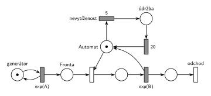

# 04–01 – Automat na kávu – údržba po nečinnosti

**Původ:** zkouška 2017/18, 2. termín (19. 1. 2018), skupina 8B, otázka 1, 10 bodů. Stejná úloha (podle vzpomínky studenta): zkouška 2018/19, 1. termín, otázka 1, 10 bodů.

**Zdroje:**

- `Fitcheats/Zkoušky z minulých let/2017-18 - 2. termín B.pdf`, str. 1 (sken zadání)
- `Fitcheats/Zkoušky z minulých let/2018-19 - 1. termín.txt` (první vzpomínka v souboru)
- `Fitcheats/Příprava na zkoušku/FIT - Příprava 2018-19.pdf`, str. 37–38 („1. opravný termín 2017/2018 - skupina B“: fotka studentského řešení, „Spravne - 3x“, a pokusy o SIMLIB) a str. 51 („řádný termín 2018/2019“, jen text)
- `Fitcheats/Příprava na zkoušku/xenix - Příprava.pdf`, str. 27 (táž fotka jako v Přípravě 2018-19)

## Zadání

> 1. (10 bodů) Nakreslete Petriho síť pro systém typu M/M/1 s obslužnou linkou "automat na kafe". Automat se po každých 5 časových jednotkách nevytíženosti přepne do režimu údržby (není k dispozici) na dobu 20 časových jednotek.

Zkouška 2018/19 podle vzpomínky: „… automat na kávu, který při vydávání kávy zabere obslužnou linku a pokud u oblužné linky není fronta po dobu 5 časových jednotek, tj. automat se nějakou dobu nepoužívá, tak přejde do nečinného režimu na dobu 20 časových jednotek.“

Podobné úlohy:

- [04–03 – Automat na kávu – uspání](<../04–03 - Automat na kávu – uspání/04–03 - Automat na kávu – uspání.md>): po nečinnosti automat usne a probudí ho až zákazník
- [04–08 – Spánek po nečinnosti](<../04–08 - Spánek po nečinnosti/04–08 - Spánek po nečinnosti.md>)
- [04–04 – Údržba při prázdné frontě](<../04–04 - Údržba při prázdné frontě/04–04 - Údržba při prázdné frontě.md>): údržba hned po obsluze, ne po nečinnosti
- [04–02 – Automat na kávu – údržba po 50 obsluhách](<../04–02 - Automat na kávu – údržba po 50 obsluhách/04–02 - Automat na kávu – údržba po 50 obsluhách.md>)
- [09–09 – Trafika](<../09–09 - Trafika/09–09 - Trafika.md>): stejný časovač nečinnosti na místě prodavače

## Interpretace

Zobrazit interpretaci (nápověda)

- **Nevytíženost** = automat nic nevydává a nikdo nečeká. Přesně tehdy je značka v místě *Automat*: obsazení je okamžitý přechod, takže při neprázdné frontě si značku vezme hned. Vzpomínka z roku 2018/19 („není fronta po dobu 5“) dodává „automat se nějakou dobu nepoužívá“, jde tedy o tutéž podmínku.
- **Časovač 5:** časovaný přechod `5` má jediný vstup, místo *Automat*. Odpočet běží jen po dobu, kdy automat stojí. Když přijde zákazník, obsazení si značku vezme a odpočet zanikne (slajd 139). Po každé obsluze začíná znovu od nuly.
- **„Po každých 5“:** když po údržbě stále nikdo nepřišel, odpočet běží znovu a za dalších 5 přijde další údržba. Síť to dělá sama, nic dalšího není potřeba.
- **Údržba (není k dispozici)** je stav značky automatu: místo *údržba* → `20` → zpět do *Automatu*. Zákazníci, kteří mezitím přijdou, čekají ve *Frontě*.
- Doby 5 a 20 jsou pevné, ne exponenciální. Střední doby příchodů a obsluhy zadání neuvádí, proto `exp(A)` a `exp(B)`.

## Řešení

Zobrazit řešení

| Požadavek | Prvek sítě |
|---|---|
| M/M/1, linka „automat“ | *generátor* ⇄ `exp(A)` → *Fronta* → obsazení *Automatu* → `exp(B)` (vrací *Automat*) → *odchod* |
| 5 č. j. nevytíženosti | *Automat* → `5` (*nevytíženost*), odpočet zruší obsazení |
| údržba 20 č. j., automat není k dispozici | *údržba* → `20` → *Automat* |
| transakce opouští systém | *odchod* |

Kontrola simulací: *Automat* + obsluha + *údržba* = 1. Údržba se spouští jen při prázdné frontě, fronta zůstává krátká.

## Existující řešení

Zobrazit srovnání s existujícími řešeními

- **Příprava 2018-19, str. 37 (a xenix, str. 27, táž fotka):** stejná síť: linka → přechod `5` → místo → přechod `20` → linka, odpočet ruší obsazení linky. Je kreslená bez rozlišení časovaných a okamžitých přechodů (všechny jsou prázdné obdélníky), časy u nich ale jsou. Řešení má tři souhlasy („Spravne - 3x“) a je správné. Následující SIMLIB pokusy (proces `Timeout` rušený při každém `Seize`) nejsou součástí otázky.

## Časté chyby

Zobrazit časté chyby

- Časovač napojený na *Frontu* nebo na generátor místo na volný automat. Pak neměří nevytíženost automatu.
- Časovač s vlastní značkou (samostatný generátor „každých 5“), který automat nijak nezastaví ani se neresetuje při obsluze. Údržba pak přichází pravidelně bez ohledu na provoz.
- Údržba, která si vezme automat i během obsluhy (přerušení). Zadání mluví o nevytíženosti, obsluha se nepřerušuje.
- Návrat z údržby do jiného místa než *Automat* (ztráta značky linky).

