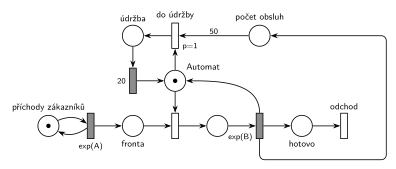

# 04–02 – Automat na kávu – údržba po 50 obsluhách

## Zadání

> 1. (10 bodů) Nakreslete Petriho síť pro systém typu M/M/1 s obslužnou linkou "automat na kafe". Automat se po každých 50 cyklech provedené obsluhy přepne do režimu údržby (není k dispozici) na dobu 20 časových jednotek.

Zkouška 2018/19 podle vzpomínky: „Automat na kávu, který po připravení X (40??) káv přejde do režimu údržby na dobu 20 časových jednotek.“

Podobné úlohy:

- [04–06 – Údržba po každé 10. obsluze](<../04–06 - Údržba po každé 10. obsluze/04–06 - Údržba po každé 10. obsluze.md>): údržbu provádí transakce, která linku ještě drží
- [10–01 – Server s údržbou po 1000 požadavcích](<../10–01 - Server s údržbou po 1000 požadavcích/10–01 - Server s údržbou po 1000 požadavcích.md>): stejný čítač, navíc se vyhazuje fronta
- [04–07 – Údržbář na obchůzce](<../04–07 - Údržbář na obchůzce/04–07 - Údržbář na obchůzce.md>)
- [04–01 – Automat na kávu – údržba po nečinnosti](<../04–01 - Automat na kávu – údržba po nečinnosti/04–01 - Automat na kávu – údržba po nečinnosti.md>)

## Interpretace

Zobrazit interpretaci (nápověda)

- **Čítač:** každá dokončená obsluha přidá značku do místa *počet obsluh*. Přechod *do údržby* má z čítače hranu s váhou 50, takže se provede až po 50. obsluze a čítač zároveň vynuluje.
- **Údržba si vezme volný automat:** `exp(B)` vrací značku *Automatu*, údržba si ji hned odebere. Pokud čeká zákazník, je v tu chvíli proveditelné i obsazení. Priorita `p=1` zajistí, že vyhraje údržba, takže přijde opravdu po každé 50. obsluze, ne až po některé další.
- Údržba nepřerušuje obsluhu: začíná vždy jen na volném automatu, tedy hned po 50. obsluze.
- Počet 50 je podle fotky zadání 2017/18. Vzpomínka z roku 2018/19 má „X (40??)“, síť je stejná, jen s jinou vahou hrany.
- Doba 20 je pevná. Střední doby příchodů a obsluhy zadání neuvádí, proto `exp(A)` a `exp(B)`.

## Petriho síť

Zobrazit Petriho síť

| Požadavek | Prvek sítě |
|---|---|
| M/M/1, linka „automat“ | *generátor* ⇄ `exp(A)` → *Fronta* → obsazení *Automatu* → `exp(B)` (vrací *Automat*) → *odchod* |
| počítání obsluh | `exp(B)` → *počet obsluh* |
| po každých 50 obsluhách údržba | *do údržby* (`p=1`): 50 × *počet obsluh* + *Automat* → *údržba* |
| údržba 20 č. j., automat není k dispozici | *údržba* → `20` → *Automat* |
| transakce opouští systém | *odchod* |

Kontrola simulací: *Automat* + obsluha + *údržba* = 1, v čítači je nejvýš 50 značek. Údržba proběhla přesně po každé 50. obsluze (198 údržeb na 9 900 obsluh).

## Časté chyby

Zobrazit časté chyby

- Hrana z čítače bez váhy 50 (údržba po každé obsluze), nebo váha jen na testovací hraně, která čítač nevynuluje (údržba po každé obsluze od 50. dál).
- Čítání příchodů místo dokončených obsluh.
- Údržba bez priority: při čekajícím zákazníkovi může automat dostat on a údržba se posune o jednu nebo více obsluh.
- Údržba, která si nevezme značku *Automatu*. Pak automat během údržby dál obsluhuje.

## Původ a zdroje

**Původ:** zkouška 2017/18, 2. termín, skupina C (hlavička je na fotce useknutá), otázka 1, 10 bodů. Stejná úloha (podle vzpomínky studenta, počet káv nejistý): zkouška 2018/19, 1. termín, otázka 1, 10 bodů.

**Zdroje:**

- `Fitcheats/Zkoušky z minulých let/2017-18 - 2. termín C.pdf`, str. 1 (fotka zadání)
- `Fitcheats/Zkoušky z minulých let/2018-19 - 1. termín.txt` (druhá vzpomínka v souboru)

**Existující řešení:**

Zobrazit existující řešení

- Ve zdrojích není žádné řešení. Stejný čítač s váhou hrany je v řešení půlsemestrálky [10–01 – Server s údržbou po 1000 požadavcích](<../10–01 - Server s údržbou po 1000 požadavcích/10–01 - Server s údržbou po 1000 požadavcích.md>).

