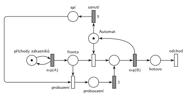

# 04–03 – Automat na kávu – uspání

## Zadání

⚠️ Zadání je známé jen ze vzpomínky studenta. Petriho síť v textu výslovně není, ale otázka 1 tohoto termínu je ve skupinách B a C vždy Petriho síť.

> Zadán M/M/1, ve kterém obsluhuje kávový automat. Když neprobíhá obsluha a po dobu 5 časových jednotek není nebo nepřichází požadavek k obsluze, automat se uspí. Při "probuzení" se délka obsluhy zákazníka prodlužuje o 2 časové jednotky.
> - pozn.: o frontě nebyla zmínka, tudíž lze uvážit, že zákazníci stojí ve frontě dokud nejsou obslouženi

Podobné úlohy:

- [04–08 – Spánek po nečinnosti](<../04–08 - Spánek po nečinnosti/04–08 - Spánek po nečinnosti.md>): probouzení trvá 5 min, zákazník při něm čeká ve frontě
- [10–02 – Výpočetní služba se spánkem](<../10–02 - Výpočetní služba se spánkem/10–02 - Výpočetní služba se spánkem.md>)
- [04–01 – Automat na kávu – údržba po nečinnosti](<../04–01 - Automat na kávu – údržba po nečinnosti/04–01 - Automat na kávu – údržba po nečinnosti.md>): stejný časovač, místo spánku údržba

## Interpretace

Zobrazit interpretaci (nápověda)

- **„Neprobíhá obsluha a nikdo nečeká“** = značka je v místě *Automat* (obsazení je okamžitý přechod, při neprázdné frontě si značku vezme hned). Časovaný přechod `5` (*usnutí*) má jediný vstup, *Automat*. Když mezitím přijde zákazník, obsazení si značku vezme a odpočet zanikne (slajd 139).
- **Automat má čtyři stavy** a jeho značka je vždy v právě jednom z nich: volný (*Automat*), obsluhuje, *spí*, *probouzení*.
- **Probuzení = obsazení spícího automatu.** Druhý okamžitý přechod obsazení (*probuzení*) bere zákazníka z *Fronty* a značku ze *spí*. Zákazník tak automat drží už během probouzení.
- **Prodloužení o 2:** po probuzení jde zákazník nejdřív přes přechod `2` a pak teprve do běžné obsluhy `exp(B)`. Jeho obsluha trvá 2 + exp(B), obsluhy ostatních zůstávají exp(B).
- Zákazníci, kteří přijdou během probouzení nebo obsluhy, čekají ve *Frontě* (poznámka v zadání).
- Kdyby se probouzení chápalo jako čas, kdy zákazník ještě čeká ve frontě a automat se „startuje“ (jako v [04–08 – Spánek po nečinnosti](<../04–08 - Spánek po nečinnosti/04–08 - Spánek po nečinnosti.md>)), automat by byl obsazený stejně dlouho. Zadání ale mluví o délce obsluhy zákazníka, proto je tu zákazník v obsluze už během probouzení.
- Střední doby příchodů a obsluhy zadání neuvádí, proto `exp(A)` a `exp(B)`. Doby 5 a 2 jsou pevné.

## Petriho síť

Zobrazit Petriho síť

| Požadavek | Prvek sítě |
|---|---|
| M/M/1, linka „kávový automat“ | *generátor* ⇄ `exp(A)` → *Fronta* → obsazení *Automatu* → `exp(B)` (vrací *Automat*) → *odchod* |
| 5 č. j. bez obsluhy a bez požadavku → spánek | *Automat* → `5` (*usnutí*) → *spí* |
| probuzení zákazníkem | *probuzení*: *Fronta* + *spí* → *probouzení* |
| obsluha po probuzení o 2 delší | *probouzení* → `2` → obsluha → `exp(B)` |
| transakce opouští systém | *odchod* |

Kontrola simulací: *Automat* + obsluha + *spí* + *probouzení* = 1. Automat usíná i se probouzí, fronta zůstává krátká.

## Časté chyby

Zobrazit časté chyby

- Časovač usnutí na *Frontě* nebo na generátoru místo na volném automatu.
- Spící automat, který se probudí sám po nějaké době, nebo ho probudí až příchod v době, kdy už nikdo nečeká. Probudit ho musí zákazník, který čeká ve *Frontě*.
- Prodloužení o 2 u všech obsluh (časovaný přechod `2` přímo v hlavní větvi) místo jen u obsluhy po probuzení.
- `exp(2)` místo pevné doby 2.
- Probuzení, po kterém se značka automatu nevrátí do *Automatu* (automat po první obsluze po probuzení zmizí nebo zůstane „spát“).

## Původ a zdroje

Zobrazit původ a zdroje

**Původ:** zkouška 2017/18, 2. termín, skupina D, otázka 1 (body neuvedeny, sesterské skupiny B a C mají 10 bodů).

**Zdroje:**

- `Fitcheats/Zkoušky z minulých let/2017-18 - 2. termín D.txt`, otázka [1] (vzpomínka studenta)

**Existující řešení:**

- Ve zdrojích není žádné řešení.

