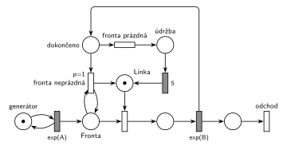

# 04–04 – Údržba při prázdné frontě

**Původ:** zkouška 2019/20, 1. termín, skupina D, otázka 3, 10 bodů. Pravděpodobně stejná úloha: zkouška 2020/21, 1. termín (16:00), otázka 2, ze zadání se zachovalo jen „petriho siete M/M/1 s údržbou“.

**Zdroje:**

- `Fitcheats/Zkoušky z minulých let/2019-20 - 1. termín.txt`, „Skupina D“, otázka 3 (přepis zadání)
- `Fitcheats/Zkoušky z minulých let/2020-21 - 1. termín.txt`, termín 16:00, otázka 2
- `Fitcheats/Příprava na zkoušku/FIT - Řešené výpočetní příklady 2017-21.pdf`, str. 17 (skupina „1“, úloha 8: studentské řešení na tabuli s diskusí) a str. 34 („2021 - Řádný 16:00“, jen „M/M/1 s údržbou“)

## Zadání

⚠️ Zadání je známé z textového přepisu studenta, ne z fotky. Znění je úplné a shoduje se s textem v Řešených výpočetních příkladech.

> 3. (10 bodů) Nakreslete model v podobě Petriho sítě pro systém typu M/M/1 se zadaným specifikem: Pokud je po dokončení obsluhy transakce fronta před linkou prázdná, pak systém zahájí údržbu o délce 5 časových jednotek.

Podobné úlohy:

- [04–01 – Automat na kávu – údržba po nečinnosti](<../04–01 - Automat na kávu – údržba po nečinnosti/04–01 - Automat na kávu – údržba po nečinnosti.md>): údržba až po 5 jednotkách nečinnosti
- [04–05 – Údržba po dlouhé obsluze](<../04–05 - Údržba po dlouhé obsluze/04–05 - Údržba po dlouhé obsluze.md>): o údržbě se také rozhoduje po obsluze
- [04–06 – Údržba po každé 10. obsluze](<../04–06 - Údržba po každé 10. obsluze/04–06 - Údržba po každé 10. obsluze.md>)

## Interpretace

Zobrazit interpretaci (nápověda)

- **Rozhoduje se v okamžiku dokončení obsluhy.** Proto `exp(B)` nevrací značku přímo *Lince*, ale do místa *dokončeno*. Odtud vedou dva okamžité přechody:
  - *fronta neprázdná* (`p=1`) je k *Frontě* připojený testovacími hranami (tam a zpět): ověří, že někdo čeká, nikoho z fronty neodebere a vrátí značku *Lince*. Čekající ji pak hned obsadí.
  - *fronta prázdná* (`p=0`) se provede jen tehdy, když `p=1` provést nejde, tedy při prázdné *Frontě*. Linka jde na 5 jednotek do *údržby*.
- **Proč ne časovač na volné lince** (jako v [04–01](<../04–01 - Automat na kávu – údržba po nečinnosti/04–01 - Automat na kávu – údržba po nečinnosti.md>)): ten by údržbu spouštěl opakovaně, dokud nikdo nepřijde, a také na začátku simulace, kdy žádná obsluha neproběhla. Zadání chce jednu údržbu po každé obsluze, po které je fronta prázdná.
- Během údržby linka není k dispozici, příchozí čekají ve *Frontě*. Po údržbě se nic dalšího nekontroluje: linka je volná, i když fronta zůstala prázdná.
- Inhibiční hrana z *Fronty* na *fronta prázdná* by fungovala také, Hrubý ale místo ní používá prioritu.
- Doba údržby 5 je pevná. Střední doby příchodů a obsluhy zadání neuvádí, proto `exp(A)` a `exp(B)`.

## Řešení

Zobrazit řešení

| Požadavek | Prvek sítě |
|---|---|
| M/M/1 | *generátor* ⇄ `exp(A)` → *Fronta* → obsazení *Linky* → `exp(B)` → *odchod* |
| po dokončení obsluhy se rozhoduje | `exp(B)` → *dokončeno* (značka linky) |
| fronta neprázdná → linka hned volná | *fronta neprázdná* (`p=1`, test *Fronty*) → *Linka* |
| fronta prázdná → údržba 5 | *fronta prázdná* → *údržba* → `5` → *Linka* |
| transakce opouští systém | *odchod* |

Kontrola simulací: *Linka* + obsluha + *dokončeno* + *údržba* = 1. Obě větve se střídají podle stavu fronty, fronta zůstává krátká.

## Existující řešení

Zobrazit srovnání s existujícími řešeními

- **Řešené výpočetní příklady, str. 17 (tabule):** stejná síť. `Exp(µ)` vede do místa, ze kterého přechod „P1“ s testovacími hranami na frontě vrací linku a přechod bez priority vede přes místo a přechod `5` zpět k lince. Výstup transakce je vidět. Diskuse pod obrázkem správně vysvětluje, proč je síť takto složitá: „…aby linka nešla do údržby niekoľkokrát po sebe, ak nechodia dlho žiadne transakcie“ (odpověď „YES“, Ano: +2).

## Časté chyby

Zobrazit časté chyby

- Časovač nečinnosti na volné lince místo rozhodnutí po obsluze (viz Interpretace).
- Test fronty obyčejnou hranou bez návratu: rozhodovací přechod pak odebere čekající transakci z *Fronty*.
- Obě větve bez priority: při neprázdné frontě se náhodně vybere i údržba.
- `exp(B)`, které vrací *Linku* a zároveň posílá značku do rozhodování. Pak vzniká druhá značka linky.

